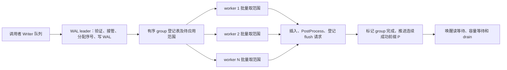

# RocksDB 异步提交详细设计

第 1～21 节记录已经落地的原 leader 应用方案（V1）；[第 22 节](#22-v2wal-与-memtable-线程池解耦方案)
记录默认不开启的线程池方案（V2）及后续 V3 无锁任务队列实现。所有权、执行顺序、
返回时机和屏障规则以第 22 节相应版本为准，其余读取语义、WAL 格式和拒绝范围沿用 V1。
原生/V1/V2/V3 串行 memtable 同批重测见第 22.24 节，并发 memtable 对比见第 22.27 节；
第 22.17～22.19 节保留早先批次。

[第 23 节](#23-strong-visibility-模式)定义默认关闭的 `async_commit_strong_visibility`。
开启该模式后，线程池写调用等到
sequence 发布再返回成功，读操作直接使用已发布视图，不建立线程本地读前等待依赖。
该模式的写返回与读等待规则以第 23 节为准。

本文定义 `enable_async_commit` 的首版实现，供修改写入队列、读路径、选项和测试时使用。代码基线为 RocksDB 6.26.1，提交 `4d57a393a`。

首版采用以下执行方式：一个 WAL 写入组的原 leader 持有整组数据，并负责整组 memtable 插入；followers 在 WAL 阶段成功后返回。每个返回成功的写调用记录自己的结束 sequence，后续同一线程对同一 DB 的读请求先等待该序号发布。开启 `enable_pipelined_write` 时，下一组 WAL 可以与当前组 memtable 插入重叠，但各组 memtable 仍按 WAL 顺序执行。

数据接管复用本组写 WAL 时形成的合并 batch，并继续用同一缓冲区插入 memtable，不为异步持有再深拷贝每个请求。这里的目标是消除异步提交额外引入的数据复制；既有 WAL 合并以及 memtable 编码仍会复制 key/value，首版不承诺端到端零拷贝。

这改变了写调用成功返回的含义：返回成功保证本次 WAL 阶段完成，读前等待负责保证本线程此前成功提交的写入已经可见。WAL 的掉电持久性仍由 `WriteOptions::sync` 等现有设置决定。

## 1 术语与现有行为

### 1.1 写请求与写入组

一次普通 `DB::Write` 接收一个 `WriteBatch`，其中可以包含多条更新。多个兼容的写请求通过 `WriteThread` 排队，组成一个 `WriteGroup`。组内一个调用线程成为 leader，其余调用线程成为 followers。

WAL 阶段负责将组内请求合并写入预写日志，并完成调用者要求的日志同步。memtable 阶段负责将更新加入内存表。本文中的 group 均指 WAL 阶段形成的原始 `WriteGroup`，除非明确写作“现有 memtable 写入组”。

Column Family 简称 CF，是 DB 内的逻辑数据分区。当前可写内存表称为 memtable；停止接收新写入、等待刷盘的内存表称为 immutable memtable；刷盘生成磁盘上的有序表文件 SST。flush 指将内存表写成这些文件。

当前普通写入路径已经支持分组，与 `enable_pipelined_write` 是否开启无关。`allow_concurrent_memtable_write` 允许符合条件的组内线程并发插入 memtable。默认路径等待整组 memtable 完成，再发布可见序号并返回。

现有流水线为 WAL 和 memtable 使用两个队列，并会在 memtable 阶段重新分组。新模式需要保留两个阶段的重叠，同时改为一个原始 group 对应一个 memtable 队列项。

### 1.2 序号与发布

sequence 是 RocksDB 为更新分配的递增序号。普通按记录计数的 batch 包含 N 条更新时，占用一个连续区间。分配序号是确定该区间；发布序号是向读取路径宣布该序号及其之前的更新已经完整应用。

本文使用以下符号：

| 符号 | 含义 |
| --- | --- |
| A | 已分配的最大序号，可能包含尚未应用的 group |
| P | 已发布的最大序号，读取可使用的连续完成位置 |
| R | 当前线程对此 DB 的最低读取序号，来自此前成功返回写调用的结束序号 |

成功运行时保持 `P <= A`。最新读开始获取数据前必须满足 `P >= R`。这里要求读取序号至少达到 R，并不要求固定读取 R 对应的历史版本。

当前普通流水线使用 `write_thread_.last_sequence_` 保存分配进度，使用 `versions_->LastSequence()` 保存普通读取使用的已发布进度。新模式沿用这个分工，不借用事务模式专用的 `LastPublishedSequence` 来另造一套状态。

`unordered_write` 会在 WAL 阶段提前推进供读取使用的序号，放宽快照和 batch 的原子可见性。首版异步提交不采用这种行为。

### 1.3 数据所有权与读视图

当前 `Writer` 通常位于调用线程的栈上，`Writer::batch` 指向调用者持有的 `WriteBatch`。调用返回后，两者都可能失效或被复用。

新模式为每个 group 建立一个 leader 持有的上下文，保存 WAL 合并 batch 和原始请求的边界、序号及选项。WAL 和 memtable 两个阶段读取同一份合并数据。leader 在本组 memtable 完成前一直留在 `Write` 内，因此上下文可以由 leader 的局部对象持有，不需要后台线程池。

单请求 group 没有提前返回的 follower，原 leader 的 batch 会存活到应用结束，因此保留借用该 batch 的快路径，不为统一结构而强制合并或复制。

流水线 memtable 队列中只保留该 group 的一个代表节点。代表节点由原 leader 持有，存活到该 group 退出 memtable 队列为止。

读视图由可见序号和包含 memtable、immutable memtable、SST 版本的 `SuperVersion` 共同决定。读前等待必须在获取用于本次读取的版本引用之前完成，再执行现有读视图选择逻辑。

## 2 已确认的设计要求

1. 新增不可动态修改的 DB 选项 `enable_async_commit`，默认 `false`。
2. 开启后，每个 group 的原 leader 负责本组全部 memtable 插入。
3. followers 在本组 WAL 阶段成功且数据已安全接管后返回，不参与 memtable 插入。
4. leader 在本组 memtable 应用和队列清理完成后返回。
5. 首版同时支持 `enable_pipelined_write=false` 和 `true`。
6. 各 group 的 memtable 应用保持顺序，整组成功后才发布结束序号。
7. 成功返回的写调用为本线程、当前 DB 更新最低读取序号 R。
8. 后续读请求在选择新读视图之前等待 `P >= R`。
9. 开关关闭时，保留当前分组、并发 memtable 写入、流水线和读取行为。
10. 多请求 group 复用唯一的 WAL 合并 batch 完成异步应用，不增加逐请求数据深拷贝，不改变普通 Write 对调用者 batch 的所有权约定。

首版不引入独立后台 worker，不跨 group 并行应用 memtable，也不允许后面的 group 越过未完成 group 发布序号。

## 3 首版支持范围

本节补充用于直接实现和验证的边界；这些是实现约束，不改变上一节的核心要求。

### 3.1 选项组合

| async commit | pipelined write | 执行方式 |
| --- | --- | --- |
| false | false | 现有普通路径 |
| false | true | 现有流水线路径 |
| true | false | followers 提前返回；leader 持有写队列直到本组应用完成 |
| true | true | followers 提前返回；每组代表节点按序进入 memtable 队列；允许阶段重叠 |

`allow_concurrent_memtable_write` 可以保持 `true` 或 `false`，但 async 分支均由 leader 串行插入，传递 `concurrent_memtable_writes=false`。不要修改这个选项的全局默认值；async 关闭时继续使用原有行为。

以下组合在初始化或调用入口明确拒绝：

| 组合或请求 | 首版处理与原因 |
| --- | --- |
| `unordered_write=true` | 拒绝打开；它的提前发布行为与本设计的 P 含义冲突 |
| `two_write_queues`、`seq_per_batch`、事务 prepare/commit 等内部写法 | 对应配置在打开时拒绝，内部特殊调用在入口拒绝；首版只支持普通按记录分配序号的写入 |
| TransactionDB、OptimisticTransactionDB | 在包装层 Open 时拒绝启用，避免事务提交中途才发现不支持 |
| `WriteOptions::disableWAL=true` | 在排队和分配序号之前返回不支持错误 |
| `manual_wal_flush=true` | 首版拒绝打开，使 WAL 确认边界保持明确；以后可单独扩展 |
| `inplace_update_support=true` | 拒绝启用，避免原地更新绕过基于序号的可见性隔离 |
| 用户时间戳相关 CF 或 WriteOptions | 首版拒绝；以后再定义额外元数据的接管与兼容语义 |
| 写回调、pre-release 回调、WAL-only、恢复状态专用写入 | 在进入 async 路径前拒绝，不隐式改变其完成时机 |
| 非空 WAL termination point | 在 WAL 前拒绝，避免用于写日志的数据仅含前缀、用于 memtable 的数据却包含后缀；该标记原本允许指定 batch 的 WAL 截止位置 |
| `atomic_flush=true` 且 `enable_pipelined_write=true` | 保留当前版本已有的拒绝逻辑 |

普通 Column Family 和跨 CF 的普通 WriteBatch 属于支持范围。支持 Put、Delete、SingleDelete、DeleteRange；Merge 仅支持 `max_successive_merges=0` 的追加操作。将 CF 的该选项改为非零时也要拒绝，避免 memtable 应用期间产生尚未设计的内部读取。

普通 LogData 日志附加记录可以保留，按现有规则不消耗更新 sequence，也不产生 memtable 更新。它与数据更新的字节范围一起保存在合并 batch 中。

新建 CF、动态修改 CF 选项以及内部直接调用 `WriteImpl` 的入口都必须执行相同的范围检查。不能只在默认 CF 的首次 Open 检查。

### 3.2 读取保证的范围

R 属于同一原生线程和同一 DB 实例。线程写入后再读，必须能够包含此前成功返回的写入，除非用户显式选择了历史快照、已有 Iterator 或只读持久层等较旧的数据范围。

其他线程不自动继承 R。通过应用同步将操作交给另一个线程、把 Iterator 移交给其他线程或使用任务迁移调度时，首版不自动传递该依赖。后续若增加显式上下文 API，应传递目标序号及 DB 实例标识；不能只传一个没有 DB 归属的数字。

因此，首版提供同一上下文的写后读保证，不承诺所有线程的普通读都立即包含其他线程已经获得 WAL 确认的写入。

## 4 必须维护的不变量

| 编号 | 不变量 |
| --- | --- |
| I1 | follower 获得成功通知之前，group 已持有可独立存活的完整合并 batch 和应用元信息，WAL 阶段已成功 |
| I2 | follower 返回后，任何队列、遍历、回调或临时边界处理均不再访问它的 Writer 和原始 batch |
| I3 | 每个未退出 memtable 队列的 group 都有一个仍在 Write 内的原 leader 持有代表节点和数据 |
| I4 | 流水线中，本组登记到 memtable 队列先于下一组获得 WAL 执行权，包括空队列重新入队的情况 |
| I5 | memtable 按原 group 顺序应用，一个 group 全部成功后才推进 P |
| I6 | 任何应用失败都不能通过后续 group 推进 P 来跳过 |
| I7 | 写调用只在成功确认后更新本线程 R；R 单调不减 |
| I8 | 新读视图的构建发生在对应 R 的等待成功之后 |
| I9 | 等待不能持有 DB mutex、WAL 锁、Writer 状态锁或队列转换所需的锁 |
| I10 | 错误路径和屏障路径同样完成节点摘除与唤醒，不遗留引用或永久等待者 |
| I11 | 多请求 group 的 WAL 和 memtable 使用同一份合并数据；确认后不再复制 key/value 到另一份应用 batch，也不将缓冲区交给后续 group 复用 |

## 5 数据结构与所有权

### 5.1 合并数据与请求描述

多请求 group 在自己的 `merged_batch` 中保存合并数据。每个原始 batch 只留下一个范围描述：在合并数据中的起止字节偏移、更新记录数、在整组更新中的起始索引，以及自己的 sequence 区间和选项。偏移是相对于完整合并 batch 开始位置的数字，范围不包含 batch 的统一头部。

普通 WriteBatch 的统一头部为 12 字节，前 8 字节保存起始 sequence，后 4 字节保存更新记录数。追加原始 batch 时仅追加其头部之后的记录，合并结果只有一个统一头部。

batch 的保护信息用于校验更新内容。它随 WAL 合并保留在同一个 merged_batch 中；范围描述中的起始记录索引用于定位对应的保护项，不为每个范围另复制保护项数组。

以下结构为内部实现草图，不要求成为公共 API：

```cpp
struct AsyncCommitThreadContext {
  SequenceNumber required_sequence = 0;
};

struct AsyncCommitBatchRange {
  size_t begin_offset = 0;
  size_t end_offset = 0;
  size_t first_record_index = 0;
  uint32_t record_count = 0;
  SequenceNumber first_sequence = 0;
  SequenceNumber last_sequence = 0;
  bool has_sequence = false;
  bool ignore_missing_column_families = false;
};

struct AsyncCommitGroup {
  WriteBatch merged_batch;  // 多请求组唯一的数据持有者。
  const WriteBatch* apply_batch = nullptr;
  bool owns_merged_payload = false;
  std::vector<AsyncCommitBatchRange> ranges;
  WriteThread::Writer memtable_writer;  // 流水线专用代表节点。
  SequenceNumber first_sequence = 0;
  SequenceNumber last_sequence = 0;
  size_t original_writer_count = 0;
  size_t reserved_bytes = 0;
  // 还需保存使用现有引用规则持有的 CF 引用，以及组内统计信息。
};
```

多请求组的 `apply_batch` 指向本组 merged_batch，设置 owns_merged_payload 为 true；单请求组则指向仍在 Write 内的 leader 原始 batch，该标记为 false。两者都不转移调用者对象的所有权，也不允许在普通 `Write(WriteBatch*)` 内偷偷移动或清空调用者 batch。

### 5.2 一次合并与缓冲区生命周期

先根据组内 batch 长度和记录数预留容量，尽可能一次准备足够的序列化数据和描述表空间，避免合并过程因反复扩容再次复制已有 key/value。按原请求顺序直接将每个 batch 的记录追加到 group.merged_batch，沿用 WriteBatchInternal::Append 对保护信息的处理。

每次追加前记录合并 batch 当前长度和更新记录数，作为该请求的 begin_offset 和 first_record_index；追加后记录 end_offset。保存原 batch 的 record_count、序号区间和选项，不保留其数据指针、保存点对象或保护信息指针。保存点是调用者编辑 batch 的状态，不需要被异步应用继承。

group.merged_batch 自始至终由 group 持有。写 WAL 的函数只借用它，不能再次调用 MergeBatch，不能在成功返回前 Clear，也不能继续依赖 DB 级 tmp_batch_ 保存其内容。流水线下一组可以重新分配自己的合并缓冲区，但不能复用前一组尚未应用的数据。

如果实现选择从内部 WAL 临时 batch 接管已完成的合并结果，只允许移动或交换内部持有者，连同保护信息一起转移；不得通过深拷贝完成接管。首版优先直接在 group 持有的对象中合并，减少转移状态。

单请求组保持现有无合并快路径，使用原 leader batch 写 WAL 和应用 memtable；同样保留一个范围描述。leader 不提前返回，因此借用有效期覆盖两个阶段。

从 WAL 阶段结束到本组应用和队列清理结束，数据内容、统一头部和范围边界均保持稳定。序号等返回元数据可以复制；不为跨阶段接管再次复制编码后的 key/value。范围内的解析通过非拥有的 Slice 或偏移完成，不通过 SetContents 或临时子 WriteBatch 重新物化数据。

### 5.3 代表节点与通知字段

`memtable_writer` 与原 leader 的 WAL Writer 是两个不同对象，由同一个 leader 调用持有。这样两个队列不会同时使用同一节点的链表字段。合并数据和描述表建立完成后，将代表节点的 `async_group` 指向本上下文；需要非空 batch 标识的现有帮助代码引用 apply_batch。入队后不再移动本上下文或使这些地址失效。

`Writer` 增加以下概念上的字段：

```cpp
SequenceNumber async_end_sequence = 0;
bool async_has_sequence = false;
AsyncCommitGroup* async_group = nullptr;  // 仅代表节点在应用阶段使用。
```

### 5.4 对象的持有与释放

| 对象 | 所有者 | 可以销毁的时机 |
| --- | --- | --- |
| follower Writer、原始 WriteBatch | follower 调用 | 收到最终返回状态后；此前必须完全解除外部引用 |
| leader Writer | leader 调用 | 本组退出所有队列之后 |
| memtable_writer 代表节点 | leader 的 group 上下文 | 已从 memtable 队列摘除且所有通知处理完成之后 |
| 多请求组的 merged_batch 与范围描述 | leader 的 group 上下文 | 本组应用、退出队列、释放统计和 CF 引用之后 |
| 单请求组的原始 batch | 调用者，leader 在 Write 内借用 | 保持普通 Write 的原有生命周期，不由 group 删除或移走 |
| 本线程 R | DB 实例内的线程局部存储 | 线程退出或 DB 生命周期结束时 |
| P、通知条件和终止状态 | DBImpl | DB 生命周期结束且没有活动调用时 |

`AsyncCommitGroup` 不能只声明在 `PipelinedWriteImpl` 当前的 WAL leader 内层 if 中，然后将地址交给外层阶段。其作用域必须覆盖等待和 memtable 应用全过程。

## 6 序号分配与写返回上下文

### 6.1 分配规则

普通 batch 的记录数为 N，起始序号为 S。当 `N > 0` 时，结束序号为 `S + N - 1`。空 batch 不更新 R，不做无符号减一运算。区间加法必须检查最大 sequence 和整数溢出，在 WAL 前拒绝无法分配的区间。

首版按原始 batch 顺序分配区间，不因某个 follower 提前返回而重新编号。被允许忽略的缺失 CF 更新仍遵循现有 InsertInto 的序号消耗规则。事务特殊计数不在范围内。

合并 batch 的统一头部保存整组起始 sequence 和总记录数；每个范围另外保存自己的起始 sequence。memtable 应用范围时显式传入该起始值，不为切换范围而重写统一头部。整组没有更新记录时不提高 A 或 P，但仍按 WriteOptions 完成必要的 WAL 同步。

非流水线可以继续从已完成的 P 开始分配下一组；流水线必须使用独立分配进度 A。继续使用当前 `UpdateLastSequence` 的规则，防止下一组重复使用尚未发布的序号。

### 6.2 更新 R 的时机

leader 在通知 follower 前，填写该 follower 的返回状态、已有输出参数所需的日志号和起始序号，以及新增的结束序号字段。通知通过现有 Writer 状态同步机制完成。

follower 被唤醒后只读取自己的返回结果，成功且非空时执行：

```cpp
context.required_sequence =
    std::max(context.required_sequence, writer.async_end_sequence);
```

随后返回，不再访问 `write_group` 或 `async_group`。leader 最终成功返回时也更新自己的上下文，此时 P 通常已经满足该目标。失败的写调用不提高 R，也不清除此前成功写入留下的 R。

通知前的结果写入与 follower 读取之间必须有明确的 release/acquire 或等价锁同步。不能直接写 state 并假设另一线程一定看到其他字段。

### 6.3 线程局部存储

在 DBImpl 内使用独立的 `ThreadLocalPtr` 实例，按需分配 `AsyncCommitThreadContext`。开关关闭时不初始化上下文，也不执行新的读取等待逻辑。

写入口在排队之前确保本线程上下文已建立，使 WAL 确认后的 R 更新不再需要分配内存。没有执行过写入的读线程可以把空上下文视为 R 等于零，不必为每个纯读线程分配对象。

不要采用仅以裸 DB 地址为键、没有销毁管理的全局 thread_local map，避免 DB 地址复用后继承旧 R。线程局部清理函数只释放上下文，遵守 `ThreadLocalPtr` 回调不能随意加锁的现有约束。

## 7 两种模式共用的 WAL 阶段

在现有 `WriteImpl` 的公共参数检查之后增加 async 分派，原有普通、流水线和 unordered 分支在开关关闭时保持不变。首版建议增加独立 `AsyncWriteImpl`，内部根据 pipelined 选项选择交接方式。

成功路径按以下顺序执行：

1. 在调用入口检查不支持的写法，进入现有 JoinBatchGroup 与写入预处理。
2. 当前 leader 建立 group，沿用现有 sync、no_slowdown、disableWAL、保护信息等兼容规则。
3. 在写入队列控制下验证 batch 操作类型、CF 和必要选项，取得相关 CF 的有效引用。
4. 预留合并数据及范围描述的容量，建立 group 上下文。多请求组直接合并到 group.merged_batch，单请求组建立对 leader batch 的借用；记录每个请求的范围和元数据。
5. 分配序号，设置一次 WAL batch 的统一头部，填写各范围的序号区间以及每个原始 Writer 的返回字段。
6. 将准备好的 batch 借给 WAL 追加和同步流程，完成对应的日志状态登记，不再次合并，也不清空应用阶段还要使用的数据。
7. 进入本设计的队列转换，安全通知 followers，并按 pipelined 选项决定下一组何时获得执行权。

第一版将组验证作为写 WAL 前的整体检查。若组内任一请求不合法，本组不追加 WAL，所有成员返回该验证错误，均不产生成功确认。不要直接给某个 Writer 设置 status 后复用当前 MergeBatch 并假定它会自动跳过；当前合并过滤与回调状态有关。以后若要支持逐请求剔除，需要单独实现过滤、计数和合并的一致规则。

现有按 WriteGroup 接收参数的 WriteToWAL 会内部合并，并在完成后清空 DB 级 tmp_batch_。async 路径需要增加或拆出接收“已准备 batch”的内部函数，复用底层追加、同步、目录同步、日志号输出和统计逻辑；该函数不得再次调用 MergeBatch 或接管、清空 group 的缓冲区。开关关闭的现有路径保持原有帮助函数行为。

WAL 追加或同步失败时，不允许向任何 follower 返回成功。按当前错误处理记录问题并安全退出组。同步失败时，恢复后是否可能出现相应写入仍遵循现有 WAL 不确定性语义；错误返回不等于记录绝对不存在。

`use_fsync=true` 仅选择同步方式，不代表每次写调用启用了 `WriteOptions::sync`。基准测试必须分别记录这两个设置。

## 8 未开启流水线时的队列转换

当前 group 的 leader 在 memtable 应用完成之前继续持有写队列执行权。followers 可以返回并提交新请求，但新请求只能排队。

```text
leader     组建 group → WAL → 释放 followers → 应用整组 → 发布 P → 交接 → 返回
followers  等待 WAL ─────────→ 更新各自 R → 返回
新写请求                                    入队并等待 ─────→ 下一组
```

需要拆分现有 ExitAsBatchGroupLeader 的职责，提供一个“摘除 followers、保留当前 leader”的转换操作。转换完成后，当前 leader 是本组留在活动写队列中的唯一节点，后续请求连接到它之后。

队列转换必须处理无后续请求、已有后续请求以及入队的比较并交换操作 CAS 正在发生三种情况。必须同时检查 `newest_writer_`、前后链和现有 write stall 处理；不能只缩小 WriteGroup.size，或者只断开一个方向的链。

转换与通知分成两个阶段：先完全修复活动队列并形成 leader 私有的待通知列表，再逐个通知。保存下一个节点所需的值必须发生在通知之前；通知之后不能再解引用该 follower。

本组完成后，最终退出函数只处理仍存活的 leader 节点和后续队列。不能使用原始包含 followers 的 WriteGroup 再次遍历或再次通知。

## 9 开启流水线时的队列转换

### 9.1 一个原始 group 对应一个代表节点

async 模式中，memtable 队列只包含各原始 group 的代表节点，以及现有等待排空使用的屏障节点。每个代表节点仍由自己的原 leader 执行；不启动组内并发线程，也不让某个 leader 代替后续 group 的 leader 应用数据。

新增专用的 memtable 入队、获得执行权和退出逻辑，或为现有函数增加明确的 async 分支。不得直接调用当前会吸收后续节点的 EnterAsMemTableWriter。

### 9.2 WAL 到 memtable 的交接顺序

当本组 WAL 成功后，在仍然控制 WAL 队列时完成下列转换：

1. 确定并保护本组与后续 WAL 请求之间的边界。
2. 将本组独立的 memtable_writer 代表节点按 WAL 顺序登记到 memtable 队列，由原 leader 继续负责执行。
3. 完全摘除原 group 的其他节点，修复后续 WAL 队列，结束所有涉及 follower 地址的边界处理。
4. 填写并通知 followers；也可以在队列修复后先交接 WAL，再执行 leader 私有通知列表。
5. 允许下一组成为 WAL leader。空 WAL 队列对新入队请求重新开放也算交接。
6. 当前 leader 在本组代表节点上等待 memtable 执行权，然后应用本组。

第 2 步必须早于第 5 步；第 3 步必须早于任何 follower 通知。当前代码使用临时 dummy 节点标记队列边界，使队列看似没有后续请求时也能安全完成交接。应复用这一边界处理和 CAS 协调思路，不得先清空 WAL 队列再补 memtable 入队。

当前 ExitAsBatchGroupLeader 把转移、交接以及等待 memtable 执行权放在同一函数中。新模式需要将转换与等待拆开，使 followers 不必等待当前 leader 从该函数返回。

### 9.3 阶段重叠与完成顺序

```text
WAL          [G1 WAL][G2 WAL][G3 WAL] ...
memtable             [G1 apply][G2 apply][G3 apply] ...
执行线程              leader1   leader2   leader3
```

此图表示允许的重叠。PreprocessWrite、WAL 切换和 flush 屏障仍可能暂停流水线。G2 的 WAL 完成时，leader2 可以在 memtable 队列等待，G2 followers 已经返回。

leader1 完成 G1 并发布 P 后，才交接 memtable 执行权给 leader2。即使 G2 所含数据较少，也不能跳过 G1。这样不需要维护跨 group 的乱序完成表。

## 10 memtable 应用与发布

leader 获得本组 memtable 执行权后，按原请求顺序遍历 group.ranges，直接解析 apply_batch 中对应的字节范围。传递 `concurrent_memtable_writes=false`，使用每个范围的起始 sequence 和 CF 忽略规则。

新增内部 InsertIntoRange 帮助函数，基于当前 WriteBatchInternal::Iterate 的 begin/end 能力构造 MemTableInserter。该函数接收合并 batch、范围起止偏移、范围起始 sequence、first_record_index 和 record_count。它不构造临时子 WriteBatch、不调用 SetContents，也不通过取子串复制记录。

范围应用必须完成以下检查：

1. 范围位于统一头部之后，起止在记录边界且不越过合并数据末尾；各范围相邻，完整覆盖原始请求追加的记录区。
2. 范围的起始记录索引与此前范围记录数之和相符，范围计数之和等于合并头部的总记录数。长度和计数加法均检查溢出。
3. 使用整组合并后的保护信息，并从 first_record_index 开始访问。当前 set_prot_info 会将保护索引重置为零，需要增加显式起点初始化和边界检查；不能给每个范围都从零开始。
4. 成功解析的更新数量和 sequence 消耗与描述一致；启用保护信息时，保护项消耗也必须匹配，未启用时不访问保护数组。当前部分 Iterate 不执行完整 batch 的头部计数校验，新增帮助函数必须补上范围校验，不能仅检查现有 Iterate 返回 OK。

首版统一使用范围应用，以保留每个请求的选项。以后若要对同选项 group 采用一次完整 Iterate，可作为独立优化，不改变缓冲区所有权。

应用期间可能有其他 WAL leader 报告终止错误，因此发布函数也必须返回并检查状态。流程如下：

```cpp
Status status;
for (const auto& range : group.ranges) {
  status = InsertIntoRange(group.apply_batch, range,
                           /*concurrent=*/false);
  if (!status.ok()) break;
}
if (status.ok()) {
  status = PublishAsyncCommitSequence(group.last_sequence);
}
if (!status.ok()) FailAsyncCommit(status);
ExitCurrentMemtableOrWriteQueue(status);
ReleaseGroupResources();
return status;
```

这些是职责示意，不是可以忽略所有权直接粘贴的代码。实际实现必须保证异常和错误分支也执行队列清理。

只有整组所有更新、计数和插入后处理完成，才允许发布 P。组内某些 batch 已成功、另一个 batch 失败时，不能发布组内成功部分的结束序号，也不能启动后续 group 的正常应用来跨过缺口。

普通插入产生的 flush 请求继续交给现有调度方式；切换当前 memtable 之前必须经过相应写入屏障。不得在 group 尚未完成时将其目标表视为可安全 flush 的完整表。

## 11 读前等待与通知

### 11.1 等待位置

用户读取入口先读取本线程 R，并等待 `P >= R`。成功后，再进入现有版本引用、快照选择和查询流程。

对于普通最新 Get，顺序是：

```text
取得 R → 等待 P 达到 R → 获取 SuperVersion → 选择当前可见序号 → 查询
```

不要先取得旧 SuperVersion 再等待；也不要保存一个历史 P，等待后再把这个未注册的历史序号当作快照使用。等待满足的是最低要求，普通读继续采用现有流程选择最新可见状态。

如果 `P >= R`，快速路径只增加必要的上下文读取与 acquire 序号读取。可以保留 R 不清零，下一次仍走比较即可，避免清零规则引入额外状态。

### 11.2 共享等待状态

DBImpl 保存一个专用的等待 mutex、condition variable、终止错误状态和关闭标记。等待 mutex 仅用于通知协议和错误状态，不承担 memtable 插入或长时间 I/O。

P 使用现有 release 发布、acquire 读取。发布者在专用等待 mutex 下更新 P，解锁后通知；等待者在同一个 mutex 下再次检查 P，然后进入条件等待。错误、关闭和容量释放也要以同一通知协议唤醒相应等待者。

下面的 deadline 来自 `ReadOptions::deadline`，表示本次用户调用的绝对截止时间；未设置时不因时间到期退出。Lock 和等待帮助函数仅表示锁与条件等待职责。

```cpp
Status WaitUntilPublished(SequenceNumber target, const ReadOptions& options) {
  if (PublishedSequenceAcquire() >= target) {
    return Status::OK();
  }
  Lock visibility_lock;
  while (PublishedSequenceAcquire() < target) {
    if (terminal_error_present) return terminal_error;
    if (closing) return Status::ShutdownInProgress();
    if (DeadlineExpired(options.deadline)) return Status::TimedOut();
    WaitWithDeadline(visibility_cv, visibility_lock, options.deadline);
  }
  return Status::OK();
}
```

目标只在本次读入口捕获一次。等待过程中不追赶其他线程不断增加的分配进度，也不等待整个写队列为空。

首版使用条件等待，不增加无上限自旋。后续若增加短暂自旋，应单独测量 CPU 与尾延迟。

### 11.3 锁顺序

调用等待时不得持有 `mutex_`、日志锁、Writer 状态锁或写队列转换锁。持有等待 mutex 时，不再获取这些锁；错误结果由该 mutex 保护的副本提供，不能为了查询 ErrorHandler 再反向获取 DB mutex。

允许已有 DB 锁保护的错误处理向等待状态登记错误，但登记过程不得等待另一个 group，也不得调用线程局部清理逻辑。发布、通知、退出队列之间需要避免嵌套 Writer 状态锁与等待 mutex；先完成一类操作再进行下一类操作。

## 12 读取接口与历史视图

| 入口 | 首版接入与失败行为 |
| --- | --- |
| Get、GetMergeOperands 等公开查询 | 在公共读取准备阶段等待；失败返回 Status |
| MultiGet 各个重载 | 一次调用统一捕获 R 并等待；失败为所有待查询 key 填写错误，不能先查一部分 |
| NewIterator | 构造新视图前等待；失败返回 NewErrorIterator |
| NewIterators | 先等待，再构造跨 CF 一致视图；失败返回 Status，结果容器保持为空 |
| GetSnapshot | 获取 DB mutex 和注册快照前等待；失败返回 nullptr，并保留可诊断日志 |
| Iterator Refresh | 切换到新视图前使用执行 Refresh 的当前线程上下文等待；失败不执行刷新 |
| KeyMayExist 等间接读取入口 | 按其实际调用链接入；不得吞掉等待错误后伪装为确定不存在 |

对 `KeyMayExist` 这类不能直接返回 Status 的接口，等待失败只能按其保守语义报告“可能存在且值未知”，不能返回确定不存在。实现和测试需覆盖其真正的调用链。

当前 GetImpl 被内部路径复用，GetSnapshotImpl 也有不自行加锁的内部调用。用户读等待应接到对外入口或一个明确的用户读取准备函数；不得给所有内部调用无条件增加等待，尤其不能让正在应用的 leader 等待自己尚未发布的 group。

显式历史快照仍然表示历史视图。首版先完成当前上下文的发布等待，再按用户给定快照读取；不把快照序号抬高，也不承诺旧快照看到后来的写入。已经存在的普通 Iterator 在 Seek、Next 时继续使用原视图，不逐步等待新的 R。用户需要新视图时应创建新 Iterator 或调用支持的 Refresh。

`ReadOptions::deadline` 的剩余时间必须包含读前等待；不能等待结束后重新给予完整超时。`io_timeout` 是底层 I/O 超时，不自动当作整个序号等待的截止时间。GetSnapshot 没有独立读取 deadline，等待到目标发布、终止错误或关闭；无法提供 Status 是现有接口限制。

首版拒绝 async DB 上的 tailing Iterator 请求，因为它当前使用不受普通 P 限制的读取方式。持久层专用 read tier 继续保留其原有数据范围，不能将“序号已发布”解释为“已经进入 SST”。

`GetLatestSequenceNumber` 继续报告当前 P，作为进度查询不承担读前等待；不能用它代替写调用已经记录的结束序号。

## 13 失败处理与恢复

### 13.1 确认边界

| 时点 | 调用者结果 |
| --- | --- |
| 参数或组验证失败 | 无成功确认，不更新 R |
| WAL 追加或要求的同步失败 | 本组返回错误，不更新 R |
| WAL 成功，followers 已返回，memtable 尚未完成 | followers 的 R 记录依赖，后续读等待 |
| memtable 全组成功并发布 | leader 返回成功，等待者可继续 |
| memtable 失败 | leader 返回错误，依赖未发布序号的读返回错误 |

### 13.2 终止错误

WAL 与内存状态可能已经分歧时，调用现有 ErrorHandler，并将不可继续的错误登记到 async 等待状态。Async memtable 应用失败必须停止本实例后续的正常应用和发布。

已经返回成功的 followers 无法通过原 Write 返回值收到这个错误。它们的后续依赖读取会获得失败；另外必须在 LOG 和统计中保留错误，纯写应用也应能诊断失败。

memtable 队列中的后续代表节点仍然需要由各自 leader 按顺序取得清理权、跳过应用并退出。不可直接唤醒所有节点让它们自行返回，否则栈上的代表节点可能在队列仍引用时销毁。屏障节点同样必须获得完成通知。

当前排空帮助函数没有 Status 返回值。调用者在屏障完成后必须重新检查终止状态，或将新的内部屏障接口设计为显式返回 Status；不能把“节点已清理”当作“全部数据已成功应用”。

首版不允许通过清除该终止错误直接恢复应用和提高 P。关闭并重新打开 DB，通过现有 WAL 恢复建立完整状态。可恢复的其他后台错误继续遵循原规则；不要把所有后台告警都当成序号应用失败。

已经发布的范围保持原有读取处理；只有依赖未达到目标的读取必须因终止状态退出，不能伪造目标已经完成。终止后不得发布后续 group 来绕过缺口。

### 13.3 崩溃恢复

不修改 WAL 记录格式。合并 batch 同时作为日志写入源和 memtable 应用源，各范围的更新与写入 WAL 的逻辑更新一致；恢复继续使用现有重放方式。首版拒绝 WAL termination point 等会使两阶段记录范围不同的写法。

`sync=true` 的成功确认必须包含要求的 WAL 同步。`sync=false` 继承原有机器掉电风险；序号发布与日志同步是两个独立条件，发布 P 不增加掉电持久性。正常进程崩溃恢复测试应覆盖已确认但尚未应用的 followers。

恢复后旧线程上下文已经结束，新 DB 的 R 从零开始，不复用此前实例的上下文。

## 14 memtable 切换与管理操作

流水线中的代表节点必须对现有 `WaitForMemTableWriters` 可见。屏障只等待它之前登记的节点，不吸收屏障后的新 group。调用屏障的一方必须已经按现有协议取得 WAL 写入控制，防止后续 group 越过屏障。

`EnterUnbatched`、`WaitForPendingWrites`、PreprocessWrite、Flush、WAL 切换、DropColumnFamily、外部 SST 导入和 CF 创建等依赖写入串行化的路径，需要逐一核对。保持“先阻止新组越过边界，再等待前面的组完成，然后修改 memtable 或 CF”的顺序。

当前 memtable 在所有属于它的 group 完成前不能被当作完整 immutable memtable 交给 flush。首版不支持让尚未完成的 group 继续写一个已经交给 flush 的表。WAL 保留继续通过正确的切换与刷盘屏障维护，不新增绕过这些屏障的日志删除路径。

非流水线时，当前 leader 持有写队列直到应用结束，原有 unbatched 串行化关系仍应成立。流水线时，CF Drop 必须等待此前代表节点结束，避免 follower 返回后应用丢失或访问被释放的 CF。

正常关闭沿用现有生命周期约束：应用停止新请求，等待所有活动调用退出，再关闭和销毁 DB。每个未应用 group 都有 leader 仍在 Write 内，因此等待所有写线程结束会包含这些组。不得只看到 followers 返回，就在 leader 仍执行时销毁 DB。

CloseHelper 的关闭标记应通知等待者，作为受控关闭和错误处理的一部分；这不等于支持任意线程与活动调用并发销毁 DB。若以后扩展并发 Close，必须另加活动调用生命周期保护，不能仅 notify 后立即释放对象。

## 15 合并缓冲区容量与背压

followers 返回后，多请求组的 WAL 合并缓冲区仍由等待应用的 group 持有。记录 pending bytes，包含排队及执行中 group 持有的合并数据、保护信息、范围描述和必要元数据；不把这些字节误报为已进入 memtable。

为限制待应用缓冲区占用，首版增加不可动态修改的 `max_async_commit_pending_bytes`，默认 64 MiB。这个值是初始资源上限，不代表最优性能配置。开关关闭时不建立这项预留。

非零上限是有效配置，零值在打开时拒绝，避免“禁止所有写入”和“不限容量”两种解释。预留依据合并缓冲区实际容量、保护信息容量、范围描述及组元信息的保守上界；不能只用序列化 ByteSize 就宣称限制了全部持有内存。若实际分配需要调整预算，必须在 WAL 前完成。

同一合并数据在 WAL 与 memtable 两个阶段只计费一次，不重复预留另一份应用数据。单请求组借用的调用者 payload 不计为 DB 新增持有内存，但该 group 新分配的描述和元信息需要计入。调用者原始 batch、原始保存点等仍由调用者持有，另行纳入进程峰值内存评估。

预留容量必须发生在分配序号和写 WAL 之前。持有 WAL 执行权等待容量时，不持有 DB mutex；此前 memtable leader 必须能够继续应用、释放容量并通知。由于后续 WAL 不能越过当前 leader，不会不断添加更多待处理数据。

当前 group 所需的预留容量大于上限时，只允许在没有其他预留的情况下独占进入，保留大 batch 的可执行性。这里比较的是 group 新增持有的容量，不是单请求组借用的调用者 payload 大小。`no_slowdown=true` 遇到需要等待的容量不足时，在 WAL 前返回 Incomplete，不改变 R。终止错误和关闭要唤醒容量等待者。

每项预留只释放一次。正常完成、WAL 失败、验证失败及应用失败都必须通过统一资源清理释放。合并数据直到 memtable 应用和队列清理完成后才释放或回收，不能在 WAL 完成时 Clear。由日志文件写入层产生的额外 I/O 缓冲按现有规则管理，并另计峰值内存。

此容量控制仅限制 async 路径新增持有的缓冲区和元信息；memtable 和 immutable memtable 继续使用现有内存预算管理器 WriteBufferManager 与写停顿机制。不要未经区分将合并缓冲区伪装成可被 memtable flush 释放的内存，否则可能触发无法解除的刷盘等待。

## 16 Writer 状态与函数职责

建议给 follower 增加终止状态 `STATE_WAL_COMPLETED`，与当前表示 memtable 阶段完成的 `STATE_COMPLETED` 区分。JoinBatchGroup 的等待目标加入新状态；返回分支先处理它，并更新本线程 R。

```text
follower
  INIT → WAL_COMPLETED → 更新 R → 返回
  INIT → COMPLETED     → 错误返回

流水线代表节点，由原 leader 线程执行
  INIT → MEMTABLE_WRITER_LEADER → 应用本组 → 发布 P → COMPLETED

流水线原 leader 的 WAL Writer
  GROUP_LEADER → 从 WAL 队列摘除 → 完成代表节点上的工作 → 返回

非流水线 leader
  GROUP_LEADER → WAL → 释放 followers → 应用本组
               → 发布 P → 最终交接 → COMPLETED → 返回
```

不新增 followers 的“WAL 完成后再被唤醒做其他事情”状态；它们得到通知后即可销毁 Writer。leader 不进入 `STATE_PARALLEL_MEMTABLE_WRITER`。

建议按职责拆出以下内部函数。实际签名需要服从现有锁和所有权规则：

| 职责 | 实现要求 |
| --- | --- |
| BuildAsyncCommitGroup | 完成验证、容量预留、一次合并或单请求借用，以及范围和序号信息 |
| WritePreparedGroupToWAL | 借用已准备数据，完成追加、同步和记账，不重新合并、不清空 |
| DetachAsyncFollowersKeepLeader | 非流水线摘除 followers，保持当前写入控制 |
| TransferAsyncGroupToMemtable | 流水线登记代表节点、修复 WAL 队列并交接 |
| NotifyAsyncFollowers | 仅遍历已私有化且尚未通知的节点，通知后不再访问 |
| ApplyAsyncCommitGroup | 仅访问本组稳定数据，按原请求范围串行应用 |
| InsertIntoRange | 直接解析非拥有的字节范围，正确定位保护项并校验计数 |
| PublishAsyncCommitSequence | 检查终止状态，release 更新 P 并通知；返回发布状态 |
| PrepareAsyncCommitRead | 捕获本线程 R，遵守调用 deadline 等待 |
| FailAsyncCommit | 记录终止错误并通知，不持锁等待队列 |

队列函数的边界条件不能仅靠伪代码推断正确性；要用第 18 节的确定性并发测试证明所有离队节点都已解除引用。

## 17 文件修改清单

| 文件 | 修改内容 |
| --- | --- |
| [options.h](D:/code/rocksdb/include/rocksdb/options.h) | 两个新增 DB 选项、默认值、成功返回及读取上下文语义 |
| [db_options.h](D:/code/rocksdb/options/db_options.h) 和 [db_options.cc](D:/code/rocksdb/options/db_options.cc) | ImmutableDBOptions、字符串解析、序列化、日志和构造复制 |
| [options_helper.cc](D:/code/rocksdb/options/options_helper.cc) | 从不可变配置恢复 DBOptions，避免开关丢失 |
| [db_impl_open.cc](D:/code/rocksdb/db/db_impl/db_impl_open.cc) | 组合校验；保留当前 atomic_flush 与流水线限制 |
| [column_family.cc](D:/code/rocksdb/db/column_family.cc) | CF 初始化和动态选项对首版范围的校验 |
| [db_impl.h](D:/code/rocksdb/db/db_impl/db_impl.h) | group 合并缓冲区与范围描述、DB 线程局部存储、等待和终止状态、帮助函数 |
| [db_impl_write.cc](D:/code/rocksdb/db/db_impl/db_impl_write.cc) | async 分派、一次合并、已准备 batch 的 WAL 写入、leader 范围应用和发布 |
| [write_thread.h](D:/code/rocksdb/db/write_thread.h) 和 [write_thread.cc](D:/code/rocksdb/db/write_thread.cc) | 新返回状态、两种队列转换、代表节点、屏障兼容 |
| [db_impl.cc](D:/code/rocksdb/db/db_impl/db_impl.cc) | 各用户读入口、快照创建、管理操作及关闭通知 |
| [arena_wrapped_db_iter.cc](D:/code/rocksdb/db/arena_wrapped_db_iter.cc) | Refresh 创建新视图之前等待 |
| [error_handler.cc](D:/code/rocksdb/db/error_handler.cc) | 将不可继续的错误传播给等待者；禁止跳过应用失败恢复发布 |
| [write_batch_internal.h](D:/code/rocksdb/db/write_batch_internal.h) 和 [write_batch.cc](D:/code/rocksdb/db/write_batch.cc) | 范围应用接口、保护项起点、部分解析的完整性检查；复用 Append，避免临时子 batch |
| [pessimistic_transaction_db.cc](D:/code/rocksdb/utilities/transactions/pessimistic_transaction_db.cc) 和 [optimistic_transaction_db_impl.cc](D:/code/rocksdb/utilities/transactions/optimistic_transaction_db_impl.cc) | 在包装层 Open 阶段拒绝不支持的 async 配置 |
| [DBOptionsInterface.java](D:/code/rocksdb/java/src/main/java/org/rocksdb/DBOptionsInterface.java)、[DBOptions.java](D:/code/rocksdb/java/src/main/java/org/rocksdb/DBOptions.java)、[Options.java](D:/code/rocksdb/java/src/main/java/org/rocksdb/Options.java) 与 [JNI options.cc](D:/code/rocksdb/java/rocksjni/options.cc) | Java 选项接口及两个 native 选项容器的访问方法 |
| [perf_context.h](D:/code/rocksdb/include/rocksdb/perf_context.h) 及 monitoring 实现 | 新增等待、复制、应用指标时同步 reset、输出和测试 |
| [db_bench_tool.cc](D:/code/rocksdb/tools/db_bench_tool.cc) | 新增 enable_async_commit 和 max_async_commit_pending_bytes 命令行参数，将其传入 Options；输出纯写基准所需的统计与最终完成检查 |
| [CMakeLists.txt](D:/code/rocksdb/CMakeLists.txt) 与 [Makefile](D:/code/rocksdb/Makefile) | 注册新增测试目标 |

新增测试文件计划为 `D:/code/rocksdb/db/async_commit_test.cc`。复用现有 db_write_test 中的 SyncPoint 和故障注入方法；SyncPoint 用于在指定代码位置同步线程，从而确定地控制执行交错。选项回归加入 db_options_test、options_settable_test、options_file_test 及 Java 的 OptionsTest、DBOptionsTest。

开发阶段使用同一源码构建的原生 db_bench 进行性能测试。除 C++ DBOptions 声明外，必须在 db_bench 注册两个新参数，并在 InitializeOptionsFromFlags 中赋值；不能只增加参数定义而没有传入 Options。确认参数能被识别，最终值写入 OPTIONS 和 LOG。

Java/JNI 的选项接口和配置往返仍属于绑定集成工作，但不是本阶段原生纯写性能测试的前置条件。文件选项解析、GetOptions、OPTIONS 和 LOG 的原生校验可以独立完成。

## 18 正确性测试与验收

测试通过 SyncPoint 明确阻塞 WAL 后、发布前、入队转换和状态通知等位置，不以长时间 sleep 推断时序。正常路径覆盖 async、pipelined、allow_concurrent_memtable_write 的布尔组合，以及 sync 的两种值。

本阶段先执行原生正确性用例；表中的 Java 选项往返在后续绑定集成阶段验证，不作为运行 db_bench 纯写性能对照的前置条件。

| 场景 | 关键安排与断言 |
| --- | --- |
| 关闭开关 | 现有返回和分组语义不变，不建立 R 等待 |
| 单请求 group | 直接借用 leader 原 batch 完成两个阶段，无合并 payload 深拷贝；无悬空代表节点 |
| followers 提前返回 | 阻塞 leader 应用，followers 已获得 WAL 成功结果，leader 尚未返回 |
| 同线程写后 Get | follower 返回后同线程 Get 阻塞；发布后得到自己的更新或合法更新版本 |
| batch 结束序号 | 多操作 batch 的 R 等于结束序号，空 batch 不产生下溢 |
| 连续异步写 | R 取最大值，一次读等待覆盖此前全部依赖 |
| 多个 DB | 同一线程操作两个 DB，R 和通知互不串用；销毁重开不继承旧值 |
| 外部线程读 | 未携带 R 的线程可读到旧的已发布状态，不能出现半个未发布 batch |
| 合并数据生命周期 | follower 返回后立即 Clear、改写、销毁原 batch，最终结果仍与 WAL 一致 |
| 合并只发生一次 | 多请求组的已准备 WAL 帮助函数不再次合并，不为应用复制 payload 或创建子 WriteBatch |
| 缓冲区复用验证 | 记录 WAL 阶段完成和应用前的合并数据地址与大小，确认两阶段使用同一对象和缓冲区 |
| 后续组隔离 | 阻塞 G1 应用并完成 G2、G3 WAL，G1 缓冲区未被 Clear、复用或改变 |
| 范围与独立选项 | 不同原 batch 的 ignore_missing_column_families 独立生效；偏移连续且记录数匹配 |
| 保护信息范围 | 开启保护信息，用多个 batch 验证非零 first_record_index，原 batch 释放后仍正确校验 |
| 空范围与日志附加记录 | 空 batch、仅 LogData 和混合记录均无计数下溢、漏解析或错误序号推进 |
| 大范围与完整性检查 | 覆盖跨 WAL 物理块的长 key/value，并验证非法偏移、记录数和保护项边界被检测 |
| 栈复用 | follower 高频再次进入 Write，旧组不访问已复用 Writer 地址 |
| 空 WAL 队列竞争 | 在尾部 CAS、dummy 边界和新请求入队处交错，组顺序不颠倒 |
| 非流水线交接 | followers 返回后下一组仍不能开始 WAL，直到当前组完成 |
| 流水线重叠 | G1 应用被阻塞时 G2 可以完成 WAL，G2 followers 可返回 |
| 原 leader 归属 | 每个 group 只由自己的原 leader 应用，后续代表节点不被重新合并 |
| 顺序发布 | G2 不在 G1 前应用，不越过 G1 发布，P 不倒退 |
| batch 与跨 CF 视图 | 反复创建快照、MultiGet 和 Iterator，不看到同一 batch 的部分更新 |
| 历史快照 | 写前建立的快照在写后仍读历史值，不被 R 强行抬高 |
| Iterator Refresh | 新视图先满足当前上下文 R；等待失败不刷新；tailing 明确拒绝 |
| API 错误形式 | MultiGet、Iterator、Snapshot、KeyMayExist 的失败符合各自契约 |
| deadline | 等待中超时返回 TimedOut；超时不清除 R，下一次读仍可等待 |
| 通知竞争 | 发布发生在快速检查和加锁之间也不会漏唤醒；覆盖假唤醒和多等待者 |
| WAL 故障 | 追加、sync、日志状态登记失败时无提前成功确认，节点和容量全部清理 |
| memtable 故障 | 在部分操作之后注入失败，P 不推进；依赖读、后续 leader 和屏障均退出 |
| Flush 与 WAL 切换 | 强制小 memtable 和 WAL 上限，未应用 group 不被切换或刷盘绕过 |
| CF 生命周期 | follower 返回后销毁 handle、Drop CF，与此前应用和后续写入保持正确顺序 |
| 容量背压 | 同一合并数据只计费一次；单请求借用不重复计费；到达上限等待，no_slowdown 在 WAL 前失败；超大 group 独占 |
| write stall | 交错 BeginWriteStall、EndWriteStall、提前通知和重新入队，无悬空链或挂起 |
| 恢复 | WAL 成功后、应用前终止进程，重开后已确认 batch 按配置规定恢复 |
| 正常关闭 | 停止请求并等待所有 leader 和读调用退出后关闭，无未释放引用或容量 |
| 范围检查 | 不支持的事务、回调、时间戳、WAL 配置和 CF 动态修改明确失败 |
| 配置往返 | 文件解析、GetOptions、OPTIONS、LOG、Java 两个选项容器显示一致值 |

恢复测试区分进程崩溃和机器掉电，不用进程退出测试证明 sync=false 的掉电持久性。使用 Sanitizer 类内存与并发错误检测工具，以及多线程压力验证内存生命周期与数据竞争；这些检查针对新队列和跨线程所有权风险。

除新测试外，至少运行现有 db_write_test、db_options_test、options_settable_test、options_file_test、write_callback_test，以及相关 memtable、跨 CF 快照、外部 SST 导入和事务拒绝配置测试。失败必须回到对应不变量定位，不能通过延长等待时间掩盖。

## 19 db_bench 纯写性能测试

### 19.1 开发阶段的测试范围

开发阶段的性能测试统一使用原生 db_bench，只测写入性能。主负载使用 `fillrandom`，即随机 key 的 Put；需要观察已有数据上的写入时，补充 `overwrite`。不将读取或读写混合负载加入本阶段的性能验收。

读前等待、快照稳定性和 batch 原子可见性仍通过第 18 节的正确性测试验证。纯写基准不能证明这些读取语义，也不需要为了性能采样而额外发起 Get。

使用相同编译器、优化级别和依赖的 Release 构建。Sanitizer 构建用于正确性检查，性能结果从正常优化构建取得。新增的两个 db_bench 参数必须在执行示例之前完成接入；当前基线还不识别它们。

当前源码中的 db_bench 将 `enable_pipelined_write` 默认设为 true，与 DBOptions 的 false 默认值不同。每个实验必须显式指定 async、pipelined 和 concurrent memtable 三个开关，不能仅凭工具默认值命名基线。

### 19.2 对照与负载参数

| 实验 | async | pipelined | concurrent memtable |
| --- | --- | --- | --- |
| 有序串行参照 | false | false | false |
| 流水线串行参照 | false | true | false |
| 新模式不流水线 | true | false | false |
| 新模式流水线 | true | true | false |

当前 V1 仅实现串行 memtable，按已确认的测试范围只进行以上四组对照，全部显式配置 `allow_concurrent_memtable_write=false`。先在固定并发下完成四组对照，再按需要扩展线程数，不将所有参数机械组合成完整乘积。V2 的 worker 数量扩展单独按第 22.15 节评估，不混入当前 V1 串行结论。

首轮参数固定为随机 key 空间 100 万、key 16 字节、value 1024 字节、每次 WriteBatch 一条更新、16 个线程、每轮约 60 秒。每组独立运行至少三次，报告中位数和结果范围。这里的数值是开发阶段的统一起点，不是生产容量结论。

`batch_size=1` 用于观察多个调用组成 WriteGroup 的效果，不能将它理解为整个 WriteGroup 只有一个请求。扩展测试采用 1、8、32 线程观察单线程开销与并发趋势，再按需要补充 batch_size 为 16 或更大 value。`sync=false` 与 `sync=true` 分开报告，所有测试均保持 WAL 开启。

fillrandom 每轮使用独立的测试 DB 目录，并显式指定 `use_existing_db=0`。overwrite 对照从相同的预填充状态开始，预填充和目录准备不计入测量时间；不在已有业务数据库上直接运行这些命令。

压缩、memtable 大小、后台任务、缓存和存储条件保持一致。主对照保留正常 flush/compaction；若为了定位瓶颈临时关闭自动 compaction，结果单独标记为诊断数据。

### 19.3 命令示例与参数来源

以下示例在 Linux 基准机的构建目录运行，目录仅供基准使用；新增参数实现后才可执行。示例采用命令行配置，不传入 options_file：

```bash
./db_bench \
  --benchmarks=fillrandom \
  --db=/data/rocksdb_async_commit_bench/async_p1_t16_r1 \
  --use_existing_db=0 \
  --num=1000000 \
  --duration=60 \
  --threads=16 \
  --batch_size=1 \
  --key_size=16 \
  --value_size=1024 \
  --compression_type=snappy \
  --sync=0 \
  --use_fsync=1 \
  --disable_wal=0 \
  --unordered_write=0 \
  --enable_async_commit=1 \
  --enable_pipelined_write=1 \
  --allow_concurrent_memtable_write=0 \
  --max_async_commit_pending_bytes=67108864 \
  --statistics=1 \
  --histogram=1
```

其余三组只按对照表修改开关，并更换实验目录；sync=true 的测试另起一轮，显式修改 sync，保留其余设置。`use_fsync=1` 不会把 sync=0 变为同步写。

db_bench 支持通过 options_file 读取 RocksDB 配置，但当前版本在这一模式下会忽略多数 DB 选项的命令行覆盖，包括这里讨论的流水线等选项。若后续改为文件驱动，必须把每组 DB 开关写入各自的 options 文件，再核实 LOG 和 OPTIONS；不能同时传入相互矛盾的文件值与 CLI 值并假定 CLI 优先。

`num` 定义随机 key 空间；启用 duration 后，写操作数量由运行时间决定。若改为固定操作数的测试，当前 DoWrite 对每个线程使用自己的 writes 上限，不能把 writes 误解为所有线程合计值。报告实际完成操作数；batch_size 大于 1 时，同时区分更新条数和 Write 调用次数。

### 19.4 统计与完成条件

主要报告 db_bench 的总 ops/sec、MB/s 和写入延迟直方图，并记录 CPU、内存、write stall、WAL 及后台刷盘状态。写延迟混合 leader 与 follower，能够提供内部分类时，再分别报告 WAL 确认、leader 应用及 Write 返回延迟。

建议新增或接入以下内部观测值：group 数、原始请求数、每组操作数和字节数、提前返回的 follower 数、WAL 合并时间和字节数、异步接管额外复制的 key/value 字节数、pending group 数与字节数、容量等待、A 与 P 的差距、终止应用错误。纯写基准不以读等待时间作为性能指标。

异步接管额外复制字节数应为零；它不包含构建 WAL 合并 batch 和现有 memtable 编码的复制。单请求组不应出现合并数据复制。范围描述、引用或序号元数据的复制与 key/value 字节分开统计。

原有 Write 计数不能因一个代表节点而将整个 group 计成一个请求；原始 WAL 写入次数、已确认请求数和已应用更新数也不能相互代替。当前 db_bench 在 Write 返回后按 batch 内更新条数累计写操作，延迟与吞吐应按工具实际口径解释。

工具的延迟直方图记录相邻 FinishedOps 之间的时间，包含构造 batch 等开销；batch_size 大于 1 时也不是每条更新单独采样。汇总 micros/op 使用合并后的线程耗时，总 ops/sec 使用墙钟时间，两者不能直接互取倒数。

当前 RunBenchmark 等待所有工作线程结束后才合并统计。由于每个未应用 group 都有一个 leader 仍在 Write 内，所有写线程正常退出应已包含最后一批 memtable 应用时间。验收时仍检查 pending group 和 pending bytes 均为零、没有应用错误，再接受结果；不通过额外 Get 或提前停止计时隐藏排空开销。

测量完成的含义是更新已进入 memtable 并发布，不要求所有数据已经刷入 SST。不得为了本测试再强制 Flush 并把这段时间与 memtable 完成吞吐混为一谈。若未来引入真正后台 worker，必须重新检查线程结束与排空的关系。

保存构建提交、完整命令、生效配置、每轮输出和内部统计。只提高短时确认速度而持续扩大积压，或存在错误、未排空数据的结果，不能计为有效吞吐提升。

## 20 实施顺序与完成标准

1. 接入两个新选项及拒绝规则，保持默认行为，通过配置往返测试。
2. 建立一次合并或单请求借用、请求范围和保护索引、R 上下文、等待通知与终止状态，验证 WAL 与应用缓冲区复用及发布协议。
3. 实现不流水线的 follower 安全摘除和 leader 整组应用，验证栈复用和 write stall。
4. 实现流水线代表节点、两个阶段交接和排空屏障，验证 WAL 重叠与原 leader 归属。
5. 接入全部读取入口、Refresh、历史快照和错误返回形式。
6. 完成 CF 生命周期、容量背压、WAL 故障、memtable 故障和恢复测试。
7. 接入 db_bench 新参数、日志和统计，通过回归与 Sanitizer，再使用正常优化构建进行 db_bench 纯写对照。
8. Java/JNI 的选项访问和配置往返作为后续绑定集成验证，不阻塞原生只写性能评估。

首版完成要求：开关关闭时原行为保持；开启后所有 I1 至 I11 均有测试覆盖；两个阶段复用同一份准备数据，异步接管不新增 key/value 复制；两种流水线配置均无悬空 Writer 和漏唤醒；同线程写后读满足 R；快照保持稳定且 batch 不部分可见；应用失败无法被跳过；开发阶段以 db_bench 无持续积压的纯写完成吞吐和写入延迟评估收益。

## 21 源码定位

以下位置用于核对当前行为与实现入口。它们属于基线源码，前文新增结构和函数属于待实现设计。

| 当前行为 | 源码入口 |
| --- | --- |
| 普通写、unordered 分派与兼容性检查 | [WriteImpl](D:/code/rocksdb/db/db_impl/db_impl_write.cc:68) |
| 流水线分配与两个阶段 | [PipelinedWriteImpl](D:/code/rocksdb/db/db_impl/db_impl_write.cc:469) |
| unordered 提前发布 | [WriteImplWALOnly](D:/code/rocksdb/db/db_impl/db_impl_write.cc:841) |
| WAL 合并 | [MergeBatch](D:/code/rocksdb/db/db_impl/db_impl_write.cc:1010) |
| 写入组形成 | [EnterAsBatchGroupLeader](D:/code/rocksdb/db/write_thread.cc:416) |
| memtable 再分组 | [EnterAsMemTableWriter](D:/code/rocksdb/db/write_thread.cc:500) |
| 队列转移与等待 | [ExitAsBatchGroupLeader](D:/code/rocksdb/db/write_thread.cc:635) |
| 排空屏障 | [WaitForMemTableWriters](D:/code/rocksdb/db/write_thread.cc:790) |
| 读取序号与版本顺序 | [GetImpl](D:/code/rocksdb/db/db_impl/db_impl.cc:1724) |
| 内外部快照创建 | [GetSnapshotImpl](D:/code/rocksdb/db/db_impl/db_impl.cc:3084) |
| 迭代器刷新 | [Refresh](D:/code/rocksdb/db/arena_wrapped_db_iter.cc:50) |
| 已发布序号的内存顺序 | [VersionSet](D:/code/rocksdb/db/version_set.h:1113) |
| batch 追加与保护信息合并 | [WriteBatchInternal::Append](D:/code/rocksdb/db/write_batch.cc:2359) |
| batch 的内部所有权转移 | [WriteBatch 移动构造](D:/code/rocksdb/db/write_batch.cc:297) |
| 范围解析与整 batch 计数检查 | [WriteBatchInternal::Iterate](D:/code/rocksdb/db/write_batch.cc:546) |
| 普通 batch 插入 | [InsertInto](D:/code/rocksdb/db/write_batch.cc:2329) |
| memtable 中的现有编码复制 | [MemTable::Add](D:/code/rocksdb/db/memtable.cc:530) |
| DB 实例隔离的线程局部存储 | [ThreadLocalPtr](D:/code/rocksdb/util/thread_local.h:36) |
| db_bench 的流水线默认值 | [enable_pipelined_write 参数](D:/code/rocksdb/tools/db_bench_tool.cc:1186) |
| options_file 的覆盖规则 | [options_file 参数说明](D:/code/rocksdb/tools/db_bench_tool.cc:874) |
| 纯写调用与操作计数 | [DoWrite](D:/code/rocksdb/tools/db_bench_tool.cc:4732) |
| 工作线程结束与汇总统计 | [RunBenchmark](D:/code/rocksdb/tools/db_bench_tool.cc:3702) |
| 延迟和吞吐的输出口径 | [Stats::Report](D:/code/rocksdb/tools/db_bench_tool.cc:2357) |

## 22 V2：WAL 与 memtable 线程池解耦方案

### 22.1 目的、证据与边界

本节基于 `async-commit-worktree` V1 原生实现扩展，线程池代码现已落地，状态为**显式选项启用，默认保持 V1**。目标是将 memtable 应用从调用者线程移交给 DB 管理的线程池，消除流水线中逐组等待原 leader 的执行依赖，支持组内和跨组并发插入，同时保持 batch 原子可见、同线程写后读及 WAL 恢复语义。

2026-11-05 的诊断均使用串行 memtable。它们说明优化方向，不能用来承诺线程池收益：

| 观察 | 对设计的约束 |
| --- | --- |
| 非流水线 async 的 slow yield 阈值从 3 μs 改为 100 μs，单轮吞吐从 89,948 提高到 220,780 ops/s，CPU 消耗也提高 | 等待策略敏感；不能只调大自旋预算并称为解决问题 |
| 流水线同一调整仅从 53,335 提高到 55,749 ops/s；原串行流水线与 async 的 WAL 平均组大小分别约 3.34 和 1 | 需要移除原 leader 逐组接力，并允许应用端跨 group 批量取任务；WAL 分组仍需独立观测 |
| 范围校验约占前台 CPU 采样的 1%～2% | 重复解析是次级优化项，不能据此解释全部退化 |

证据保存在本 worktree 的 `build/async-slow-yield-probe-20261105-113907/results.csv`、`build/async-profile-20261105-113321/` 和 `build/async-perf-20261105-111920/serial-comparison.csv`。这些是本地构建产物，不作为仓库永久依赖。诊断为单轮 10 秒，先前吞吐对照为每配置三轮 10 秒，均不替代第 19 节的正式验收。

`sync=false` 仍执行 WAL 追加及现有日志缓冲刷新，只省略本次请求要求的持久化同步。线程池不能省去 WAL、memtable 编码和插入工作；单请求数据接管还会增加一次复制。评价目标是无持续积压的完成吞吐和合理的 CPU 成本。

### 22.2 方案选择与 V1 规则替代

| 方案 | 特点 | 决定 |
| --- | --- | --- |
| DB 独立线程池，WAL 有序提交，应用可并发，连续前缀发布 | 解开调用者生命周期和应用执行线程的绑定；可以在不重写 payload 的情况下跨组取任务 | **采用** |
| 整组提交线程池，但全 DB 始终只有一个应用任务 | 可作为单 worker 验证路径，能解开生命周期，但不能提高 memtable 并行能力 | 作为退化配置，不作为最终并发方案 |
| 按 key 或 CF 分片，每片独立发布 | 降低部分争用，但跨 CF batch、DeleteRange、全局快照和屏障需要额外协调 | 本轮不采用 |

V2 保留原始 WAL group 作为数据、确认和发布的基本单位，另外引入可批量领取的应用任务。应用任务可以引用多个 group 的范围，但不拼接它们的 payload，不重新分配 sequence，不合并 WAL 确认边界。

以下替代仅在显式启用线程池时生效，worker 数为零时继续执行 V1：

| V1 规则 | V2 替代规则 |
| --- | --- |
| 第 2 节：原 leader 执行本组插入 | 所有插入由 DB 专用 worker 执行；调用者负责 WAL、预算和写停顿等待，成功入队后不等待本组应用 |
| I1、I2：成功通知 follower 前独立持有数据并摘除引用 | 扩展到所有提前返回的调用者，包括两种 pipelined 配置下的 leader |
| I3：栈上 leader 持有代表节点和数据 | executor 持有堆上 group，任务 lease 保证数据、CF 和目标 memtable 存活 |
| I4：memtable 代表节点先入队，再交出 WAL 执行权 | group 先进入 executor 的有序登记表，再允许下一组执行 WAL |
| I5：按 group 顺序应用并发布 | 允许乱序应用和完成；仅按完整成功的连续 group 前缀推进 P |
| I6、I7～I10 | 保留；错误后的排空覆盖所有 worker 和清理回调 |
| I11：WAL 与应用复用同一份 group 数据 | 保留；单请求组也在 WAL 前构建独立 payload，取消借用快路径 |
| 第 14、19 节：写线程退出隐含全部应用完成 | 线程池模式不再成立，必须显式 drain |

### 22.3 选项与 pipelined write 兼容性

新增两个不可动态修改的 DB 选项，并接入解析、OPTIONS、日志、BuildDBOptions 和 db_bench：

| 选项 | 默认值 | 含义 |
| --- | --- | --- |
| `async_commit_memtable_threads` | `0` | `0` 保持 V1；正整数启用该 DB 独立线程池，数量为固定 worker 数；负值拒绝 |
| `max_async_commit_pending_groups` | `4096` | 线程池模式下已预留、排队、执行和等待按序退休的 group 数上限；零值拒绝 |

`enable_async_commit=false` 时线程数必须为零，避免配置写错却悄悄未启用。`max_async_commit_pending_bytes` 沿用默认 64 MiB，并按第 22.11 节扩展计费范围。

`allow_concurrent_memtable_write=false` 只允许配置 1 个 worker；多于 1 个时 Open 返回 InvalidArgument。配置 1 个 worker 且无并发插入时走串行 Add 路径。配置多个 worker 必须显式开启 `allow_concurrent_memtable_write=true`，并对所有现有、新建 CF 执行 `CheckConcurrentWritesSupported`，不能绕过 memtable factory 的能力检查。开启并发选项且只有 1 个 worker 也是有效配置，执行仍按串行路径处理。

| async | worker 数 | pipelined | 执行与返回 |
| --- | --- | --- | --- |
| false | 0 | 任意 | 现有普通或流水线路径 |
| true | 0 | 任意 | V1 原 leader 应用路径 |
| true | 正数 | false / true | 本组 WAL 成功且 owned 数据登记到 executor 后，leader 和 followers 均返回并交出 WAL 执行权；下一组 WAL 与线程池应用重叠 |

线程池自身负责 WAL 与 memtable 的阶段解耦，**不依赖 `enable_pipelined_write`**。关闭该选项也不能让 leader 等待本组应用，否则既阻止下一组 WAL，又破坏了完全解耦的目标。单 worker 仍按序串行插入 memtable，但可以与后续组的 WAL 重叠；多 worker 可以组内及跨组并发。`enable_pipelined_write` 继续控制 async 关闭时的原生写路径，以及 worker=0 的 V1 回退路径。

不修改全局 `write_thread_slow_yield_usec` 默认值。WAL 队列继续使用原有等待策略；worker 空闲等待使用独立条件变量，不通过调用者的 `AwaitState` 轮流获取 memtable 执行权。

其余 V1 拒绝范围继续保留，包括事务包装、unordered、two_write_queues、disableWAL、manual_wal_flush、inplace 更新、时间戳、特殊回调和 tailing iterator。`atomic_flush && enable_pipelined_write` 仍遵守本版本已有拒绝规则。

### 22.4 执行结构与任务粒度

每个 DB 创建一个 `AsyncCommitExecutor`，内部使用独立 `ThreadPoolImpl`。不占用 Env 的 HIGH/LOW flush、compaction 线程池，以免 worker 与解除写停顿所需的 flush 互相饿死。



Open 成功返回前初始化队列、worker 工作区和固定数量的 drain-loop 任务。每个 loop 空闲时睡眠，唤醒后主动领取已有工作；不对每个 group 调用一次 `SubmitJob`，不为每条写新建线程。

调度的最小单元为 V1 已有的一个原始请求范围，范围内记录由一个 worker 顺序应用。首轮不在单个原始 WriteBatch 内拆记录；大 batch 可能独占一个 worker，但其他 group 仍可在流水线模式运行。一个 group 包含多个请求范围时可由多个 worker 共同处理。

worker 每次从有序就绪队列领取最多 64 个范围、目标累计 64 KiB 编码数据，达到任一上限就停止；首个范围大于 64 KiB 时允许单独领取。只领取当前已有工作，不等待凑批、不增加固定聚合延迟。线程池模式允许一次领取跨多个相邻 group 的范围；payload、选项和 sequence 边界保持独立。两个数是初始内部调度参数，测量后调整，不作为新的用户配置。

批量领取同时受空闲 worker 数约束：在队列锁内，用“当前可领取范围数 / 可领取工作的空闲 worker 数，向上取整”限制本次范围数，再与 64 范围、64 KiB 上限取较小值，至少领取一个。遇到 Merge 独占边界时提前停止。这样一个包含 16 个小请求的组不会被第一个 worker 全部拿走，组内并行与批量摊薄调度成本可以同时存在。领取和空闲计数在同一锁内更新。

新任务登记时按可用任务量唤醒必要数量的空闲 worker；只唤醒一个时，由领取者在仍有剩余任务时继续唤醒其他空闲 worker。普通入队不无条件 notify_all；终止、关闭及相应等待谓词变化再广播，避免把调用者队列的唤醒风暴搬到线程池。

领取从最早未领取的范围开始，不让 worker 无限跳过队头；先把一个 group 的范围分发完才分发后面的 group。已经开始的任务可以乱序完成。串行配置由唯一 worker 按 group、范围顺序应用。

不能把 WAL 平均组大小仍为 1 与应用端无法批处理混为一谈。该方案能消除原 leader 接力和摊薄任务调度，但不保证扩大 WAL group；WAL 合并、单请求复制或锁竞争仍可能成为瓶颈。第一轮继续复用 `EnterAsBatchGroupLeader`，不增加人为 WAL 等待窗口。

### 22.5 数据结构、接管与引用

executor 内部结构的职责如下，名字为实现约定，字段可按现有容器调整：

```cpp
struct AsyncCommitTarget {
  uint32_t cf_id;
  ColumnFamilyData* cfd;  // 在 DB mutex 下 Ref/Unref。
  MemTable* mem;         // 在 DB mutex 下捕获和 Ref，完成后释放。
  uint64_t log_number;
};

struct AsyncCommitGroup {
  uint64_t group_id;     // 本实例内递增，包含零记录 group。
  SequenceNumber first_sequence;
  SequenceNumber last_sequence;
  std::unique_ptr<WriteBatch> payload;
  std::vector<AsyncCommitBatchRange> ranges;
  std::vector<AsyncCommitTarget> targets;
  size_t remaining_ranges;
  Status apply_status;
  // 执行状态、容量预留、应用任务引用及管理/关闭的排空通知。
};

struct AsyncCommitApplyRef {
  AsyncCommitGroup* group;  // 仅在持有 executor 任务 lease 时有效。
  size_t range_index;
};
```

group 使用稳定地址的堆对象，有序登记表拥有它；已领取任务持有显式 lease 或等价引用计数。不可将 `Writer*`、调用者 batch 指针、调用者 CF handle 或原 `WriteGroup*` 留在 group 中。调用者在成功提交后只完成 WAL 队列摘除和自身的 TLS/输出参数更新，不再读取 group payload；管理与关闭通过 group_id 排空，不借用调用者的栈对象。

多请求组仍直接在 group payload 内完成一次 WAL 合并；不再构造另一份应用 batch。**单请求组必须复制一次记录和保护信息到 group payload**，因为两种 pipelined 配置下的 leader 都会提前返回。该复制在 WAL 前完成，WAL 和 worker 随后共用这份 payload；普通 `Write(WriteBatch*)` 不得擅自 move、Clear 或夺取调用者对象。原 V1 单请求零接管复制的承诺在此明确取消，并单独计量新增字节。

在 WAL 执行权和 DB mutex 保护下捕获 group 需要的 CF、目标 memtable 与日志元数据。被允许忽略的缺失 CF 也在验证阶段确定；应用期间不重新把它解析为新建 CF。管理屏障保证目标表和 CF 状态在任务完成前不被切换或 Drop，引用保证地址有效。

增加任务私有的 `AsyncCommitMemTables`，实现 `ColumnFamilyMemTables` 接口，只查询 group 捕获的 target 集合；每次范围应用拥有自己的当前 CF 游标和内部 handle。不能共享 `DBImpl::column_family_memtables_`，也不让 worker 无锁查询可能被 CF 创建修改的全局 `ColumnFamilySet`。内部 handle 引用已持有的 cfd，不依赖用户 handle 的存活。

### 22.6 WAL 提交、确认与调用者摘除

WAL leader 沿用现有兼容分组和预处理，按以下顺序执行：

1. 完成请求验证，预留 bytes、group 配额和固定地址队列节点，准备 owned payload、范围、保护信息及 CF/memtable 引用。
2. 从 A 而非 P 分配 sequence，填写每个 Writer 的起止序号、日志号及输出参数。两种 pipelined 配置都使用独立 A，不能因 worker 尚未发布而复用序号。
3. 对 payload 调用现有 `WritePreparedBatchToWAL`；`sync=true` 包含所需日志同步及相关目录同步处理。WAL 格式不变。
4. 在 executor mutex 下检查终止状态，给 group 分配有序 group_id 并登记，冻结本组的 WAL 确认结果。登记只转移预先准备的节点，不再因容量不足拒绝已成功 WAL 的 group。
5. 完整修复 WAL 队列和后继边界，形成私有待通知列表；摘除节点后才逐个通知。worker 只能看到已登记且确认决策已固定的 group。
6. 无论 pipelined 开关如何，均从 WAL 队列摘除整组，包括原 leader，允许下一组执行；所有成功调用者分别更新自己的 R 后返回。正常成功路径不再针对本组调用 drain，只有读依赖、管理屏障、背压和关闭在需要时等待应用。

group 登记必须先于下一组执行 WAL，包括原队列从空状态重新开放的情况。不能沿用“代表节点入旧 memtable 队列、原 leader 等待”的转换；需要独立的 `ExitAsyncWalGroup` 职责，并覆盖现有 CAS、dummy 边界和 write stall 规则。

worker 可以在某个调用者真正被调度返回前完成应用，这不改变已冻结的 WAL 确认结果。若终止错误发生在确认决策之前，本组返回错误；若发生在成功决策之后，已确认请求仍按异步错误协议通过后续读、管理操作及统计获知失败，不能声称能撤销已发出的成功确认。

`STATE_WAL_COMPLETED` 在线程池模式同时用于 leader 和 followers。通知前填完状态和序号；通知后不得解引用该 Writer，也不能再遍历包含它的旧 WriteGroup。调用者成功时各自执行 `R=max(R,end_sequence)`；worker 不继承、不修改调用者 TLS。空 batch 和仅 LogData 的 group 不提高 R。

### 22.7 并发插入、特殊操作与后处理

现有 `InsertIntoRange` 固定 `concurrent_memtable_writes=false`，不能直接交给多个 worker 并发调用。需要显式增加并发模式参数，保持序号、保护信息起点、消费计数检查和 hint 的原有规则。

多 worker 普通任务统一使用 `MemTable::Add(..., allow_concurrent=true, ...)`，即使某一瞬间只有一个任务也不切换成串行 Add，避免与其他任务的并发写发生竞态。每个范围使用私有 MemTableInserter、保护索引、CF 游标和 hint；共享 payload 仅供只读，不修改统一头部或保护数组。

并发路径必须执行 `MemTableInserter::PostProcess()`，把每个 MemTable 的条数、字节数、删除计数和 flush 状态更新完毕，再认为该范围完成。部分插入失败时也处理已经插入部分的计数，并进入终止错误流程。任务内所有范围完成后，统一处理涉及 CF 的调度请求，再登记完成。需核对 first_seqno、earliest_seqno、Bloom 并发添加及 hint 能力，不能只因跳表支持并发就推断全部元数据安全。

| 操作 | 首轮 V2 规则 |
| --- | --- |
| Put、Delete、SingleDelete | 可在同组或跨组并发；internal key 的 sequence 决定逻辑顺序，不要求物理插入顺序一致 |
| DeleteRange | 使用 range memtable 的并发插入路径；必须验证点查询、range tombstone 可见序号、Iterator 和重叠区间行为 |
| Merge，且 max_successive_merges=0 | 保留支持，但含 Merge 的整个 group 作为独占应用屏障，先完成此前所有任务，再单 worker 串行应用整组，完成前不派发后组 |
| 空 batch、LogData、忽略缺失 CF、空 DeleteRange | 按原规则消费记录/sequence；没有实际插入也必须登记 group 完成和释放资源 |

Merge 采用保守屏障是因为当前普通并发写路径会对 `HasMerge()` 禁用并发；本轮不借线程池隐式扩大这项能力。独占期间可以使用串行 Add，因为此前 worker 已退出且后组未派发。仅追加 Merge 的并发放开作为后续独立优化。

**调度请求不能直接照搬现有共享 scheduler 的用法。** `FlushScheduler::ScheduleWork` 允许多生产者，但其约定不允许与 `TakeNextColumnFamily` 并发；WAL 预处理现在会与 worker 重叠。采用以下协议：

- worker 调用范围插入时传空的 flush/trim scheduler，不在插入过程读取会变化的 `cfd->imm()` 或向共享 scheduler 入队。
- PostProcess 后，任务完成处理短暂取得 DB mutex，按去重后的目标 CF 检查 flush 和 history trim 条件，调用现有标记去重与共享 scheduler。所有线程池模式的共享入队、取出均在 DB mutex 下串行化。
- 退出 DB mutex 后再登记任务/group 完成和发布。等待 drain 的线程必须释放 DB mutex，保证这些后处理能够执行。

并发记账在 PostProcess 前可能低估本轮 memtable 大小，overshoot 还包含执行中的任务；容量评估和测试需要计算这一部分。任务完成时的再次检查不可省略，否则最后一批插入可能不产生 flush 请求。

### 22.8 连续前缀发布与读保证

保留 A、P、R 的定义。增加独立 group_id，严格按 WAL 登记顺序递增；零更新 group 也有 id，用于 drain，不能只用 sequence 判断是否有未完成工作。

每个范围完成时，在 executor mutex 下记录结果并减少 remaining_ranges。最后一个范围及必要的调度后处理完成后，将 group 标记为 APPLIED；任何范围失败均进入全局终止状态。状态同步必须汇集所有 worker 的写入，发布线程通过同一 mutex 或等价 release/acquire 链获得此前插入与 PostProcess 的完成结果。

发布者在同一 mutex 下从有序登记表头开始，只越过完整 APPLIED 且成功的 group，将 P 更新到本次连续前缀最后一组的 last_sequence，再通知等待者。没有跨越缺口就不更新 P。现有 `PublishAsyncCommitSequence(sequence)` 的“只检查单调性”不再充分，需要由 executor 的前缀推进函数取代，禁止 worker 按自己的结束序号直接发布。

```text
group              G1: 1..10    G2: 11..20   G3: 21..30
先完成 G2/G3        未完成        完成         完成          P = 0
随后 G1 成功        完成          完成         完成          P = 30
若 G1 失败          失败          完成         完成          P 保持 0
```

因此，较新数据可以物理存在于 memtable，但对使用 P 或更旧快照的读不可见。一个 group 的所有 CF 和所有范围完成之前，P 不会落在其内部，原始 batch 也不会部分可见。相同 key 的覆盖和删除由 sequence 排序；不能依据“后面的线程先执行完”决定最终值。

读入口、deadline、历史快照及 Refresh 沿用第 11、12 节：先等本线程 R，再构建读视图。其他线程仍不自动继承 R。普通内部插入路径不增加用户级等待，worker 不调用会等待自己 group 的读取包装入口。

group 的 payload 在所有范围和任务引用释放后即可释放；若前组未完成，后组只需保留完成状态和小量元信息等待按序退休。被保留的元信息仍占 group 配额和 bytes，不能因为 payload 释放就无限累积完成表。P 的发布不是 WAL durable sync，也不是 flush 完成。

### 22.9 管理屏障、表切换与写停顿

新增内部屏障 `Status DrainAsyncCommits(uint64_t target_group_id)`。调用者先控制 WAL 写入入口，捕获最后登记的 group_id B，再等待 B 及之前的组全部应用/取消、任务退出并完成资源清理。等待期间不持有 DB mutex、日志锁、Writer 状态锁或 executor mutex；条件等待只在检查谓词时持有 executor mutex。

区分两个完成位置：成功前缀用于推进 P；清理完成前缀 D 用于证明 B 之前已无 worker 引用。失败后的组可以被取消并使 D 前进，但不得提高 P。drain 即使已经发现终止错误，也必须等到 `D >= B` 后再返回该错误；读取等待则可以立即返回错误。

`WaitForPendingWrites` 在线程池模式下**无论 pipelined 开关取值都必须接入新 drain**，不能仅等待旧 `newest_memtable_writer_`，也不能因为 `unordered_write=false` 就直接返回。`EnterUnbatched` 获得 WAL gate 后也必须 drain；它原先只在 pipeline=true 时等待旧 memtable 队列，已不足以保护后台 worker。所有调用者在 drain 后检查 Status，再执行管理操作。

| 路径 | 屏障与处理 |
| --- | --- |
| PreprocessWrite / SwitchMemtable / SwitchWAL | 控制 WAL gate，drain 前序 group，处理已登记的 flush/trim 请求，再切换 memtable、WAL 和 SuperVersion |
| 手动 Flush / AtomicFlush | drain 前序 group 后确定目标表和 flush sequence；失败时不把含未发布部分的表当作成功输入 |
| CF 创建、Drop、外部 SST ingest/import | 在现有 unbatched 串行化边界加 drain，覆盖直接 EnterUnbatched 的调用链 |
| SetOptions | 对会影响 memtable 应用行为的变更取得 WAL gate 并 drain，再修改；继续拒绝 max_successive_merges 非零等不兼容值 |
| WAL 回收、obsolete file 清理 | 沿用受表切换/flush 保护的引用规则，不能把调用者返回解释为 WAL 已不再需要 |

首轮使用 DB 级 drain，不实现单 CF 精细屏障，也不允许 worker 继续写已经 MarkImmutable 的表。屏障边界之后的写请求保持排队，不能越过管理操作获得目标表引用。

写停顿须额外审计：producer 在进入需要 flush 才能解除的 DelayWrite/WriteBufferManager 等待前，先让此前 worker 完成并将请求登记到共享 scheduler，消费这些请求并安排必要的 flush，再进入既有等待。不能持有 DB mutex 等 worker 完成，也不能等 worker 取得 WAL gate 来替自己触发 flush。worker 不进入前台 WAL 队列、不执行写停顿等待，保证持有 WAL gate 的容量等待或 drain 总能获得进展。

### 22.10 终止错误、关闭与恢复

参数验证、预算不足等错误在 WAL 和序号分配之前返回。WAL append/sync 失败继续走现有 I/O 错误处理，并停止后续应用发布。WAL 成功后的内部登记错误不得当作普通可重试 Incomplete；预留节点避免正常入队失败，其他不可继续的故障进入 terminal 状态。

任一 worker 插入、保护校验、后处理失败时，第一次错误在 executor mutex 下冻结终止状态与当时的 P；停止领取新范围，唤醒读、容量和管理等待者。已经开始的任务允许安全退出并完成部分记账，**不再发布任何后续结果**；尚未开始的范围标记取消。所有 lease 释放后回收 payload、CF/memtable 引用和预留，推进 D，解除屏障。不得尝试从 memtable 回滚部分插入，也不得清除 terminal 后继续运行。

错误登记先完成 executor 状态变更并释放其锁，再取得 DB mutex 调用 ErrorHandler；不持有 executor mutex 反向获取 DB mutex。不会把所有可恢复后台告警自动升级为 async sequence 错误。

正常关闭仍要求用户停止新请求并等待所有活动 API 调用退出，但后台 group 不再隐含在这些调用内。关闭必须执行：

1. 禁止新的提交，捕获最后 group_id；使用独立的 `accepting=false` 状态，不立即禁止已有任务完成和发布。
2. drain 所有已登记 group；错误时也等待 worker 和清理完成，保存失败 Status。
3. 设置 worker stop 标记、通知空闲 loop，使用 `WaitForJobsAndJoinAllThreads` 等待专用线程池退出；不能用会丢弃未执行任务的 `JoinAllThreads` 代替 drain。
4. 进入现有 shutdown flush、后台任务回收、scheduler 清空以及 CF、VersionSet、TLS 销毁过程。关闭返回应用失败状态；析构无法返回的失败写入 LOG。

当前 CloseHelper 在入口就设置 `async_commit_closing_`，当前发布函数也会据此拒绝发布；线程池模式必须拆分“停止接收”“允许已有任务 drain”和“最终关闭通知”，否则正常关闭会取消已确认请求。Close 不持有 DB mutex join worker。Open 失败的回滚也必须停止并 join 已启动的 worker 后释放 DB 资源。

不修改 WAL 格式和 recovery 顺序。进程在 WAL 确认后、任何 worker 应用前崩溃，仍由 WAL 恢复全部更新；`sync=false` 的掉电风险不变。恢复完成后再启动线程池，A/P 从恢复结果初始化，group_id 与 TLS R 按新实例重新开始。含 Merge 屏障、空范围和多 CF 的应用结果必须与同步重放一致。

### 22.11 容量、背压与资源回收

先预留、后构造 payload、再分配序号和写 WAL。预算覆盖 owned payload 的实际容量、保护数组、范围描述、target/ref 数组、group/队列节点、完成表及任务引用；单请求 payload 现在也计费。固定 worker 工作区和线程栈单列报告，不把调用者 batch、memtable、immutable memtable 和日志层额外缓冲混入 pending bytes。

若构建过程中实际容量超过估算，在 WAL 前补足预留；不能 WAL 成功后再阻塞等待自身 group 的预算。`no_slowdown=true` 在需要等待 bytes 或 group 配额时返回 Incomplete，不更新 R 或 A。

大于 bytes 上限的单组仅在没有其他 pending group 时允许独占进入；此规则包括已完成但尚未退休的元信息，不能只判断 payload 字节已释放。group 数上限对空 batch、LogData 和被忽略的缺失 CF 同样有效，防止没有 sequence 增长时无限积压。

持有 WAL gate 等容量的 producer 必须释放 DB mutex。worker 不需要 WAL gate 即可插入、完成记账、释放预算和通知。容量可分两段释放：最后任务 lease 退出时释放 payload 和已不需要的引用；连续退休时释放剩余完成元信息和 group 配额。每段依据实际释放的对象扣减，错误取消走同一个清理协议。

最早未完成 group 的 payload 不能被后面的任务挤占到无法执行。任务和必要的完成状态均提前预留；调度优先领取最早范围，不在执行中等待新的 pending bytes，不为后组新建无界临时应用 batch。

### 22.12 锁与状态机

| 同步域 | 保护内容 | 禁止事项 |
| --- | --- | --- |
| WAL gate / WriteThread 队列协议 | WAL 分组、A 分配、登记次序、管理边界 | worker 不加入此队列；不得在通知后访问调用者节点 |
| DB mutex | CF/memtable 引用、选项、切换、共享 flush/trim 请求 | 不持锁等待 drain、容量、worker join |
| executor mutex，可复用 async_commit_mutex_ | 待领取范围、完成表、terminal、容量、发布与 CV 谓词 | 不持锁做 WAL、memtable 插入、获取 DB mutex 或调用用户代码 |

确需嵌套时只允许现有的 DB mutex → executor mutex 检查方向。完成处理先在 DB mutex 下登记请求并释放，再到 executor mutex 下更新 group；资源释放同样分段，禁止反向嵌套。worker 领取任务后先释放 executor mutex 再插入。

```text
group：RESERVED → WAL_OK → REGISTERED → APPLYING → APPLIED → PUBLISHED → RETIRED
                      \ 或失败 → TERMINAL；未开始范围 CANCELLED，已开始范围退出 → CLEANED

worker：IDLE → 批量领取 lease → 插入/PostProcess → 调度请求 → 完成登记/归还 lease → IDLE

线程池调用者（两种 pipelined 配置）：排队 → WAL 成功 → owned group 登记 → 整组摘除并通知 → 更新 R → 返回
```

APPLIED 和 PUBLISHED 分开；CLEANED 和成功分开。所有用于 drain 的“完成”通知都发生在任务引用、CF/memtable 访问及资源清理退出之后，不能只把 remaining_ranges 减到零就报告排空。

### 22.13 文件与接口改动范围

| 文件/模块 | 计划变更 |
| --- | --- |
| 新增 `db/async_commit_executor.h/.cc` | group 所有权、固定 worker loop、范围领取、完成表、前缀发布、容量和 drain；不承担读入口包装 |
| `db/db_impl/db_impl_async_commit.cc` | 构建 owned payload、捕获目标、WAL 成功后提交；增加 worker 完成调度请求的 DB 侧帮助函数；保留 V1 分支 |
| `db/db_impl/db_impl.h/.cc` | 持有 executor、Open/Close 生命周期、WaitForPendingWrites、SetOptions 和管理操作 drain |
| `db/write_thread.h/.cc` | WAL 整组摘除/确认；V1 回退和失败路径保留 follower 摘除，线程池成功路径不进入旧 memtable 队列 |
| `db/write_batch_internal.h`、`db/write_batch.cc` | 范围插入增加并发参数，保证 PostProcess 和保护索引/计数正确；私有 CF adapter 接口复用 |
| `db/column_family.cc` 与 options 模块 | CF 并发能力验证，新选项不可变、解析往返及不兼容组合 |
| `tools/db_bench_tool.cc` | worker 配置、显式 drain、两种吞吐/延迟口径与积压观测 |
| 新增 `db/async_commit_executor_test.cc`，扩展 `db/async_commit_test.cc` | 调度/前缀/预算单测与真实 DB、文件系统故障、恢复集成测试 |
| CMakeLists、src.mk、Makefile、现有 options 测试 | 注册新源文件、测试目标和配置验证 |

executor 提供内部 `SubmitPreparedGroup`、`DrainThrough(group_id)`、`BeginShutdownAndDrain` 等职责接口；DBImpl 的 drain 包装负责释放/重取 DB mutex。内部接口不新增公共 DB ABI；现有读取等待仍由 DBImpl 实现。实现时按本节状态和锁协议固定具体签名，不沿用 V1 的栈上代表节点传递方式。

### 22.14 正确性测试与验收

保持 V1 现有测试与默认路径回归。新测试通过 SyncPoint/事件控制顺序，不以 sleep 推断后台阶段；线程池模式已有“Write 返回即应用完成”的测试要按 WAL 确认与显式 drain 改写断言，不能直接跳过。

| 必测场景 | 断言 |
| --- | --- |
| 单请求 leader 在 worker 暂停时返回，立即 Clear/销毁/复用 batch；多请求全部调用者返回 | group 数据独立存活、WAL 和应用共用同一 payload，无悬空 Writer/用户 handle |
| 先完成 G2/G3，暂停 G1；包括同 key 覆盖、删除、跨 CF batch | P 不越过 G1，其他线程最新读不见后组，同线程 R 等待；G1 完成后连续发布 |
| 同 group 多范围分给不同 worker，其中一个暂停或失败 | 不发布 group 内部序号，不出现 batch 部分可见；失败无法由后组越过 |
| 多 worker 并发 Add、保护校验和 hint、最后任务触发 flush | 计数/字节数正确，PostProcess 先于发布，调度请求不丢失；覆盖 first/earliest sequence |
| DeleteRange 与 Put/删除的顺序交错、相等端点、重叠范围及 Iterator | 与 WAL 顺序的串行执行模型一致；空范围计数和恢复一致 |
| 含 Merge 的组夹在普通组之间 | 前序全部退出后独占执行，后组不提前派发；最终值与串行模型一致 |
| 全空、LogData、忽略缺失 CF 的组 | 无 sequence 增长仍能 drain，group 限额有效，无永久等待 |
| worker 暂停时触发 SwitchMemtable、WAL 切换、Flush、CF 创建/Drop、SetOptions、ingest/import | 管理操作等待清理屏障，目标表不会先 MarkImmutable，返回状态反映错误 |
| pending bytes/group 耗尽、超大单组、no_slowdown、WBM/写停顿 | WAL 前拒绝或等待；worker 可独立释放容量；不因 producer 持锁导致死锁 |
| WAL append/sync 失败，worker 部分插入失败，后组已完成 | terminal 冻结 P，未开始任务取消，活跃任务安全退出，错误后 drain 必须等清理完成 |
| 所有 API 调用已退出但 worker 仍在运行时正常 Close；Open 中途失败 | Close 先 drain 后 join，无提前拒绝已有发布、无丢任务和资源释放后访问 |
| 全部调用者收到 WAL 确认而 worker 尚未开始时子进程退出 | 重开 V1/线程池/async 关闭均正确恢复；sync 开关不改变 sequence 计数 |
| 读 deadline、历史快照、Refresh、MultiGet、多 DB 与地址复用 | 保留 V1 R/P 语义；超时不清 R，实例互不污染 |
| async 关闭、worker=0、非法选项、CF 并发能力不支持 | 旧行为不变，配置明确拒绝，序列化往返不丢选项 |

测试矩阵至少包括 worker=1/2/4、pipelined=false/true、sync=false/true；串行选项 false 配 1 worker，并发选项 true 配多个 worker。另用 1 个前台写线程验证后台并发不依赖 follower 存在。并发随机测试将实际请求 sequence、payload 和最终数据库视图与串行模型比较，覆盖大 batch 和热点 key。

Debug、ASan+UBSan、TSan 均跑实际测试并确认用例数；文件系统故障和 fork/exec 崩溃恢复使用集成测试。只有调度模型单测通过不能证明 DB 生命周期和恢复正确。

### 22.15 性能验证、可观测性与实施阶段

先继续比较串行 memtable，隔离线程池移交本身的成本：

| 对照 | async | worker | concurrent memtable | pipelined |
| --- | --- | --- | --- | --- |
| 现有串行基线 | false | 0 | false | false / true |
| V1 串行 | true | 0 | false | false / true |
| V2 单 worker | true | 1 | false | false / true |

以上数据单独报告，不与多 worker 吞吐混合。随后为验证本次新增的并发能力，单列开启 `allow_concurrent_memtable_write=true` 的扩展实验，比较 V2 worker=1/2/4/8，并补充相同并发选项的原生路径参照。该扩展不改变此前“V1 只与串行 memtable 比较”的结论。

继续使用第 19 节相同 Release、随机 Put、key/value、WAL、正常 flush/compaction 和独立目录规范，sync 两组分开，至少三轮 60 秒。保留 1/8/16/32 个前台线程的扩展，关注线程总数和 CPU 核数，不能把超额 CPU 消耗隐入收益。单 worker 先通过全部正确性测试，再测多 worker；不预设多 worker 必然更快。

线程池模式下 db_bench 的写线程退出只表示确认完成。必须在汇总结束计时之前，执行一个不发起 Get、不强制 Flush 的内部 drain：所有写线程退出后，控制 WAL 入口捕获 B，等待 `D >= B`，同时确认成功前缀覆盖所有提交。这个内部能力通过工具与 DBImpl 的内部接口连接，不先扩展公共 DB API。

同时报告：

- **确认吞吐和写延迟**：从起始到调用者全部 Write 返回，注明主要反映 WAL 确认；worker=0 的 V1 leader 还包含应用等待，线程池成功返回不等待本组应用。
- **完成吞吐**：总更新数除以从起始到最后应用、发布和清理完成的墙钟时间，包含结束 drain；这是主性能指标。保留原 db_bench 输出但明确其口径，不能把确认吞吐标成完成吞吐。
- **应用与资源指标**：WAL group 大小、每 worker 任务的 group/range/byte 数、排队/插入/PostProcess/完成登记耗时、worker 利用率、CPU 秒/更新、上下文切换、pending bytes/groups 高水位与曲线、A-P、容量等待与 drain 耗时、单请求接管复制字节。

新增内部 drain 返回 Status；不能仅轮询 pending=0，因为错误取消也可使积压归零。成功验收要求无 terminal error、无未清理任务、所有确认 group 已发布，并验证正常 flush/compaction 下积压无持续增长。冻结 P 的错误场景必须报告失败，禁止作为高吞吐样本。

实施分三阶段，每阶段均有独立可验证结果：

1. **拥有数据与单 worker 解耦**：接管单请求、整组 WAL 摘除、内部 drain、关闭和工具计时；先验证无需调用者存活也能完整应用。workers=0 保留 V1 回退。
2. **并发任务与连续发布**：独立 CF adapter、并发 InsertIntoRange/PostProcess、跨组批量领取、Merge 屏障、乱序完成表，以及全部管理/错误屏障。
3. **性能测量与定向优化**：先给出上述串行对照，再给出并发扩展；依据 profile 决定是否优化 WAL 分组、校验前缀扫描、分配和完成锁。只在测试证明安全后减少锁或复制，不用提高 yield 默认阈值代替执行结构调整。

阶段 1、2 已按本节实现；阶段 3 已记录串行 memtable、16 个前台线程的修正前历史对照（第 22.17 节）及 leader 返回修正后的针对性重测（第 22.18 节）。更多前台线程数和多 worker 扩展仍应单列。下面记录当前实现的配置和观测入口。


### 22.16 实现配置与观测入口

默认 `async_commit_memtable_threads=0`，保留 V1 原 leader 应用。串行 memtable 的线程池配置为：

```cpp
Options options;
options.enable_async_commit = true;
options.enable_pipelined_write = false;  // 不影响线程池的 WAL 确认返回。
options.async_commit_memtable_threads = 1;
options.allow_concurrent_memtable_write = false;
```

需要并发应用时，显式将 `async_commit_memtable_threads` 设为 `2` 或 `4`，同时开启 `allow_concurrent_memtable_write=true`。这属于新增的并发能力；与 V1 的性能对照仍固定串行 memtable。选项均已接入 OPTIONS 往返、日志、BuildDBOptions 和 db_bench，不能通过 SetDBOptions 动态修改。线程池模式下，两种 pipelined 配置都会在 WAL 成功且 owned group 入队后返回整个调用组，包含 leader；不持有 WAL gate 等待本组应用。

`DBImpl::WaitForAsyncCommit()` 是测试和 db_bench 使用的内部完成入口，通过 unbatched WAL 屏障捕获当前组边界；不增加公共 DB API，也不通过 Get/Flush 实现 drain。正常 Close 会先排空所有已确认的后台组，再 join 专用线程池。错误 drain 同样等待取消/在途任务和资源清理，返回首次终止错误。

保留 `rocksdb.async-commit-pending-bytes`、`rocksdb.async-commit-pending-groups`、`rocksdb.async-commit-terminal-error`，另外提供以下 `GetIntProperty`。计数为当前 DB 实例生命周期累计值，取消任务的领取/等待也计入调度指标：

| 属性后缀（统一前缀 `rocksdb.async-commit-executor-`） | 含义 |
| --- | --- |
| `submitted-groups` / `drained-groups` | 有序登记组数 / 已完成资源清理的连续组数，包含零更新组 |
| `lease-batches` | worker 领取批次数 |
| `lease-ranges` | 已领取的原始请求范围数，Merge 独占组按其实际范围数累计 |
| `lease-bytes` | 领取的编码记录字节数，不含 WriteBatch 头 |
| `single-copy-bytes` | 单请求组接管的编码 payload 字节数，含头，不含保护数组 |
| `queue-micros` | 领取单元的排队时间总和；Merge 独占组作为一个单元 |
| `apply-micros` | 各领取批次从开始应用到登记调度请求的耗时总和，不含最终清理/发布 |

这组计数与 pending 曲线、WAL 原始组大小及 CPU profile 一起使用；不能把领取范围数直接当作完成吞吐。db_bench 在线程退出后显式 drain，先捕获完成时间，再输出 WAL 确认摘要与包含 drain 的主吞吐；延迟直方图保持 API 确认口径。文件操作计数只在主报告输出/重置一次。

实现中补齐了两个清理/恢复边界：零更新 group 的 WAL 头仍写 `A+1`，避免尾部空 batch/LogData 使恢复后的 P 回退；没有进入 executor 的拒绝组在交出 WAL gate 前释放目标引用，避免管理操作越过其清理。并发 DeleteRange 不复用点表的插入 hint，两张 MemTableRep 的 hint 生命周期保持独立。


首次实现验证结果（2026-11-05，leader 返回修正前；修正后验证见第 22.18 节）：

| 验证 | 结果 |
| --- | --- |
| Debug | `async_commit_test` 145 + `async_commit_executor_test` 216，通过 |
| ASan + UBSan（含 leak 检查） | 同上 361 个测试，通过 |
| TSan（无地址随机化运行） | 同上 361 个测试，通过 |
| 既有回归 | 12 个二进制、520 个测试，通过；包含写入/回调、选项、memtable、SST、事务包装、WriteBatch、范围删除、迭代器及外部 SST |
| Debug / Release db_bench 功能检查 | 各 5 组，通过；覆盖 worker=1/2/4、串行 memtable、流水线开关、sync 开关；确认 pending 归零、主吞吐包含 drain、文件计数只报告一次 |

新测试还覆盖容量阻塞时 worker 独立释放预算、无 sequence 的 LogData group 配额、忽略缺失 CF 后的序号消费和重开一致性。构建、实际用例数、源文件/二进制 SHA256 与 benchmark 命令保存在本地 `build/async-v2-checks/verification.json` 及该目录的检查产物中；该目录不作为仓库永久依赖。实现验收时未执行正式性能对照；后续本轮串行正式结果见第 22.17 节，不能据功能 smoke 的短运行判断吞吐提升。


## 22.17 修正前串行 memtable 性能对照（2026-11-05，历史数据）

**本节保留修正前的历史数据：当时 V2 在 `pipelined=false` 时仍让 leader 等待 memtable，不符合完全解耦要求。表内该模式不能用于评价修正后的 V2；修正及重测见第 22.18 节。** 本轮固定串行 memtable，对比当时同一 Release 二进制下 async 关闭、V1（worker=0）与 V2（worker=1）；不代表多 worker 或更多前台线程数的扩展实验。

### 配置与计时

- 16 个前台写线程；每配置 3 轮、每轮 60 秒，共 36 个有效样本。每轮打乱配置顺序，逐个运行，无同时执行的其他基准或构建。
- `fillrandom` 直接 Put，单请求 batch=1，key=16 B、value=1024 B，key 空间 1,000,000；随机重复 key 会覆盖旧值，不是仅插入新 key，也不做 Get 后再 Put。
- 所有配置显式 `allow_concurrent_memtable_write=false`；pipelined、sync 分别开/关；WAL 始终开启，`use_fsync=true`，所有 sync=false 样本的 `rocksdb.wal.synced=0`。
- `write_buffer_size=64 MiB`、`max_write_buffer_number=2`、`max_background_jobs=2`，NoCompression，保留正常 flush/compaction；每个样本新建独立 DB 目录。
- pending bytes=64 MiB、pending groups=4096；adaptive yield 开启，slow yield=3 μs、max yield=100 μs，未使用先前诊断的 100 μs slow-yield 调参。
- GCC Release `-O3 -DNDEBUG`，无 sanitizer。本机为 i7-13700、WSL2、16 个可见逻辑 CPU、约 11.7 GiB 内存、ext4；没有 CPU 绑核或清空系统缓存。
- 下表为**完成吞吐**的三轮中位数，包含最终内部 drain；没有用 Get/强制 Flush 掩盖应用时间。WAL 确认吞吐和前台操作延迟另外保留。

### 完成吞吐（ops/s，三轮中位数）

| sync | pipelined | 原生（async=false） | V1 | V2 单 worker | V2 / 原生变化 | V2 / V1 变化 |
| --- | --- | ---: | ---: | ---: | ---: | ---: |
| false | false | 206,357 | 77,920 | 84,132 | -59.23% | +7.97% |
| false | true | 239,320 | 48,269 | 252,761 | +5.62% | +423.65% |
| true | false | 1,822 | 3,539 | 3,474 | +90.67% | -1.84% |
| true | true | 1,824 | 1,796 | 1,954 | +7.13% | +8.80% |

这组旧实现数据的现象是收益集中在流水线：关闭 sync、开启 pipelined 时，V2 为 V1 的约 5.24 倍，恢复到本机原生串行路径附近。V2 相对原生中位数高约 5.62%，但三次原始范围有重叠，不能据此保证稳定超过原生。旧实现的非流水线、sync=false 仍低于原生约 59.23%；该结果包含错误的 leader 应用等待限制，不能据此评价完全解耦后的性能。sync=true、非流水线的吞吐收益在 V1 已经存在，V2 相对 V1 还下降约 1.84%。

### 三轮范围与资源成本

| sync | pipelined | 模式 | 最低 ops/s | 最高 ops/s | 进程 CPU μs/写，中位数 |
| --- | --- | --- | ---: | ---: | ---: |
| 0 | 0 | native | 187,461 | 221,979 | 52.09 |
| 0 | 0 | v1 | 74,687 | 78,910 | 33.87 |
| 0 | 0 | v2_worker1 | 80,589 | 85,464 | 35.39 |
| 0 | 1 | native | 200,814 | 245,486 | 45.37 |
| 0 | 1 | v1 | 47,991 | 48,668 | 36.63 |
| 0 | 1 | v2_worker1 | 215,518 | 264,268 | 41.15 |
| 1 | 0 | native | 1,177 | 1,862 | 41.36 |
| 1 | 0 | v1 | 3,432 | 3,580 | 34.73 |
| 1 | 0 | v2_worker1 | 3,461 | 3,478 | 35.86 |
| 1 | 1 | native | 1,803 | 1,933 | 40.82 |
| 1 | 1 | v1 | 1,767 | 1,813 | 42.47 |
| 1 | 1 | v2_worker1 | 1,882 | 2,014 | 43.49 |

CPU 成本使用 GNU time 的 user+system CPU 时间除以完成写数，包含启动、关闭和后台工作，不是仅统计前台插入函数。吞吐、CPU、各均值的汇总分别取逐轮结果的中位数。

关键场景 `sync=false && pipelined=true` 的辅助指标：

| 模式 | WAL group 平均请求数 | 前台操作 P99，μs | DB_WRITE P99，μs，近似 | 平均占用 CPU 核数 |
| --- | ---: | ---: | ---: | ---: |
| native | 3.75 | 354.05 | 352.60 | 10.61 |
| v1 | 1.00 | 552.78 | 551.68 | 1.77 |
| v2_worker1 | 7.68 | 350.31 | 341.55 | 10.35 |

V2 每次领取平均覆盖 **4.54 个 WAL group / 35.16 个请求范围**。这与移除原 leader 逐组接力、恢复 WAL 分组和应用端跨组领取的设计目标一致；本轮没有追加 profile 来把各优化的独立贡献拆开。单请求接管复制字节约为编码应用字节的 1.27%，其余主要是原有多请求合并。

代价与边界：V2 该场景平均应用排队 **17.64 ms**。前台操作 P99 主要反映确认返回，不能作为应用完成/写后读延迟；同线程读仍可能等待 R。V2 每写 CPU 成本约 41.15 μs，低于原生的 45.37 μs，但高于 V1 的 36.63 μs；V2 与原生均使用约 10 个 CPU 核的进程 CPU，V1 约 1.8 个，不能把 5.24 倍吞吐解释成同等 CPU 预算下的 5.24 倍效率。

前台操作 P99 来自 db_bench 的 FinishedOps 间隔，包含 key/value 准备与 batch 构造；DB_WRITE 为内部写调用计时。内部 HistogramStat 的计数采用 load/store 累加：一个原生样本的 DB_WRITE 直方图比前台操作计数少 1 项（12,459,383 对 12,459,384），该近似统计没有用作吞吐分母。所有样本的前台操作总数均与原子 ticker `write.self + write.other` 一致，偏差明细单列保存，未通过重跑或丢弃该样本改变结果。

### 正确性检查与限制

- 36 个样本均验证实际进程可执行文件、加载的 Release librocksdb 路径与有效 OPTIONS；二进制/共享库 SHA256 在开始和结束一致。
- 所有 async 样本末尾 pending groups/bytes 为 0、terminal error 为 0，内部 drain 返回成功；线程池 submitted/drained group 数一致，领取范围数与完成写数一致。
- 12 个 V2 样本的最终 drain 最大为 22 μs，确认与完成吞吐在本次结束阶段近似，主吞吐仍按完成口径计算。
- 正常 flush/compaction 下存在写停顿，尤其高速配置。进程 RSS、CPU、上下文切换、后台写字节、逐线程进度与每秒 OS 采样均保留；没有采集中途内部 pending 曲线，不能由末尾归零推断运行中没有积压。
- 仅 3 次重复且本机共享存储有波动，没有统计显著性声明；更多线程数、worker>1 和写后读工作负载尚未测量。

### 计时修正与产物

正式测试前，短预检查发现 Stats 汇总对象在 drain 后创建，构造时间会被 Merge 作为最大结束时间，导致确认吞吐也包含 drain。新增 `ResetTimingForMerge()` 将空汇总对象的时间设为中性值，再汇集各写线程实际时间；主吞吐随后扩展到 drain 结束。`DBBenchTest.AsyncAcknowledgmentTimingExcludesFinalDrain` 用受控 250 ms 间隔先复现失败、再通过；本次全部 5 个 db_bench_tool_test 通过。该修正不改变 DB 写路径。

本地原始产物目录：`build/async-v2-perf-serial-60s-20261105/`。包含 manifest、实际命令、OPTIONS/LOG、GNU time、进程/库映射、每秒 OS 采样、原始/派生 JSON/CSV、直方图偏差明细及 `comparison.png/.svg`。三次原始范围保留，成功样本的临时 DB 目录在保存日志后清理。复现脚本位于 `build/async-v2-perf/run.py`，分析与作图脚本位于同目录；这些构建产物不作为仓库永久依赖。


## 22.18 修正：线程池 leader 独立于 pipelined 开关返回

用户指出，既然 WAL 与 memtable 已由 executor 解耦，关闭原生 pipelined write 也不应让 leader 等待本组应用。此前第 22.3/22.6 节及实现中对该配置额外保留了 leader drain，这是设计偏差，现已删除。worker=0 继续作为 V1 回退，不纳入此次线程池返回规则。

线程池成功路径统一为：验证/预留并接管数据 → 写 WAL（按 sync 决定同步）→ 有序提交 owned group → `ExitAsyncWalGroup` 摘除整组并交接 WAL gate → 所有调用者更新各自 R 并返回。下一组 WAL 无需等待上一组 memtable。串行 worker 仍逐组应用，多个 worker 的并发插入能力与该规则独立。

保留的等待包括：同线程读等待 R、管理操作/表切换屏障、pending 容量和写停顿背压，以及 Close 的清理排空。已成功确认的组发生应用错误时，成功确认不撤销，由后续读/管理/关闭和 terminal 状态反映；仍按完整成功前缀发布 P。

回归测试 `LeaderReturnsAndNextWALRunsBeforeApply` 暂停第一个 group 的应用，要求其 leader 已返回、第二组 WAL 也能确认、P 仍为旧值，且原调用线程的限时读会超时；释放后所有更新正确可见。该测试在旧 `pipelined=false` 路径先观察到失败。原来仅覆盖 pipelined=true 的背压、管理屏障、Merge 独占、错误清理、CF 生命周期和进程崩溃恢复测试扩展到两种配置。

### 修正后验证与重测（2026-11-05）

- 新增返回/跨组 WAL/读等待回归先观察失败，再通过；两种 pipelined 配置、sync 两种值、worker=1/2/4 共 12 个模式均覆盖。
- Debug、ASan+UBSan（含 leak 检查）、TSan 各通过 `async_commit_test` 145 + `async_commit_executor_test` 252，共 **397** 个测试。
- 其中新增 Close 在调用者全部退出、worker 仍暂停时先等待清理再 join 的测试；新增 `atomic_flush=true && pipelined=false` 下已确认跨 CF 组的 flush 屏障与恢复测试。
- 5 个 db_bench 工具测试通过；另有写入、memtable、选项和范围删除 4 个既有二进制、76 个测试通过。

受影响性能配置单独重测：仍固定串行 memtable、16 个前台线程、1 KiB value，关闭 pipelined。修正版与同期原生基线使用同一新版 Release 二进制，每配置 3×60 秒；两种 sync 共 12 个有效样本。其余 WAL、压缩、memtable、后台任务、key 空间和随机 Put 参数沿用第 22.17 节；原生基线重新测量，不复用旧二进制数据。

| sync | 同期原生完成吞吐 ops/s | 修正版 V2 完成吞吐 ops/s | V2 / 原生变化 |
| --- | ---: | ---: | ---: |
| false | 213,926 | 254,356 | +18.90% |
| true | 1,945 | 1,856 | -4.58% |

| sync | 模式 | 三轮最低 ops/s | 三轮最高 ops/s | 进程 CPU μs/写，中位数 | WAL group 平均请求数，中位数 |
| --- | --- | ---: | ---: | ---: | ---: |
| 0 | native | 207,912 | 218,852 | 51.20 | 6.76 |
| 0 | v2_worker1 | 222,907 | 255,765 | 41.24 | 7.71 |
| 1 | native | 1,881 | 1,981 | 39.55 | 8.32 |
| 1 | v2_worker1 | 1,837 | 1,957 | 41.62 | 8.39 |

关闭 sync 时，修正版已恢复到本轮原生基线附近并取得更高的样本中位数；旧受限行为的 84,132 ops/s 不再代表当前实现。该旧值与修正版不是同一轮数据，不把其比值作为同期原生比较。
开启 sync 时，修正版相对同期原生低约 4.58%，三轮范围有重叠；相对旧受限行为的约 3,474 ops/s 也下降。旧行为的 leader 等待形成约 15.69 请求/WAL group，修正版约 8.39；分组大小变化影响同步成本摊薄。完全解耦的正确返回语义不保证所有配置都提高吞吐，保留该结果，不丢弃或重跑挑样本。
修正版 sync=false 每次领取平均覆盖约 4.62 个 WAL group / 35.64 个请求范围，平均应用排队约 19.39 ms。API 确认 P99 不能代表写后读延迟；本线程后续读仍等待 R。主吞吐包含最终 drain，12 个样本的异步 pending 最终均为零、terminal error 均为零，登记/清理组数和操作计数一致。

本轮产物：`build/async-leader-return-perf-serial-60s-20261105/`，包含原始与汇总 JSON/CSV、实际命令、有效 OPTIONS、日志、CPU/RSS/上下文切换与进程映射。测试证明保存在 `build/async-leader-return/test-verification.json`，修正前二进制和库另存于 `build/async-leader-return/before/` 并核对过旧 SHA256；未修改旧性能原始产物。


## 22.19 最新代码完整重测：原生、V1 与 V2（2026-11-05）

按用户要求，使用最新代码重新完成整个矩阵，不复用第 22.17 或 22.18 节的任何吞吐样本。正式运行约为本机时间 19:38～20:16；本轮没有修改 DB 写入实现。

### 模式定义与方法

- 原生：同一最新 Release 二进制，`enable_async_commit=false`、worker=0。
- V1：同一最新二进制中的原 leader 应用回退路径，`enable_async_commit=true`、worker=0；leader 仍等待应用，followers 在 WAL 后可返回。不是使用早期独立二进制。
- V2：最新修正版线程池路径，`enable_async_commit=true`、worker=1；两种 pipelined 配置均在 WAL 成功且 owned 数据入队后让整组调用者返回。
- 所有模式显式串行 memtable，`allow_concurrent_memtable_write=false`；16 前台线程、直接随机 Put、batch=1、key=16 B、value=1 KiB、key 空间 1,000,000。随机重复键会覆盖旧值，不做 Get 后 Put。
- WAL 开启，`use_fsync=true`，sync/pipelined 分开测试；NoCompression、64 MiB memtable、2 个写缓冲、max_background_jobs=2，正常 flush/compaction。
- slow yield=3 μs、max yield=100 μs、adaptive yield 开启；保持默认等待阈值。每个样本新建 DB，保存 OPTIONS/LOG 后清理本轮临时 DB。
- 每配置 3×60 秒，共 **36 个有效正式样本**，逐轮打乱顺序、顺序运行；另有 12 个 1 秒预检查样本，不计入汇总。
- 下表为各配置完成吞吐的三轮中位数，包含结束 drain。各配置相对值是中位数之比；另存逐轮成对比值，不将其中一轮单独选作结论。

### 完成吞吐（ops/s）

| sync | pipelined | 原生 | V1 | 最新 V2 单 worker | V2 / V1 | V2 相对原生 |
| --- | --- | ---: | ---: | ---: | ---: | ---: |
| false | false | 200,557 | 74,240 | 256,485 | 3.45× | +27.89% |
| false | true | 243,190 | 47,039 | 259,574 | 5.52× | +6.74% |
| true | false | 1,942 | 3,475 | 1,884 | 0.54× | -2.99% |
| true | true | 1,875 | 1,793 | 1,996 | 1.11× | +6.45% |

本轮结论：关闭 sync 时，V2 对 V1 的完成吞吐提升在关闭/开启 pipelined 时分别约为 **3.45 倍 / 5.52 倍**。开启 sync 时，关闭 pipelined 的 V2 对 V1 下降约 **45.78%**；开启 pipelined 则提高约 **11.32%**。收益需要按场景区分，不能概括为所有配置都提高。

### 三轮范围与资源成本

| sync | pipelined | 模式 | 最低 ops/s | 最高 ops/s | 进程 CPU μs/写，中位数 | 平均 CPU 核数，中位数 |
| --- | --- | --- | ---: | ---: | ---: | ---: |
| 0 | 0 | native | 191,327 | 215,067 | 52.50 | 10.50 |
| 0 | 0 | v1 | 73,038 | 75,148 | 33.98 | 2.49 |
| 0 | 0 | v2_worker1 | 254,711 | 276,410 | 39.71 | 10.13 |
| 0 | 1 | native | 237,154 | 250,485 | 44.73 | 10.76 |
| 0 | 1 | v1 | 47,002 | 47,373 | 37.22 | 1.76 |
| 0 | 1 | v2_worker1 | 251,415 | 271,088 | 39.95 | 10.38 |
| 1 | 0 | native | 1,875 | 1,970 | 40.31 | 0.08 |
| 1 | 0 | v1 | 3,467 | 3,618 | 34.51 | 0.12 |
| 1 | 0 | v2_worker1 | 1,860 | 2,021 | 44.95 | 0.09 |
| 1 | 1 | native | 1,859 | 1,880 | 40.63 | 0.08 |
| 1 | 1 | v1 | 1,789 | 1,794 | 42.51 | 0.08 |
| 1 | 1 | v2_worker1 | 1,970 | 2,008 | 44.47 | 0.09 |

CPU 成本为 GNU time 进程 user+system 时间除以完成写数，包含后台、启动及关闭。关闭 sync 时，V2 的每写 CPU 时间约 40 μs，V1 约 34～37 μs，原生约 45～53 μs；V2 的进程 CPU 使用约 10 核，V1 仅约 1.8～2.5 核。因此 3.45/5.52 倍是本机同等可用硬件下的完成吞吐差异，不等于固定相同 CPU 用量下的纯计算效率倍数。

### 分组与同步成本

| sync | pipelined | 模式 | WAL group 平均请求数，中位数 | 每千写 WAL 同步轮次，中位数 | WAL 同步阶段平均 μs，中位数 |
| --- | --- | --- | ---: | ---: | ---: |
| 0 | 0 | native | 6.50 | 0.00 | — |
| 0 | 0 | v1 | 15.98 | 0.00 | — |
| 0 | 0 | v2_worker1 | 8.02 | 0.00 | — |
| 0 | 1 | native | 3.77 | 0.00 | — |
| 0 | 1 | v1 | 1.00 | 0.00 | — |
| 0 | 1 | v2_worker1 | 7.74 | 0.00 | — |
| 1 | 0 | native | 8.32 | 120.24 | 4201.87 |
| 1 | 0 | v1 | 15.87 | 63.02 | 4187.55 |
| 1 | 0 | v2_worker1 | 8.38 | 119.34 | 4375.89 |
| 1 | 1 | native | 8.09 | 123.64 | 4250.78 |
| 1 | 1 | v1 | 8.04 | 124.39 | 4430.89 |
| 1 | 1 | v2_worker1 | 8.39 | 119.15 | 4132.25 |

关闭 sync、开启 pipelined 时，V1 的 WAL group 仍约 1 个请求，V2 恢复到约 7.74。关闭 pipelined 后，最新 V2 也可与后续 WAL 重叠，其完成吞吐与开启 pipelined 的 V2 接近；两个独立基准的差异不能证明该开关仍决定线程池是否解耦。
开启 sync、关闭 pipelined 时，V1 的组平均约 15.87 请求，V2 约 8.38；每千写同步轮次约从 63 增至 119，单次同步阶段耗时也略有变化。这与该场景 V2 对 V1 的下降一致，后续若优化应单独评估 WAL 分组与同步摊薄。本轮只做测量，没有为改善结果调参或改代码。`wal.synced` 是统计同步轮次，单轮可能处理多个日志及目录；同步阶段时间不是单个 fsync 系统调用的独立计时。

### V2 排队与延迟

| sync | pipelined | 前台操作 P99 μs，中位数 | 领取前平均排队 ms，中位数 | 每领取批次范围数，中位数 | 提交 WAL 组数 / 领取批次数 |
| --- | --- | ---: | ---: | ---: | ---: |
| 0 | 0 | 337.41 | 15.375 | 39.24 | 4.90 |
| 0 | 1 | 334.62 | 21.053 | 36.47 | 4.71 |
| 1 | 0 | 13006.41 | 0.019 | 8.38 | 1.00 |
| 1 | 1 | 13149.90 | 0.020 | 8.39 | 1.00 |

领取前排队指 owned group 登记到范围被 worker 批量领取的时间，不是完整应用延迟。前台操作 P99 来自 FinishedOps 间隔，包含请求准备；主要反映异步确认，不能直接作为写后读延迟。用户读仍等待本线程 R 所要求的发布进度。
“提交 WAL 组数 / 领取批次数”是累计计数的比值，不是逐批去重 group 引用的精确均值；一个组可以跨多个领取批次。该比值与范围数用于观察应用端跨组领取，原始字段保持可核对。

### 校验、范围与产物

- 实际进程 exe、加载的 librocksdb 路径及有效 OPTIONS 逐样本核对。开始/结束的二进制、共享库及记录的源文件 SHA256 一致。
- 操作数与原子 ticker `write.self+write.other` 一致；所有 async 样本最终 pending groups/bytes 为零、terminal error 为零，内部 drain 成功；V2 登记/清理组数一致、领取范围数等于写数。
- 正式 V2 样本结束 drain 最大 32449 μs，均包含在主吞吐中；本轮 DB_WRITE 辅助直方图 count 与前台操作数也均一致。
- 构建后通过 5 个 db_bench 工具测试及 12 个 leader 提前返回测试；关键源码、配置头和 executor 测试与此前完整 sanitizer 验证快照一致。本轮不重复运行全部 397 个功能测试，性能测量期间也不并行运行构建或重负载测试。
- 本轮仅覆盖本机 WSL2、16 前台线程、1 KiB 直接随机 Put、串行 memtable。三次样本范围保留，不声明统计显著性；多 worker 吞吐、更多前台线程数、写后读负载尚未重测，也没有运行中内部 pending 曲线采样。

本轮独立产物目录为 `build/async-latest-v1-v2-20261105/`：`results.json/.csv`、`analysis.json/.csv`、`paired-effects.csv`、`comparison.png/.svg`、源文件快照/patch、manifest、实际命令、OPTIONS/LOG、GNU time、进程映射与 OS 采样均在该目录。复现/分析/作图脚本位于 `build/async-latest-compare/`，运行脚本另冻结在产物内；这些构建产物不作为仓库永久依赖。


## 22.20 定位 sync=true、pipelined=false 相对 V1 的下降（2026-11-05）

本轮仅做原因定位，未修改生产写入实现或 leader 提前返回语义。所有应用端仍使用串行 memtable；线程数对照只改变前台请求线程数量。

### 根因与正式数据分解

主要原因是移除 leader 的 memtable 等待后，WAL 组装时机变早；在固定 16 个同步调用线程、每个线程一次只发一个 Write 的闭环负载中，上一组调用者尚未重新入队，下一组就已截取队列快照。V1 无意中利用 memtable 阶段形成了一个聚合窗口，V2 的完整解耦移除了这个窗口。

沿用第 22.19 节的 3×60 秒正式样本，分解为：

| 模式 | 完成写/s | 请求/WAL group | WAL group/s | WAL 同步阶段占完成时间 | 每组同步外时间 μs |
| --- | ---: | ---: | ---: | ---: | ---: |
| native | 1,942 | 8.32 | 233.27 | 98.02% | 85.02 |
| v1 | 3,475 | 15.87 | 218.99 | 95.05% | 220.41 |
| v2_worker1 | 1,884 | 8.38 | 225.17 | 98.53% | 65.05 |

完成吞吐可分解为“每组请求数 × 每秒组数”。V2 每秒完成 WAL group 的速度略高于 V1，但每组请求接近减半，所以总体写吞吐下降。V2 的同步外批间时间更短；worker 范围应用约 5 μs/写、领取前平均排队约 20 μs，所有样本 write_stall=0，支持主要瓶颈在 WAL 同步摊薄而非 memtable 执行速度。同步时间是串行 WAL 同步阶段计时，可能包含多个日志/目录；各分解指标分别取逐轮中位数。

### 源码时序

1. V1 在 `DBImpl::AsyncWriteImpl` 中调用 `DetachAsyncFollowersKeepLeader`，先通知本组 followers；原 leader 继续持有 WAL 执行权，应用 memtable、发布 P，再 `ExitUnbatched`。followers 在这段时间返回并提交下一次 Write，下次 WAL 成组时通常已积累约 16 个请求。
2. V2 提交 owned group 后调用 `ExitAsyncWalGroup`。该函数在通知本组 followers 前已设置下一位 leader 的 `STATE_GROUP_LEADER`；队列变空的 CAS 分支也立即允许新入队者成为 leader。下一位 leader 可以在旧组请求返回、构造及重新链接之前开始组装。
3. `EnterAsBatchGroupLeader` 只消费进入时取得的 `newest_writer` 快照，不等待稍后到达的旧组成员。当前 snapshot 之外的新请求要等另一个 group，同步阶段又需执行一轮。16 个客户端因此经常分成错开的两拨，平均组大小接近 8。
4. 所有写选项一致、每请求约 1 KiB，16/32 个请求远未触及当前小写组约 128 KiB 的大小上限；容量限制没有把组硬截为 8。原生路径也约 8 请求/组，与 V2 的吞吐接近，V1 在此负载中具有额外的隐含分组优势。

### 现有 Debug SyncPoint 跟踪

使用独立诊断程序链接已有 Debug 库，记录队列链接、group 成员、WAL 完成、应用和 API 返回；仅保存稳定身份/数值，不保留已返回 Writer 的引用。Debug 跟踪有观察开销，绝对组大小不替代正式 Release 数据，主要用于确认先后顺序。每个实际同步跟踪使用 16 前台线程、每线程 512 次 Put。首尾不稳定区间在分析中排除。

| 实际同步跟踪 | 稳态平均组大小 | 下组形成前旧组已重入成员均值 | API 跨过 WAL 完成轮次数均值 |
| --- | ---: | ---: | ---: |
| real-v1-r0 | 15.16 | 14.23 | 1.05 |
| real-v2-r0 | 9.95 | 4.16 | 1.61 |

V2 跟踪可见 15→1→16 等大小组交错；较多调用者重新入队时已错过当前快照，需要跨过当前同步及自己的下一轮同步。这也与正式数据中 V1 前台 P50 约 3.7 ms、V2 约 8.1 ms 的现象一致。跟踪序列、成员掩码和逐调用等待轮次均保留。

### 控制实验一：固定 WAL 延时，单独改变组装窗口

这组是 Debug 因果诊断：实际 `sync=false`，在 WAL 阶段固定注入 4,000 μs 延时，以排除真实磁盘同步波动；不是持久化吞吐结果。每个配置 3 次、每次 8,192 个 Put。V2 仅在 WAL 组装前增加诊断延时，不恢复任何 memtable 等待。

| 模式 | 平均 WAL group（逐轮均值再取中位数） | 完成 ops/s 中位数 |
| --- | ---: | ---: |
| fixed-v1 | 14.65 | 3,105.82 |
| fixed-v2 | 9.35 | 2,122.55 |
| fixed-v2-window100 | 12.15 | 2,650.99 |
| fixed-v2-window500 | 15.88 | 3,153.92 |

随着单独的聚合窗口从 0 增至请求值 100/500 μs，更多旧组调用者赶上下一次快照；500 μs 组装窗口使 V2 分组恢复到接近 16，吞吐恢复到该实验 V1 的量级。调度后的实际间隔可能大于请求 sleep 值，已在 trace 中保留。该实验说明无需等待 memtable，也能通过独立的 WAL 分组机会恢复同步摊薄；500 μs 不是已选定的生产修复参数。

### 控制实验二：未改动的 Release，改变前台并发

使用与正式测试完全相同的 Release 二进制和库，sync=true、pipelined=false、串行 memtable，分别测试前台 1/16/32 线程；每配置 3×10 秒，共 18 个诊断样本。单 worker 不变，未并发执行其他基准。

| 前台线程 | 模式 | 请求/WAL group 中位数 | 完成 ops/s 中位数 | 三轮范围 ops/s |
| --- | --- | ---: | ---: | --- |
| 1 | v1 | 1.00 | 227 | 227～234 |
| 1 | v2_worker1 | 1.00 | 230 | 223～231 |
| 16 | v1 | 15.92 | 3,558 | 3,552～3,561 |
| 16 | v2_worker1 | 8.22 | 1,914 | 1,892～1,941 |
| 32 | v1 | 31.92 | 6,701 | 6,545～6,727 |
| 32 | v2_worker1 | 16.10 | 3,628 | 3,585～3,654 |

只有 1 个前台线程、组大小同为 1 时，两版本吞吐接近；16 线程复现约 16 对 8 的分组与近半吞吐；V2 增至 32 个前台线程后，组大小约 16，吞吐恢复到 V1 的 16 线程量级。这进一步排除了“线程池本身使单次同步变慢一倍”的解释。增加的是前台并发，memtable 始终只有 1 个 worker、串行插入。

### 后续方向与边界

保持 WAL 成功且 owned group 入队后全组返回，不能通过重新等待 memtable 恢复大组。候选优化应独立作用于 WAL 分组：审计下一 leader 的唤醒/快照时机与旧 followers 通知顺序，或为 sync=true 设计短而有界的聚合机制。空队列开放的 CAS 边界、caller 生命周期、写停顿和 no_slowdown 都需单独正确性验证；仅交换两条通知语句不保证完整解决。

诊断窗口实验不评估 sync=false 下的代价，不能把固定延时推广到所有写入；本轮也没有实施任何生产优化。定位产物在 `build/async-sync-diagnosis/`：`formal-decomposition.json`、`trace-analysis.json`、`cycle-analysis.json`、`fixed-delay-summary.json`、`release-thread-summary.json/.csv`、原始 events/groups CSV、独立 probe 源码与构建命令，以及 18 个 Release 样本的命令、OPTIONS、LOG 和映射证明。

## 22.21 按用户要求修订 V2：无锁任务交接与空闲轮询

**状态：已按用户确认的设计实现为 V3，验证见第 22.22 节。** 本节替代第 22.4、22.6、22.12 节中的共享锁队列与 worker 等待机制。第 22.17～22.20 节的测量仍对应原有实现，不能用于评价 V3。

### 目标时序与成功边界

```text
前台 leader：校验、预留预算、准备 owned payload 和任务节点
             → 写 WAL（sync=true 时完成同步）
             → 原子发布任务链到无锁 FIFO
             → 安全摘除本组，通知 followers 和休眠的 worker，交接 WAL 执行权
             → 更新本线程 R，返回成功
前台 follower：收到本组 WAL 成功通知 → 更新本线程 R → 返回成功
后台 worker：TryPop → 应用 → 完成记账 → 立即再次 TryPop
             连续为空：短自旋 → yield 轮询 → 超过空闲期限才休眠
```

任务一旦发布，worker 可以立即执行，不要求先收到通知；通知只负责使休眠的 worker 恢复取任务。所有前台调用者都不等待 worker 领取、应用或发布 P。两种 `enable_pipelined_write` 配置使用同一规则；worker=0 的 V1 回退不在本次调整范围内。

成功的必要条件仍是 WAL 成功且任务所有权已转移。不能先唤醒成功的 followers，再发布任务。前台通知 followers 时必须先修复写队列的活动链接，并在每次通知前保存仍需访问的前驱；被通知的调用者可以立即销毁栈上 Writer。任务不得持有 Writer、调用者 WriteBatch 或 CF handle 的借用引用。

### 当前实现的差距

当前 `AsyncCommitExecutor::SubmitPreparedGroup` 在 WAL 后取得 `async_commit_mutex_`，将 group 接到 `head_/tail_/ready_`；worker 领取与完成也使用这把锁。`Run` 每轮从条件变量的谓词等待路径进入领取阶段。队列已有可领取任务时谓词不会真正休眠，但没有连续空队列轮询期，实际入队、领取仍然互相争锁。

新方案将任务入队、出队与 worker 的完成记账分开。队列操作不获取 `async_commit_mutex_`、DB mutex 或互斥式领取锁。容量、错误、P/D 发布以及管理操作仍可在各自边界使用锁；不能把整个 Write API 或整个 memtable 应用过程称为无锁。

### 队列选择与任务粒度

采用预先分配节点的 intrusive Michael–Scott FIFO：原子 head/tail/next、多 consumer CAS 领取、hazard pointer 保护节点回收。WAL gate 使正常提交只有一个逻辑 producer，但实现不依赖同一原生线程生产，不能使用绑定 producer 线程身份的 SPSC 队列。`util/work_queue.h` 是互斥队列，不适合复用。

选择链式队列而非固定容量 ring，是为了保留现有“超大 group 在无其他 pending 时独占预算”的能力，避免 WAL 成功后因 ring 无空槽而等待。也不采用 `atomic<shared_ptr>` 作为无锁保证：任务节点的发布和领取必须使用目标平台确实无锁的指针原子操作。

每个普通原始 WriteBatch 范围对应一个不可变任务描述，保留其 sequence、payload 范围和原有选项；不拆开单个 WriteBatch，也不重新编码 key/value。含 Merge 的整个 group 对应一个独占任务。整组任务在 WAL 前形成链，WAL 成功后将整条链一次发布到 FIFO，避免部分任务可见而其余任务尚未入队。跨 group 顺序与 WAL 顺序一致。

worker 可以连续出队形成有界的本地应用批次，沿用最多 64 个范围或约 64 KiB 的边界，遇到独占任务先结束普通批次。组内和跨组任务均可由多个 worker 领取；串行配置只有一个 worker，出队及应用顺序与 WAL 一致。批量领取不得提前推进 P，P 仍以完整 group 的连续完成前缀发布。

### WAL 前准备与 WAL 后发布

1. 在 WAL 前完成 group、owned payload、任务节点、引用和必要完成记录的分配；节点内存计入 pending bytes。预留不足及 `no_slowdown` 的处理都发生在 WAL 前。
2. 同样在 WAL 前登记完成跟踪记录，避免 WAL 后为了把 group 接入完成链而重新争夺 worker 的完成锁。记录区分 preparing、queued、cancelled、complete，不能让 preparing 记录被提前发布或回收。
3. WAL 失败时不向任务队列发布，取消准备记录并释放引用；涉及管理安全的清理必须在交接 WAL gate 前完成。
4. WAL 成功后，以 release 发布不可变任务链；consumer 以 acquire 读取。提交不再检查“队列满”、扩容或提交新的线程池 job，也不等待完成锁。
5. WAL 成功期间若其他 worker 报错，已写 WAL 的 group 仍有确定的所有权去向：发布给 worker 做取消、资源清理和 D 推进。不能因应用错误在入队与 ACK 之间丢失 group。已确认写的后台错误继续通过错误状态、读取和 drain 暴露。
6. 原子更新已提交 ticket，完成本组/worker 通知和 WAL gate 交接。同步组先通知 followers 再交接；非同步组可先激活下一位 WAL leader，再完成本组通知，避免把所有通知串行加到短 WAL 的组间路径。两种时序都在任务发布后进行，不以 memtable 工作量或完成状态为条件，也不加入固定的 WAL 聚合 sleep。这个内部时序细化来自下述独立诊断，不改变 ACK 或持久化语义。

容量管理允许 WAL 前等待，不允许以“无锁队列”为由删除背压。空 batch 和 LogData-only group 也占 group 配额。所有提交记录必须有成功排队或取消的终态，保证管理 drain 和 Close 不挂起。

### 节点生命周期与回收

出队者获得独立的 group 所有权和任务描述，之后才能提交完成；读到节点但尚未取得它的其他 consumer 由 hazard slot 保护。不能以“CAS 出队成功”或“group 已完成”直接判定节点可删除，也不能让节点地址复用产生 ABA。

每个 worker 使用预先注册的 hazard slots 和退休列表。队列旧 dummy 节点在无 hazard 引用后才回收；队列当前 dummy 仍须保留到下一次出队或队列销毁。节点必须在 WAL 前分配，回收扫描由 worker 执行，不放到 WAL 后提交路径。退休节点和 dummy 的存储单独计入有界队列管理内存；完成清理后不能因 dummy 的引用继续保留 payload、memtable 或 CF 引用。

任务完成计数归零后清理 payload 和目标引用，再允许 D 越过该 group。队列节点的延迟回收与 payload 清理分离，避免 hazard 暂停拖住所有业务预算。Close 在调用者停止提交后 drain、唤醒并 join workers，最后回收剩余 dummy 和退休节点；此时不再有并发访问者。

### worker 轮询与休眠协议

worker 执行循环优先 `TryPop`，成功就处理并重置空闲计时。第一次读空后不立即进入条件变量：先进行短时间 `AsmVolatilePause` 轮询，再用有界 yield 继续轮询。只有从最后一次成功领取任务起连续超过 idle threshold、且最终复查队列仍为空，才进入休眠。idle threshold 作为执行器内部可测参数，第一轮比较 10/50/100 μs，不预先承诺固定值或将其作为 WAL 聚合延时。

休眠必须使用带通知序号的 event-count 协议，不能简单地“读空后 wait”：

1. worker 原子登记为准备休眠，读取 wake epoch，再次尝试出队并检查 stop/error。
2. 复查有任务则撤销休眠登记并继续执行；仍为空则仅在 epoch 未变化时进入内核等待。
3. producer 必须先发布任务，再推进 wake epoch。发现已登记的休眠者才调用唤醒原语；即使唤醒先于真正休眠发生，epoch 的变化也使等待立即返回。
4. 唤醒后撤销登记，重新从队列领取；虚假唤醒不改变任何任务的所有权。Close 和终止错误同样推进 epoch 并唤醒全部 worker。

Linux 使用 expected-value futex 等待保证检查与休眠之间不漏信号。其他构建平台使用单独的睡眠事件 mutex/CV 适配 epoch 谓词；只有其休眠与通知路径涉及该锁，任务队列始终使用同一无锁实现，不回退到共享互斥队列。非 Linux 的事件通知不宣称无锁，本轮没有执行其他平台的运行验证。epoch、休眠登记与最终复查的内存序需要独立测试；不能依赖一次近似的 sleeping counter 读取来保证正确性。

持续有任务时不执行空闲等待或每任务内核通知。初版对已休眠 worker 使用有界广播，保证一组包含多个范围时可以激活多个 worker；根据测量再优化唤醒数量。独占屏障、容量等待和 drain 等正确性等待与“队列为空后的空闲休眠”分别计数。

### 顺序、屏障及错误不变量

- 保留 A/P/D/R：sequence 由 WAL 路径分配，前台成功更新本线程 R；worker 只发布连续成功 group 的 P；资源清理完成才能推进 D；读取仍等待本线程要求的 R。
- worker 数大于 1 时，普通任务允许乱序完成。Merge 的独占任务必须等此前已领取任务全部退出，后续任务即使已领取也不能越过其执行屏障。独占任务必须先于后续任务被领取，worker 的本地批次不能把后续任务放在屏障等待前执行，防止所有 worker 等待尚未处理的队头工作。
- 首个终止错误冻结 P。已排队或已领取任务仍进入取消/清理路径，不因停止应用而遗留 pending；错误不回写已经返回的成功状态。
- Flush、memtable switch、CF 创建/删除、导入和 Close 的 drain 继续覆盖所有在对应 WAL 边界前已提交的 group，不能只等待“队列空”：队列空时仍可能有 worker 正在应用。
- 单 worker、`allow_concurrent_memtable_write=false` 仍走串行插入；多 worker 的能力检查及 PostProcess/共享 flush scheduler 的保护不变。

### 正确性与性能验收

先补确定性测试再调整实现。新测试至少覆盖：

| 场景 | 必须证明 |
| --- | --- |
| 暂停 worker 在完成锁内，前台完成 WAL | 发布及 ACK 不争夺该完成锁，下一组 WAL 可继续 |
| 暂停全部 worker 的领取或应用 | leader/followers 均在成功排队后返回；caller 销毁 batch 后数据仍安全 |
| 空队列轮询期提交 | worker 在调用休眠原语前直接取到任务；不依赖每组通知才运行 |
| 最后一次空检查与实际休眠之间提交 | 不漏唤醒，最后一个任务无需后续请求也能完成 |
| 多 consumer 在同一节点 CAS、节点回收及复用 | 每个任务恰好执行或取消一次，无 UAF/ABA；被暂停的 hazard reader 不阻塞其他出队 |
| 任务链发布与 consumer 交错 | 整组任务可见、FIFO 正确，无部分丢失和重复 |
| Merge 前后夹普通组、乱序完成 | 屏障顺序、P 的完整组连续前缀及 D 的清理顺序正确 |
| WAL 失败、并发应用失败、空 batch、配额及超大 group | 取消、预算、错误传播和管理 drain 正确 |
| 长期空闲后 Close、持续入队后 drain/Flush/CF drop | 无睡眠挂起、悬空引用或遗漏任务 |

复跑现有 worker=1/2/4 × pipelined=false/true × sync=false/true 正确性矩阵，并执行 Debug、ASAN/UBSAN、TSAN。队列测试需要高争用和受控回收交错；sanitizer 通过不能替代对 CAS、内存序和生命周期的审查。

性能继续只比较串行 memtable：`allow_concurrent_memtable_write=false`、V2 worker=1，与原生、V1 和修订前 V2 比较，保持 16 前台线程、1 KiB Put、两种 sync 和两种 pipelined。保存修订前 Release 二进制、共享库和有效配置，避免覆盖后无法复现。正式结果至少三次 60 秒，完成吞吐包含最终 drain。

新增观察队列 CAS 重试、空轮询次数、休眠/唤醒次数、领取前排队、提交耗时及 CPU；同时记录 WAL group 大小和同步轮次。无锁交接和轮询旨在减少共享锁及休眠交接成本，**不保证恢复第 22.20 节闭环同步负载中的 WAL 聚合大小**；不能将两个问题的收益混为一谈。

## 22.22 V3 实现与正确性验证

### 实现入口与版本口径

V3 使用 `enable_async_commit=true, async_commit_memtable_threads>0`；没有新增用户必须选择的版本开关。`async_commit_memtable_threads=0` 保留 V1。V2 以修改前保存的 Release 可执行文件、共享库和源文件快照参与性能对照，不把新实现改名后当作旧版本运行。

主要路径如下：

1. `BuildAsyncCommitGroup` 在预留预算时计入每个任务节点的存储；`AsyncCommitExecutor::PrepareGroup` 在 WAL 前分配任务链并登记完成链。
2. WAL 成功后，`SubmitPreparedGroup` 原子发布完整任务链，不获取完成 mutex、不等待队列空间、不提交线程池 job，也不再返回可能失败的提交状态。此前 worker 刚发生的应用错误不会使已成功 WAL 的 group 失去清理所有者。
3. `sync=true` 时，`DetachAsyncFollowersKeepLeader` 修复活动写队列、保留 leader 作为通知期间的哨兵并通知 followers，随后唤醒 worker、`ExitUnbatched` 交接 WAL gate。`sync=false` 时，发布后唤醒 worker，使用 `ExitAsyncWalGroup` 安全摘除整组，及时激活下一位 WAL leader，再完成本组通知。两种情况下 leader/followers 都直接返回，不等待 memtable，也不人为等待请求重新入队。
4. worker 使用 `AsyncCommitQueue::TryPop` 直接取得原始 batch 范围。单 worker 最多聚合 64 个范围或约 64 KiB；多 worker 每次领取一个范围，保证组内任务可及时分散执行。Merge 独占任务与其后继通过 group ticket 等待 D，不复用队列领取锁。
5. 普通任务以原子 remaining 计数判断最后完成者；最后完成者释放 payload/目标引用，再在独立完成临界区推进完整 group 的 P/D 和配额。WAL 失败的已准备记录经过取消路径清理，不遗留完成链空洞。

`util/async_commit_queue.h` 实现单逻辑 producer、多固定 consumer 的 Michael–Scott FIFO；使用 C++11 指针原子、SC hazard 发布及二次校验，不依赖 `atomic<shared_ptr>`。每个 worker 的退休节点列表在超过阈值时扫描；被暂停的 reader 最多保护有限节点，不阻塞其他 consumer 领取。最后一个 dummy 可以暂存 group 控制记录，但 payload/CF/memtable 引用已由最后完成者清理。构造期预留的 hazard/退休管理存储及有限的 dummy/退休节点属于有界执行器管理开销。

`util/async_commit_event.h` 实现 epoch 休眠协议。默认连续空闲 50 μs 后休眠，其中前 10 μs 使用 pause，随后 yield；每次从队列领取成功即重新计算下一段空闲时间。有积压时持续领取，不经过空闲睡眠。Linux 通知仅在存在已登记的休眠 worker 时调用 futex wake，活动 worker 取任务不依赖该通知。

新增观测属性包括 `idle-polls`、`sleep-calls`、`wake-calls`、`submit-micros`、`queue-cas-retries`、`retired-nodes`、`idle-micros`，前缀均为 `rocksdb.async-commit-executor-`，db_bench 在最终 drain 后打印。`submit-micros` 只覆盖发布路径，不含 follower 通知或完整 API 返回时间。V3 的 `queue-micros` 从发布计到所在应用批次开始，包含领取、本地合批及适用时的屏障等待；V2 则计到有锁领取，不能将二者当作完全相同的队列时间口径。纯 Put、batch=1 时除以写数得到每个任务的平均值；多更新 batch 不能直接按更新数解释。

### 实际验证结果

| 验证 | 本轮实际通过数 |
| --- | ---: |
| Debug：executor / V1 / queue-event | 312 / 145 / 7，共 464 |
| ASAN + UBSAN，开启 leak 检查 | 312 / 145 / 7，共 464 |
| TSAN，无 suppressions | 312 / 145 / 7，共 464 |
| db_bench 工具 / db_write / db_memtable / options_settable / db_range_del | 5 / 27 / 4 / 3 / 42，共 81 |

executor 矩阵仍为 worker=1/2/4、pipelined=false/true、sync=false/true。新增确定性交错验证：前台 WAL 完成后不被完成 mutex 阻塞；暂停通知时 worker 仍从轮询领取；在最终空检查与内核等待之间发布不会漏唤醒；先前应用错误与后组 WAL 成功交错时，后组仍 ACK、取消并清理，重开从 WAL 恢复。队列另覆盖 FIFO 链、多 consumer 恰好一次、hazard 发布前暂停与发布后暂停、有限退休回收及通知先于等待。

测试先在旧实现观察到完成锁阻塞、无主动轮询和缺少相应休眠协议的失败，再验证新实现通过。C++11 普通 new 不支持扩展对齐的问题也通过失败测试确认，队列改用字段间填充而非要求 64 字节对齐的分配。旧 Merge 测试中的重复通知时机假设改为观察实际等待的屏障 ticket，串行配置直接验证前后任务不越过独占应用。

独立审查未发现具体的实现正确性缺陷；发现的一项漏唤醒测试清理挂起问题已修正：先保存超时失败，再发清理唤醒，避免断言失败后无限 drain。本轮验证在本机 Linux/WSL2 执行；非 Linux 的事件适配尚未进行运行验证。

验证记录、日志、审查结论与实现计划进度位于 `build/async-v3/`。该轮验证完成时，代码保留在当前 worktree，尚未提交或合并；后续本地提交见第 22.26 节。

## 22.23 V3 的轮询期限与 WAL 交接诊断

以下均是正式对照前的独立 Release 诊断，串行 memtable、16 前台线程、每配置单轮 10 秒、pipelined=false。不能将单轮结果视为最终吞吐或最优参数证明，也不混入后面的正式样本。

先对最初“所有组都先通知 followers、再激活下一位 WAL leader”的候选测试空闲期限：

| 连续空闲期限 μs | sync=false ops/s | sync=true ops/s | sync=false CPU μs/写 |
| --- | ---: | ---: | ---: |
| 10 | 148,655 | 3,458 | 43.76 |
| 50 | 128,107 | 3,464 | 43.76 |
| 100 | 106,567 | 3,481 | 40.27 |

较长轮询没有改善这版候选的 NoSync 吞吐。随后固定 50 μs，仅将 WAL 交接换回“及时激活下一位 leader”的原有安全摘除流程，保留同一个无锁队列、任务节点和 worker 轮询机制：

| 交接方式，单轮诊断 | sync=false ops/s | sync=true ops/s | sync=false 请求/组 | sync=true 请求/组 |
| --- | ---: | ---: | ---: | ---: |
| 所有组先通知本组 followers | 128,107 | 3,464 | 12.75 | 15.71 |
| 所有组及时激活下一 WAL leader | 308,973 | 1,879 | 7.10 | 8.20 |

这组控制说明不能将候选的 NoSync 退化归因于“无锁队列没有收益”，也不能仅靠改轮询期限解决。短 WAL 下，把全部 follower 通知串行放在下一 WAL leader 激活之前会限制组间推进；同步写则受益于旧调用者较早得到通知所带来的聚合机会。实际实现因此按原 leader 的 `WriteOptions.sync` 选择交接时机，保留两种情况下相同的“owned 任务发布后通知并返回”成功语义。现有 WAL 组装规则仍阻止非同步 leader 吸收要求同步的 follower。

没有引入固定的 WAL 聚合延时，没有恢复 leader 的 memtable 等待，也没有修改前台 adaptive yield 的 3/100 μs 默认值。worker 的连续空闲期限保持 50 μs；这一选择不是声称全局最优，后续可依据其他负载单独调整。

新增 `WALHandoffTimingFollowsSyncPolicy` 强制在首组 WAL 成组后排入第二个请求，再暂停首组通知：sync=false 要求第二组 WAL 可继续，sync=true 要求此时仍由首组保有 WAL gate。该测试在未细分策略的候选上 NoSync 失败，修正后 12 个矩阵配置通过。最终三种构建各 464 项的完整检查包括该策略。

原始诊断、命令、有效 OPTIONS、进程实际库映射、源文件和库的归档位于 `build/async-v3/idle-*-diagnostic`、`idle-binaries/`、`handoff-early-diagnostic/` 和 `handoff-early-binary/`；诊断修改均已恢复，正式 V3 使用最终的按 sync 区分的策略。

## 22.24 V3、V2、V1 与原生串行 memtable 正式对比

本轮重新采集四种模式的全部样本，不复用第 22.19 节的历史数据。V3 已完成第 22.23 节的交接时机细化；正式期间没有调参或修改产品源码。

### 方法与版本确认

- 每配置 3×60 秒；4 模式 × 2 种 sync × 2 种 pipelined，共 48 个有效正式样本。每轮按固定种子随机打乱配置顺序。此前 16 个一秒预检与参数/交接诊断均排除在正式结果外。
- 全部为串行 memtable，`allow_concurrent_memtable_write=false`；V2/V3 都只有 1 个 memtable worker。16 前台线程、直接随机 Put、batch=1、key=16 B、value=1024 B、key 空间 100 万。重复随机 key 会覆盖旧值，不做 Get 后 Put。
- WAL 开启，`use_fsync=true`；两种 sync 分开报告。无压缩，64 MiB write buffer、2 个 write buffer、2 个后台作业，保留正常 flush/compaction。每次新建独立 DB，保存有效 OPTIONS/LOG 后清理本次 DB。
- 前台 adaptive yield 保持开启，slow/max yield 为默认 3/100 μs。V3 空闲期限固定 50 μs；没有固定 WAL 聚合 sleep。
- 原生为 `enable_async_commit=false`；V1 为 async 开启、worker=0；V2 为修改前归档的旧可执行文件和旧共享库、worker=1；V3 为当前实现、worker=1。原生/V1/V3 使用同一个当前 Release 可执行文件和库，编译选项与 V2 相同。
- 每个 V2 样本单独设置 `LD_LIBRARY_PATH` 指向归档目录，并核对实际 `/proc` 库映射；没有让旧可执行文件意外加载新库。每个样本核实实际可执行文件、有效 OPTIONS、计数及 drain。
- 主吞吐包含前台写入与最终内部 drain，不通过 Get 或强制 Flush 完成。正式期间不并行运行构建、功能测试或其他基准，也未清缓存或设置 CPU affinity。

### 完成吞吐中位数

单位为完成写/s；相对值为各配置中位数之比，不能视为统计显著性检验。

| sync | pipelined | 原生 | V1 | V2 | V3 | V3 较 V2 | V3 较 V1 | V3 较原生 |
| --- | --- | ---: | ---: | ---: | ---: | ---: | ---: | ---: |
| false | 关 | 215,870 | 77,865 | 256,617 | 248,523 | -3.15% | +219.17% | +15.13% |
| false | 开 | 239,088 | 48,295 | 260,383 | 266,425 | +2.32% | +451.66% | +11.43% |
| true | 关 | 1,865 | 3,454 | 1,895 | 3,524 | +85.96% | +2.03% | +88.95% |
| true | 开 | 1,830 | 1,843 | 1,865 | 3,495 | +87.40% | +89.64% | +90.98% |

### 三轮吞吐范围

| sync | pipelined | 原生最小～最大 | V1 最小～最大 | V2 最小～最大 | V3 最小～最大 |
| --- | --- | ---: | ---: | ---: | ---: |
| false | 关 | 209,360～217,226 | 74,356～78,198 | 242,820～265,250 | 224,147～263,046 |
| false | 开 | 238,688～239,375 | 48,216～48,730 | 248,399～260,738 | 223,292～268,175 |
| true | 关 | 1,821～1,869 | 3,430～3,524 | 1,887～1,916 | 3,467～3,588 |
| true | 开 | 1,826～1,876 | 1,159～1,846 | 1,851～1,931 | 3,424～3,558 |

同步写时，V3 对 V2 的优势在本机三轮中均复现，范围没有重叠；其中关闭 pipelined 已恢复到 V1 的吞吐水平。NoSync 时，V3 相对 V2 为 -3.15%/+2.32%，范围明显重叠，且 V3 首轮低于后两轮，不能宣称有稳定吞吐提升。V1 同步流水线有一个较低样本（1,159 ops/s），完整保留，不作为异常删除。

### CPU 成本与 WAL 分组

下表 CPU 为 GNU time 的进程 user+system CPU 时间除以完成写数，包含进程启动、关闭及后台工作；不是单独的前台指令成本。

| sync | pipelined | 原生 CPU μs/写 | V1 CPU μs/写 | V2 CPU μs/写 | V3 CPU μs/写 |
| --- | --- | ---: | ---: | ---: | ---: |
| false | 关 | 51.58 | 35.29 | 40.49 | 38.66 |
| false | 开 | 44.80 | 36.91 | 40.43 | 38.58 |
| true | 关 | 39.72 | 34.57 | 42.99 | 38.87 |
| true | 开 | 42.08 | 42.60 | 43.55 | 38.95 |

| sync | pipelined | 原生 请求/WAL group | V1 请求/WAL group | V2 请求/WAL group | V3 请求/WAL group |
| --- | --- | ---: | ---: | ---: | ---: |
| false | 关 | 6.72 | 15.91 | 7.51 | 7.85 |
| false | 开 | 3.61 | 1.00 | 7.66 | 8.18 |
| true | 关 | 8.32 | 15.95 | 8.41 | 15.77 |
| true | 开 | 8.07 | 8.04 | 8.39 | 15.73 |

同步写的主要收益与分组一致：V2 每组约 8.4 个请求，V3 约 15.7～15.8 个，单轮 WAL 同步摊薄到更多写。不能把约 86%～87% 的全部收益单独归给无锁队列；第 22.23 节的交接时机也是实现的一部分。NoSync 的分组没有这种翻倍变化，吞吐与 V2 接近。NoSync 每写 CPU 成本在 V3 较低，但这不等同于固定 16 前台并发下必然提高吞吐。

### V3 worker 与前台延迟

| sync | pipelined | 前台操作 P99 μs | 发布至应用批次开始均值 ms | 平均范围/应用批次 | 平均发布路径 μs/组 | 休眠次数/千写 |
| --- | --- | ---: | ---: | ---: | ---: | ---: |
| false | 关 | 371.70 | 10.592 | 27.04 | 0.155 | 1.31 |
| false | 开 | 344.00 | 8.155 | 30.26 | 0.153 | 0.87 |
| true | 关 | 9076.02 | 0.148 | 15.77 | 0.204 | 63.40 |
| true | 开 | 9662.10 | 0.146 | 15.73 | 0.203 | 63.56 |

NoSync 每千写只有约 0.9～1.3 次空闲休眠；同步写约 63 次，与每千写 WAL 组数接近。这与“有任务持续取队列、持续为空后才睡眠”的运行方式一致。串行队列的 CAS 重试在本轮均为 0，最终退休节点数始终在有限阈值内；不能据此推断多 worker 的争用表现。

前台 P99 来自 db_bench FinishedOps 间隔，包含请求准备，主要反映异步 ACK，不能直接当作可读延迟。V3 的任务等待指标计到批次应用开始，与 V2 的领取时刻口径不同；同线程写后读仍按 R 等待 P，不由这些纯写延迟数据证明。

### 验证与产物

- 48 个正式样本共完成 **289,458,232** 次写，前台计数均与 `write.self+write.other` 相符；本轮辅助 DB_WRITE 直方图计数也全部相符。
- 所有 async 样本 pending bytes/groups 归零、terminal error 为零，drain 成功；V2/V3 submitted=drained=WAL groups，领取范围数等于完成写数。
- V3 最长最终 drain 为 19,914 μs，已计入主吞吐。源码、当前和归档二进制/共享库的运行前后 SHA256 一致，并与正确性验证源文件快照核对。
- 正式前最终 Debug、ASAN+UBSAN（leaks）、TSAN 各通过 464 项，另有 81 项回归通过；正式结束不为追求更好结果改代码、重选样本或重新调参。
- 本轮仅代表本机 WSL2、串行 memtable、16 个前台线程和 1 KiB 随机 Put；没有测试多 worker 吞吐、混合读写或其他平台，不声明 NoSync 的小幅中位数差异具有统计显著性。

完整产物：`build/async-v3/perf-serial-60s/` 下的 `results.json/.csv`、`analysis.json/.csv`、`enriched-results.json`、`comparison.txt`、`comparison.png/.svg`、`verification.json`、manifest、源文件快照，以及每个样本的命令、OPTIONS/LOG、GNU time、进程映射与 OS 样本。图中误差线为三轮最小～最大范围，不是置信区间。V2 二进制/源文件归档在 `build/async-v3/v2-reference/`；复现、分析、作图脚本位于 `build/async-v3/`，正式运行脚本也冻结在产物中。

## 22.25 定位 NoSync、关闭流水线时 V3 的 -3.15%（2026-11-06）

本轮只诊断，不修改产品实现或默认参数。首先核实当前 V3、归档 V2 的可执行文件、共享库及产品源码 SHA256 与第 22.24 节完全一致；性能比较仍为 16 前台线程、1 个 memtable worker、禁止并发插入、WAL 开启、sync=false、pipelined=false。

### 已确认：原样本的后台写停顿明显不同

第 22.24 节保留正常 flush/compaction，吞吐同时受后台处理与 WriteController 限速约束。展开三轮原始数据：

| 轮次 | V2 完成写/s | V3 完成写/s | V2 stall.micros 秒 | V3 stall.micros 秒 |
| --- | ---: | ---: | ---: | ---: |
| 1 | 242,820 | 224,147 | 6.2745 | 18.8154 |
| 2 | 256,617 | 263,046 | 5.9365 | 11.3893 |
| 3 | 265,250 | 248,523 | 6.6594 | 10.7675 |

各指标分别取逐轮中位数：CPU 为 V2 40.49、V3 38.66 μs/写；WAL group 为 V2 7.51、V3 7.85 请求/组；应用阶段计时约为 V2 2.52、V3 2.43 μs/写。后者不包含全部领取、回收及完成记账，不等于完整 worker 成本。没有出现上一轮同步写的 WAL 分组减半，串行队列 CAS 重试均为零；原三轮本身也不是每轮都由 V3 较慢。

`DBImpl::DelayWrite`（`db/db_impl/db_impl_write.cc`）要求调用者位于写队列头部，计入 `STALL_MICROS` 的是确实发生过限速/停写的等待时间。队头 leader 睡眠或等待后台条件时，后续前台写也不能继续写 WAL。它不是把 16 个客户端各自等待时间简单相加，也不覆盖所有其他锁、drain 和队列等待。

日志直接显示两种触发：L0 达到默认 slowdown 阈值 20 个文件时限速；`max_write_buffer_number=2` 下有未完成 flush 时停写。原三轮中 V2 的 L0 限速状态日志分别为 15/18/19 条，V3 为 27/29/24 条；immutable 停写状态日志为 V2 4/1/0、V3 112/1/2 条。这些是状态日志条数，不是所有 DelayWrite 调用次数。V3 首轮的 flush 停写尤为明显。

因此，V3 更多的后台背压等待是原样本中已确认的吞吐拖累。每写 CPU 较低与整体吞吐较低可以同时发生。不能仅从这些数据把额外等待全部归为某一条队列原子操作，也不能将 -3.15% 当成已经证明的固定实现成本。

### 单独放宽 L0 限速阈值的对照

使用未修改的 V2/V3 Release，保持其他配置不变，仅将诊断 DB 的 `level0_slowdown_writes_trigger` 和 `level0_stop_writes_trigger` 都设为 1000。自动 compaction 仍开启，write buffer 仍为 64 MiB、数量仍为 2，memtable 仍串行。2 轮×4 配置×30 秒，共 8 个新样本；默认与放宽配置交错运行。

| 模式 | 默认 L0 阈值：两次完成写/s | 放宽 L0 阈值：两次完成写/s | 默认 stall 秒：两次 | 放宽后 stall 秒：两次 |
| --- | --- | --- | --- | --- |
| V2 | 277,126 / 287,610 | 275,880 / 313,166 | 2.387 / 2.061 | 0 / 0 |
| V3 | 308,337 / 289,762 | 327,424 / 330,646 | 6.418 / 4.281 | 0.115 / 0.112 |

放宽后的 L0 限速日志均为零，V3 保留的少量等待来自 flush。V3 在这组诊断中相对其默认配置两轮都提高，但不能据此建议生产把 L0 上限改为 1000；它只用于隔离限制来源。V2 的变化方向并不一致，显示后台状态仍有波动。新默认配置中也没有复现两轮均由 V3 较慢。

本组是新一天、每次 30 秒的机制诊断，LSM 演化时间与先前三次 60 秒不同。不能用它替换原正式中位数，也不能据此声称原下降测错了。它确认了 L0 背压对该负载的影响，并说明不能把两版本吞吐差异固定理解为 3.15%。

### 轮询与任务管理成本：存在，但尚未拆定其吞吐份额

另对未修改的 V2/V3 各运行一次 30 秒诊断，在第 10～20 秒以 `cpu-clock:u`、99 Hz、DWARF 调用栈采样。采样期间存在 profiler 开销，不将其吞吐混入正式对照。观察到：

- V2 `WriteThread::AwaitState` 自身约占用户态样本 35.69%，V3 约 34.00%。
- V3 `TakeOrWait` 自身约占 5.50%，含子调用约 7.88%；worker 自身的 `sched_yield` 约占全部用户态样本 0.97%。该函数同时包含正常首任务领取、空队列探测和休眠协议，不能把整个占比都算作空轮询。
- V3 `PrepareGroup` 自身约 0.64%，含子调用约 0.86%。源码确实在 WAL 前为每个原始 batch 范围建立节点，领取时还有 hazard 发布、指针 CAS、shared_ptr 引用及退休扫描；无锁交接不会使这些操作免费。
- 用户态采样不含内核执行和 off-CPU 等待，其百分比不能直接换算成吞吐损失。零 CAS 重试也不表示没有原子操作成本。

为验证 50 μs 空闲期限，额外构建一个仅将 `kAsyncCommitIdleMicros` 从 50 改为 10 的诊断库，复用同一 Release 编译选项和其他目标文件；产品源码、原共享库和可执行文件均不改动。按 10/50/50/10 顺序各测 30 秒：

| 顺序 | 空闲期限 μs | 完成写/s | stall 秒 | CPU μs/写 |
| --- | ---: | ---: | ---: | ---: |
| 1 | 10 | 311,578 | 5.179 | 34.57 |
| 2 | 50 | 289,283 | 4.491 | 38.26 |
| 3 | 50 | 290,459 | 4.175 | 38.38 |
| 4 | 10 | 282,666 | 4.289 | 37.97 |

10 μs 一次提高、一次降低，没有一致改善，不能宣布改短期限就能修复原 3.15%。当前实现的前 10 μs 为 pause，50 μs 候选在其后还有 yield 轮询；改变期限同时改变进入事件等待的时机。产品默认仍为 50 μs。

### 结论边界与产物

目前证据明确到：原 60 秒样本中 V3 有更多后台写停顿；同时新增轮询及逐任务管理确有成本。没有证据支持“WAL 分组退化”或“单次 memtable 插入明显变慢”作为这组下降的解释。额外背压、节点管理、空闲轮询与后台推进节奏各自贡献多少，尚未通过单因素消融唯一拆定，不能给出精确的 3.15% 成本归因。

这次新增 8 个 L0 对照、4 个空闲期限对照和 2 个 CPU profile。所有性能对照的操作数、WAL 同步开关、有效串行配置、实际库映射及最终 drain 均核实。产品源码和二进制与正式对照的哈希保持一致，未实施生产修复或调参。

产物在 `build/async-v3-nosync-diagnosis/`：`formal-focused.json`、`l0-control/diagnostic-analysis.json`、`idle-control-results.json`、`profile/condensed-profiles.json`、原始 perf 数据与调用栈、线程调度快照、诊断库源文件和构建命令、每次命令/OPTIONS/LOG，以及 `verification.json`。复现脚本也保存在该目录。

## 22.26 本地提交基线（2026-11-06）

根据用户请求，将当前完整实现保存为 `async-commit-worktree` 分支的本地提交基线，供后续优化继续。范围包括 enable_async_commit、V1 回退、V3 无锁任务交接与 worker 轮询、sequence/读前等待、管理及资源屏障、正确性测试、设计和性能定位记录。

提交前重新运行 Debug 的 464 项 async/executor/queue 测试和 81 项相关回归，共 545 项全部通过；源码与此前 ASAN/UBSAN、TSAN 及正式性能验证的产品快照一致。记录位于 `build/async-commit-checkpoint/`。

本次不把诊断的 10 μs 空闲期限或 L0=1000 阈值改为产品默认值。原始基准、profiling 数据、诊断库和旧 V2 二进制继续保留在本地 `build/`，不纳入代码提交。工作树保留用于继续开发。

## 22.27 原生并发 memtable 与 V3 多 worker 对比（2026-11-06）

### 配置与完成口径

基于本地提交 `8fe481080d9022fda26b0c3bcd7d7bf2c544528c`，所有配置使用同一个已验证的 Release 可执行文件和共享库。这里“原生”指当前提交关闭 `enable_async_commit` 后的原生写入路径。产品源码、原有 Release 构建和默认参数均未改动。

6 个模式 × sync 开/关 × pipelined write 开/关 × 3 轮，共 72 个正式样本；每次 30 秒，每轮打乱顺序。另有 24 个 2 秒预检及 3 个独立 CPU profile，不计入正式结果。此次重新测量串行参考组，不把第 22.24 节的三次 60 秒结果混入统计；短运行的 LSM 演化与之前不同。

机器是 WSL2 下报告 16 个逻辑 CPU 的 i7-13700 环境。统一 16 个前台线程、batch_size=1、16 B key、1 KiB value、1M key 空间、seed=1000 的 fillrandom Put（含覆盖），每次全新 DB；WAL 开启、use_fsync=true、SkipListFactory、无压缩、64 MiB write buffer、max_write_buffer_number=2、max_background_jobs=2。保留自动 flush/compaction，L0 slowdown/stop 为 20/36；写线程等待参数仍为 slow yield 3 μs、max yield 100 μs、自适应开启。

原生串行与 Async 1 设置 allow_concurrent_memtable_write=false；原生并发与 Async 2/4/8 设置 true，线程池大小分别为 2/4/8。原生并发由写组内前台线程并行插入，最多受这 16 个调用者限制；async 的 16 个前台调用者之外还增加独立 worker。因此这是同前台负载的实现/配置比较，不是相同总线程数或固定 CPU 预算比较。未设置 affinity、未清缓存，正式期间没有同时运行其他基准、编译或测试。

完成吞吐包含最后的内部 WaitForAsyncCommit 排空，不执行 Get 或强制 Flush。所有 219,317,248 次写的操作数均与 write.self+write.other 及 DB_WRITE 直方图计数相符；WAL 同步计数与 sync 开关一致。每次检查实际映射的共享库和 OPTIONS；异步最终 pending_groups/pending_bytes/terminal_error 全为零。最终 drain 最大 6.918 ms，已计入吞吐分母。

### 完成写吞吐

单位 ops/s，各自三轮中位数。Async 后的数字是 worker 数。

| sync | 流水线 | 原生串行 | 原生并发 | Async 1 | Async 2 | Async 4 | Async 8 |
| --- | --- | ---: | ---: | ---: | ---: | ---: | ---: |
| false | 关闭 | 253,148 | 124,195 | 287,589 | 246,778 | 114,178 | 59,576 |
| false | 开启 | 273,663 | 287,694 | 304,697 | 254,127 | 113,180 | 61,164 |
| true | 关闭 | 1,769 | 1,707 | 3,315 | 3,381 | 3,436 | 3,420 |
| true | 开启 | 1,749 | 1,732 | 3,205 | 3,307 | 3,296 | 3,348 |

Async 多 worker 相对原生并发的中位数变化：

| sync | 流水线 | Async 2 | Async 4 | Async 8 |
| --- | --- | ---: | ---: | ---: |
| false | 关闭 | +98.70% | -8.07% | -52.03% |
| false | 开启 | -11.67% | -60.66% | -78.74% |
| true | 关闭 | +98.07% | +101.29% | +100.35% |
| true | 开启 | +90.94% | +90.30% | +93.30% |

这些百分比是本批样本中位数的比值，不是置信区间。尤其原生并发、sync=false、流水线关闭的三轮为 124,195 / 80,063 / 152,917 ops/s，波动很大；Async 2 对应为 237,082 / 269,660 / 246,778，各轮都高于原生并发，但不能把 +98.70% 当成固定收益。原生并发开启流水线为 288,239 / 287,694 / 269,516，明显更稳定。

相对 Async 1，Async 2 的无同步写中位数分别下降 14.19%/16.60%，Async 4 下降 60.30%/62.85%，Async 8 下降 79.28%/79.93%（依次为流水线关闭/开启）。4/8 worker 的全部无同步样本都低于相应单 worker，范围没有重叠。当前 1 KiB、batch=1、16 前台的负载未显示多 worker 的吞吐扩展性。

同步写中，多 worker 相对 Async 1 的中位数只提高约 1.99%～4.46%，不是随线程数扩展。相对原生并发约 1.9～2.0 倍的主要证据指向 WAL 分组：原生约 8.1 请求/组，Async 1 已约 15.6～15.7，多 worker 约 15.8～15.9。不能把该优势归功于 memtable 多线程本身；sync=false 时原生并发关闭流水线也明显低于其串行参考组，原生并发并非在本负载下一定获益。

### CPU 与调用延迟

CPU 单位 μs/完成写，包含整个进程的前台、worker、flush/compaction、启动/关闭 CPU；每个指标各自取逐轮中位数，不是从其他指标的中位数反推。

| sync | 流水线 | 原生串行 | 原生并发 | Async 1 | Async 2 | Async 4 | Async 8 |
| --- | --- | ---: | ---: | ---: | ---: | ---: | ---: |
| false | 关闭 | 48.15 | 65.58 | 38.61 | 45.53 | 61.42 | 102.48 |
| false | 开启 | 42.52 | 39.74 | 35.90 | 44.69 | 61.24 | 100.94 |
| true | 关闭 | 56.54 | 86.74 | 53.63 | 56.94 | 62.80 | 79.72 |
| true | 开启 | 60.50 | 92.95 | 55.64 | 56.32 | 64.32 | 82.51 |

API 操作耗时 P99，单位 μs，三轮各自 P99 的中位数：

| sync | 流水线 | 原生串行 | 原生并发 | Async 1 | Async 2 | Async 4 | Async 8 |
| --- | --- | ---: | ---: | ---: | ---: | ---: | ---: |
| false | 关闭 | 335.99 | 674.50 | 300.65 | 377.92 | 521.23 | 569.87 |
| false | 开启 | 341.73 | 336.21 | 273.01 | 379.61 | 522.23 | 568.02 |
| true | 关闭 | 13776.39 | 13907.88 | 9324.90 | 9127.01 | 8659.78 | 8613.02 |
| true | 开启 | 13908.71 | 13811.96 | 9332.05 | 9049.47 | 8865.52 | 8504.36 |

原生 API 返回已完成 memtable 应用；async API 返回只代表 WAL 成功和任务已交接。上述 P99 比较的是各自 API 语义，不是相同 memtable 可见性延迟。此次没有运行 Get/读前等待负载。

### 多 worker 的开销证据与归因边界

以下固定 sync=false、流水线关闭，各指标分别取三轮中位数：

| 指标 | Async 1 | Async 2 | Async 4 | Async 8 |
| --- | ---: | ---: | ---: | ---: |
| 领取范围数/lease | 32.225 | 1.000 | 1.000 | 1.000 |
| 空队列探测/写 | 0.862 | 4.951 | 74.032 | 160.399 |
| sleep-calls/千写 | 0.668 | 5.045 | 173.433 | 733.768 |
| wake-calls/千写 | 0.816 | 3.465 | 76.585 | 129.548 |
| 主动上下文切换/千写 | 108.016 | 275.068 | 990.932 | 1,778.843 |
| 队列 CAS 重试/写 | 0.000 | 0.004 | 0.068 | 0.095 |
| 应用开始前排队 μs | 9,941.449 | 5,354.031 | 35.864 | 15.221 |
| stall.micros 秒 | 4.786 | 0.484 | 0.000 | 0.000 |

4/8 worker 的全部 12 个无同步样本 stall.micros 均为零，不能用第 22.25 节串行 V2/V3 对照中的额外 L0/flush 背压解释这次明显下降。当前实现每个 WAL group 调用 WakeAll；Linux AsyncCommitEvent::NotifyAll 使用 FUTEX_WAKE_PRIVATE/INT_MAX。每个空闲 worker 先轮询至 50 μs，再尝试事件等待。线程增加时，实测空探测、等待协议和主动上下文切换均显著增加。sleep-calls 统计调用等待协议，可能因 epoch 变化立即返回，不等于实际睡眠次数；wake-calls 不是被唤醒线程数。

代码也存在粒度差异：AsyncCommitExecutor::Run 中只有 workers_==1 才批量领取至 64 范围/约 64 KiB；多 worker 一次领取一个范围，本负载即一个 Put。每个 lease 后都进入 DB mutex 下检查 flush/trim 调度并做完成记账。这解释了为什么增加并发还会增加单位交接成本；不能仅根据 CAS 重试少就认为所有原子/缓存或锁成本可忽略。

独立诊断在 sync=false、流水线关闭下对 Async 1、Async 8、原生并发各运行 30 秒，第 10～20 秒以 cpu-clock:u、99 Hz、DWARF 采样。三组分别 3,659/3,133/2,605 个样本，丢样均为零；profile 的吞吐没有混入正式结果。用户态自身样本中：

- Async 1/8 的 TakeOrWait 分别为 5.06%/40.34%，worker sched_yield 分别约 0.87%/12.24%。TakeOrWait 同时含正常首任务领取、hazard/指针操作、空探测与等待协议，不能把其全部占比算成空转。
- 原生并发的 AwaitState 约 35.24%，sched_yield 约 20.84%，后者主要在前台线程；这与其大量线程交接的表现一致，但尚未通过单因素消融唯一归因原生并发的全部退化。
- 用户态样本不包含内核执行和 off-CPU 时间，百分比不能直接换算为吞吐损失。当前证据支持调度、轮询及逐任务管理开销显著增加，尚未量化广播唤醒、锁、hazard、分配等各自贡献。

Async 4/8 的排队时间较短是在更低输入吞吐下测到的，不能据此证明同等输入速率下的读等待更短。当前结果仅支持：这组写负载下单 worker 吞吐最好；若要求多 worker，则 2 worker 的综合表现明显优于 4/8。其他 value/batch 大小、读写混合、CPU 预算或长期稳态需要另测。

### 验证、复现与产物

本轮性能测试前重新运行 async_commit_executor_test 312 项、async_commit_queue_test 7 项、db_bench_tool_test 5 项，共 324 项 Debug 测试通过。executor 正确性参数覆盖 worker=1/2/4，worker=8 另外通过预检、正式运行及排空核验；未把这些性能运行称为新增的 worker=8 正确性测试矩阵。正式期间产品源码/二进制哈希与开始时一致。此次只追加性能记录，没有实现或默认参数变更。

产物位于 `build/async-concurrent-perf/`：

- `formal-30s/`：results/analysis 的 JSON/CSV、verification.json、manifest.json、每次命令/OPTIONS/LOG、实际进程库映射、逐秒 OS/线程 CPU、GNU time、五秒进度和 source snapshot。`comparison.png`/`comparison.svg` 的误差线是三次 min/max，不是置信区间。
- `profile/`：三组原始 perf 数据、self/children/thread-self 报告、线程调度快照、condensed-profiles.json 及 verification.json。首个报告核验器曾错误要求 children 报告含 Overhead 表头，实际为 Children/Self；修正后验证并复用有效的首组数据，再继续余下两组，原始日志保留。
- `preflight/`、`tests.json` 和测试日志；`compare.py`、`analyze.py`、`plot.py`、`profile.py`、`verify_profiles.py`、`write_report.py` 保存复现与汇总逻辑。

重跑矩阵（输出目录需为新目录）：

```sh
python3 build/async-concurrent-perf/compare.py --duration=30 --rounds=3 --out=build/async-concurrent-perf/repeat-30s
python3 build/async-concurrent-perf/analyze.py build/async-concurrent-perf/repeat-30s
```

## 23. Strong visibility 模式

### 23.1 目标与配置

新增不可动态修改的 DBOptions::async_commit_strong_visibility，默认 false。
开启时要求 enable_async_commit=true 且 async_commit_memtable_threads>0；
不隐式开启 async commit 或创建线程池。不满足条件时 Open 返回 InvalidArgument。
支持 enable_pipelined_write 开关、WriteOptions::sync 开关，以及现有的单/多 worker
配置；多 worker 继续要求 allow_concurrent_memtable_write=true。
该模式复用 V3 的 WAL 与 memtable 分离架构，改变成功返回的可见性条件。

### 23.2 写入、发布与返回

leader 完成 WAL（sync=true 时包括所需同步）后，将已拥有数据的任务发布到无锁队列，
唤醒 worker 和 followers，并释放 WAL 队列，让后续 WAL 继续推进。
leader 和 followers 都在离开 WAL 队列后等待自己的结束 sequence 被发布，才返回 OK；
等待时不得持有 WAL 队列领导权、DB mutex 或阻止 worker 完成的锁。

发布仍使用现有的连续完成前缀：只有某个 group 及其之前的 group 都完成，才能推进
versions_->LastSequence()。并发 worker 可以乱序完成插入，但不能跳过未完成的前驱发布。
这与原生有序写在并发 memtable 模式下的 group 完成屏障具有相同的可见性约束，
保证新读视图和 snapshot 不会因后续补入较小 sequence 的写而改变。
一个调用者自己的 range 完成并不足以返回成功，必须等公开发布水位覆盖它。
空 batch/LogData 不消费 sequence，也不能因 sequence 为零或未初始化而发生无限等待；
这类调用至少等待入组时已有的分配水位，允许保守等待所在 group 的发布水位。

WAL、预处理或校验失败直接返回相应错误。等待期间遇到 memtable 全局错误或关闭，
唤醒等待者并返回相应错误；不得把 WAL 成功当作 strong visibility 写成功。
WriteOptions::sync 的持久性语义保持不变，strong visibility 本身不额外执行 WAL sync。
Close 继续要求用户 API 调用已静止，不新增并发 Close/Write 的使用约定。

### 23.3 读操作

strong visibility 开启时，成功写入已经发布，不再建立线程本地的读前 sequence 依赖。
所有用户读入口的 PrepareAsyncCommitRead 直接跳过 async commit 的等待逻辑，
Get、MultiGet、迭代器和新 snapshot 使用正常的已发布视图。
正在执行但尚未返回的写不会让读等待其分配水位；显式旧 snapshot 和既有迭代器继续
保持原有历史视图。关闭该模式时，保留现有线程 sequence 上下文和读前等待行为。

### 23.4 实施与验证

1. 补齐 DBOptions/ImmutableDBOptions、配置解析与回写、OPTIONS/日志、db_bench 参数
   和 Open 配置校验，并记录默认关闭及依赖条件。db_bench 在 strong 模式下将 API
   返回摘要标为 published-ack，延迟包含发布等待；原模式继续使用 wal-ack。
2. 在公共写返回路径添加 sequence 发布等待，覆盖 leader/follower；复用现有
   async_commit_mutex_/async_commit_cv_ 的发布、错误和关闭通知，先释放 WAL 队列再等待。
3. strong visibility 下跳过线程依赖分配/更新和读前等待，保持默认模式原有行为。
4. 先添加能够在当前实现上失败的测试，再实现。正确性矩阵覆盖流水线、sync、
   worker=1/2/4；检查 leader/follower 返回前已发布、下一组 WAL 可继续、跨线程可见、
   group/range 乱序不能提前返回、读不等待正在执行的写、错误唤醒、空 batch/LogData、
   配置持久化与不可动态修改。运行现有 async commit、队列及相关写入/配置回归测试。

### 23.5 实现记录

`AsyncWriteImpl` 的共同返回路径根据选项选择行为：strong 模式调用
`WaitForAsyncCommitSequence(writer.async_end_sequence, ReadOptions())`，
原模式继续更新线程本地 required_sequence。leader 在线程池 Submit/Wake 和 WAL
队列退出之后才执行共同返回路径；followers 收到 WAL 完成通知后走同一个等待入口。
等待复用原读前等待的条件变量、连续发布水位、错误及关闭检查，不另建完成队列。
空 batch/LogData 的等待目标取所在 group 的结束水位，避免漏等前驱或消费额外 sequence。

strong 模式不为调用线程创建 AsyncCommitThreadContext；PrepareAsyncCommitRead
在查询 TLS 之前直接返回 OK。配置接入 DBOptions、ImmutableDBOptions、配置解析和
回写、OPTIONS 文件、日志以及 db_bench；Open 拒绝缺少 async 或线程池的组合，
SetDBOptions 拒绝动态修改该选项。

新增 7 组参数化线程池测试，每组 12 个配置（worker=1/2/4 × pipeline × sync），
合计 84 个 gtest 项；跨 group 乱序完成、后组错误唤醒前组两个场景只在 worker>1
时执行。另有配置 round-trip/校验测试和 db_bench 参数、有效 OPTIONS、摘要名称测试。
先验证了未注册配置、提前成功返回、漏等空 batch 前驱、丢失 memtable 错误和
strong 摘要仍标为 wal-ack 的失败，再验证修正结果。

### 23.6 本轮验证结果（2026-11-06）

| 测试程序 | Debug | ASan + UBSan | TSan |
| --- | ---: | ---: | ---: |
| async_commit_executor_test | 396 | 396 | 396 |
| async_commit_test | 146 | 146 | 146 |
| async_commit_queue_test | 7 | 7 | 7 |
| db_bench_tool_test | 6 | 未运行 | 未运行 |
| options_settable_test | 3 | 未运行 | 未运行 |
| db_write_test | 27 | 未运行 | 未运行 |
| db_memtable_test | 4 | 未运行 | 未运行 |
| db_range_del_test | 42 | 未运行 | 未运行 |
| 合计通过 | 631 | 549 | 549 |

各程序均完整运行其测试集，退出码为零，无失败。ASan 开启泄漏检测并同时启用 UBSan，
TSan 使用当前 WSL 环境已有的 `setarch x86_64 -R` 运行方式，未使用 sanitizer suppressions。
另用本轮重新构建的 Debug db_bench 做两个命令行功能检查：4 个前台线程、2 个 worker，
pipeline/sync 分别为 0/0 和 1/1；有效 OPTIONS 确认 strong=true，输出 published-ack，
最终 pending groups/bytes 和 terminal error 均为零。这些短运行不作为性能数据。

验证产物位于 `build/async-strong-visibility/`：manifest.json 保存产品源码哈希和运行环境；
verification-{debug,asan,tsan}.json 保存退出码、测试计数、命令、二进制与动态库哈希；
同目录保存逐程序日志、gtest JSON、失败验证日志、smoke.json 及实际 OPTIONS。
核验各测试程序运行的动态库哈希一致，验证结束时产品源码哈希与记录一致。
正式性能测试在用户确认其他负载已停之后另行开始。

新增线程池测试可单独运行：

```sh
./build/async_commit_executor_test --gtest_filter='*StrongVisibility*'
```

## 23.7 Strong visibility 性能对比

### 条件、配置和计数核验

本轮在用户确认可以开始、其他负载已停后运行。重新构建当前工作区 Release（-O3 -DNDEBUG，无 sanitizer），八种模式使用同一个可执行文件及动态库。原生指本工作区关闭 enable_async_commit 的原生写入路径；Weak 指 strong_visibility=false 的当前 V3，Strong 指 strong_visibility=true。不混入第 22 节的历史样本。

8 模式 × sync/pipeline 四个组合 × 3 轮，共 96 个正式样本，每次 30 秒，每轮使用固定种子打乱顺序。另有 32 个 2 秒预检，全部排除出统计。16 个前台、batch=1、key=16 B、value=1 KiB、1M key 空间、seed=1000、fillrandom 直接 Put（含覆盖），每次全新 DB。WAL 开启、use_fsync=true、SkipListFactory、无压缩；64 MiB memtable、max_write_buffer_number=2、max_background_jobs=2，保留自动 flush/compaction 和 L0 slowdown/stop=20/36。等待参数仍为 slow yield 3 μs、max yield 100 μs、自适应开启，worker 空闲阈值 50 μs。

原生串行、Weak 1、Strong 1 设置 allow_concurrent_memtable_write=false；原生并发、Weak/Strong 2/4 设置 true。数字是独立 memtable worker 数；原生使用前台写线程。异步模式在 16 个前台之外增加 worker，因此比较固定前台负载下的实现配置，同时报告整个进程 CPU；不是固定总线程数或 CPU 配额的扩展性实验。未设置 affinity、未清缓存，正式期间无并行基准、构建或测试。

共完成 212,813,764 次写。逐次核验实际进程可执行文件/映射动态库、有效 OPTIONS、sync 对应 WAL 同步计数，以及完成操作数=write.self+write.other=DB_WRITE 直方图计数；异步 submitted/drained groups 相等，最终 pending groups/bytes/error 均为零。最终排空最大 18.605 ms，计入吞吐分母。产品源码及二进制哈希在全程一致。

### 完成吞吐

单位 ops/s，逐配置三轮中位数。吞吐含最后的内部 memtable 排空。图中的误差线为三次 min/max，不是置信区间。

| sync | 流水线 | 原生串行 | 原生并发 | Weak 1 | Weak 2 | Weak 4 | Strong 1 | Strong 2 | Strong 4 |
| --- | --- | ---: | ---: | ---: | ---: | ---: | ---: | ---: | ---: |
| false | 关闭 | 262,741 | 120,069 | 301,592 | 264,909 | 113,201 | 7,088 | 24,531 | 13,715 |
| false | 开启 | 283,110 | 243,530 | 275,470 | 263,042 | 115,473 | 7,658 | 23,602 | 13,289 |
| true | 关闭 | 1,763 | 1,703 | 3,280 | 3,376 | 3,340 | 1,728 | 1,702 | 1,770 |
| true | 开启 | 1,788 | 1,724 | 3,339 | 3,324 | 3,280 | 1,713 | 1,744 | 1,790 |

Strong 相对相应原生配置的中位数变化（Strong 1 对原生串行，Strong 2/4 对原生并发）：

| sync | 流水线 | Strong 1 | Strong 2 | Strong 4 |
| --- | --- | ---: | ---: | ---: |
| false | 关闭 | -97.30% | -79.57% | -88.58% |
| false | 开启 | -97.30% | -90.31% | -94.54% |
| true | 关闭 | -1.99% | -0.06% | +3.93% |
| true | 开启 | -4.19% | +1.16% | +3.83% |

Strong 相对相同 worker 数 Weak 的中位数变化：

| sync | 流水线 | 1 worker | 2 workers | 4 workers |
| --- | --- | ---: | ---: | ---: |
| false | 关闭 | -97.65% | -90.74% | -87.88% |
| false | 开启 | -97.22% | -91.03% | -88.49% |
| true | 关闭 | -47.32% | -49.59% | -47.01% |
| true | 开启 | -48.70% | -47.53% | -45.43% |

### 整个进程 CPU（μs/完成写）

| sync | 流水线 | 原生串行 | 原生并发 | Weak 1 | Weak 2 | Weak 4 | Strong 1 | Strong 2 | Strong 4 |
| --- | --- | ---: | ---: | ---: | ---: | ---: | ---: | ---: | ---: |
| false | 关闭 | 46.23 | 68.04 | 36.42 | 43.04 | 61.37 | 193.34 | 67.18 | 115.43 |
| false | 开启 | 39.15 | 46.87 | 39.24 | 43.46 | 60.86 | 177.83 | 69.27 | 118.97 |
| true | 关闭 | 57.58 | 89.55 | 51.82 | 55.31 | 66.28 | 85.32 | 92.01 | 108.30 |
| true | 开启 | 55.53 | 91.69 | 50.87 | 58.68 | 67.79 | 84.01 | 93.93 | 104.91 |

### API 返回 P99（ms）

| sync | 流水线 | 原生串行 | 原生并发 | Weak 1 | Weak 2 | Weak 4 | Strong 1 | Strong 2 | Strong 4 |
| --- | --- | ---: | ---: | ---: | ---: | ---: | ---: | ---: | ---: |
| false | 关闭 | 0.323 | 0.683 | 0.287 | 0.367 | 0.522 | 2.892 | 1.235 | 1.857 |
| false | 开启 | 0.309 | 0.456 | 0.323 | 0.367 | 0.516 | 2.890 | 1.262 | 1.872 |
| true | 关闭 | 13.715 | 13.761 | 9.145 | 8.919 | 8.914 | 13.688 | 13.865 | 13.746 |
| true | 开启 | 13.455 | 13.663 | 9.265 | 9.147 | 8.505 | 13.780 | 13.819 | 13.689 |

### 平均 WAL group 大小（请求/组）

| sync | 流水线 | 原生串行 | 原生并发 | Weak 1 | Weak 2 | Weak 4 | Strong 1 | Strong 2 | Strong 4 |
| --- | --- | ---: | ---: | ---: | ---: | ---: | ---: | ---: | ---: |
| false | 关闭 | 7.34 | 9.06 | 8.34 | 7.11 | 3.89 | 1.00 | 1.01 | 1.01 |
| false | 开启 | 3.90 | 4.22 | 7.92 | 7.07 | 3.78 | 1.00 | 1.01 | 1.00 |
| true | 关闭 | 8.31 | 8.21 | 15.66 | 15.69 | 15.90 | 8.00 | 8.10 | 8.45 |
| true | 开启 | 8.10 | 8.14 | 15.66 | 15.82 | 15.92 | 8.00 | 8.12 | 8.43 |

### 主动上下文切换（次/千次完成写）

| sync | 流水线 | 原生串行 | 原生并发 | Weak 1 | Weak 2 | Weak 4 | Strong 1 | Strong 2 | Strong 4 |
| --- | --- | ---: | ---: | ---: | ---: | ---: | ---: | ---: | ---: |
| false | 关闭 | 98.9 | 497.8 | 111.0 | 256.3 | 982.4 | 16,821.2 | 5,167.2 | 9,370.8 |
| false | 开启 | 57.7 | 86.8 | 123.8 | 267.1 | 995.5 | 16,823.2 | 5,132.2 | 9,398.9 |
| true | 关闭 | 1,282.1 | 2,193.2 | 1,267.8 | 1,421.7 | 1,478.0 | 2,474.7 | 2,572.5 | 2,700.2 |
| true | 开启 | 1,316.6 | 2,192.7 | 1,266.2 | 1,418.2 | 1,483.8 | 2,480.0 | 2,573.1 | 2,698.1 |

原生和 Strong 的 API 延迟均包含 memtable 发布等待；Weak 的 API 延迟是 WAL/安全入队确认，尚未计入同线程后续读可能发生的等待。因此不能将 Weak 的低返回延迟当成相同可见性下的读写延迟优势。本轮是纯 Put，没有测读写混合或首次读的延迟。CPU 包括前台、worker、flush/compaction、启动与关闭；各指标分别取逐轮中位数。

百分比是中位数比值；三轮范围见 comparison.png/SVG，逐次数据见 results/enriched-results。分组、CPU、上下文切换与 stall 用于解释观察，未做单因素消融时不据此唯一归因。

### 验证和复现

本轮产品实现此前通过 Debug 631 项、ASan/UBSan 549 项、TSan 549 项（第 23.6 节）。性能样本只使用随后重新构建的 Release；所有构建、功能测试和预检在正式采集开始前完成。

产物：build/async-strong-perf/formal-30s/ 下保存 manifest/source snapshot、原始命令/日志/OPTIONS/库映射、逐秒进程及线程 CPU、GNU time、五秒进度、results/analysis/enriched-results 的 JSON/CSV、verification.json、comparison.png/SVG 和 report.md；preflight/ 单独保存短运行。compare.py、analyze.py、plot.py 和 write_report.py 保存复现与汇总逻辑。

```sh
python3 build/async-strong-perf/compare.py --duration=30 --rounds=3 --out=build/async-strong-perf/repeat-30s
python3 build/async-strong-perf/analyze.py build/async-strong-perf/repeat-30s
uv run --with matplotlib python build/async-strong-perf/plot.py build/async-strong-perf/repeat-30s
```

## 23.8 Strong visibility 等待开销定位

### 正式结果与稳定性

三轮结果显示：Strong 1 的无同步完成吞吐只有原生串行约 2.7%，两个流水线设置下均如此；无同步时 Strong 2 比 Strong 1 高，但仍显著低于相应原生和 Weak。同步写中 Strong 接近原生，约为相同 worker 数 Weak 的一半。这里是当前等待实现的结果，不能由此推断强可见性语义本身必须牺牲这些吞吐。

非流水线、sync=false 的逐次吞吐为：原生串行 262,741 / 239,359 / 267,546；Weak 1 为 301,592 / 313,763 / 285,213；Strong 1 为 7,069 / 7,088 / 7,551；Strong 2 为 24,309 / 25,142 / 24,531 ops/s。Strong 的大幅退化三轮均可复现，范围与原生/Weak 不重叠。

### 等待、CPU 与分组证据

以下均为 sync=false、流水线关闭的逐轮指标中位数；主动上下文切换包括整个进程。application 计时包含插入和目标调度，排除后续 Complete/回收/通知，不能当作完整 memtable 阶段延迟。

| 模式 | 完成 ops/s | CPU μs/写 | 平均使用 CPU 核 | 主动切换 次/写 | WAL 请求/组 | application μs/写 |
| --- | ---: | ---: | ---: | ---: | ---: | ---: |
| 原生串行 | 262,741 | 46.23 | 12.02 | 0.099 | 7.34 | — |
| Weak 1 | 301,592 | 36.42 | 11.12 | 0.111 | 8.34 | 2.17 |
| Strong 1 | 7,088 | 193.34 | 1.37 | 16.821 | 1.00 | 2.85 |
| Strong 2 | 24,531 | 67.18 | 1.65 | 5.167 | 1.01 | 3.10 |
| Strong 4 | 13,715 | 115.43 | 1.59 | 9.371 | 1.01 | 4.32 |

1. 18 个 Strong 无同步正式样本的 stall.micros 全部为零，不能套用早先 V3/V2 的 L0 写停顿诊断。Strong 1 的 worker sleep 尝试只有约 0.040 次/千次写，空队列探测约 0.016 次/写；没有证据支持将主要损失归因于 50 μs 空闲阈值。
2. Strong 1 每写约 16.82 次主动切换，原生串行约 0.099、Weak 1 约 0.111。Strong 1 总 CPU 使用仅约 1.37 核，远低于对应原生串行/Weak 1 实际使用的约 11～12 核，额外时间大量消耗在阻塞和唤醒中。Strong 1 的 system CPU 约 171.44 μs/写，原生串行约 22.99、Weak 1 约 15.92。
3. Strong 1 每次 lease 仍平均领取约 15.92 个请求，application 约 2.85 μs/写，接近 Weak 1 的 2.17 μs/写；但每个 WAL group 约只有一个请求，逐组 Complete 在 application 计时之外反复通知。WAL 分组退化与完成通知成本应分别考虑。
4. sync=true 时，Strong 的 WAL group 大小约回到 8，而 Weak 约 16。同步服务成本相近、分组大小不同，与 Strong 同步吞吐接近原生、约为 Weak 一半的表现一致；尚未做分组和通知的独立消融，不能把全部差异唯一分摊给其中一个因素。

### 独立采样与线程栈

正式矩阵结束后，另对原生串行、Weak 1、Strong 1、Strong 2 各运行 30 秒，在第 10～20 秒以 cpu-clock:u、99 Hz、DWARF 8192 采样，并保存 100 次 /proc 线程状态、schedstat/wchan/futex syscall 观察；采样窗口后获取一次 GDB 全线程调用栈。四组分别得到 3,323 / 3,578 / 122 / 306 个用户态样本，丢样均为零。四组的命令、OPTIONS、计数、排空和实际动态库均单独核验，诊断吞吐不计入第 23.7 节。

用户态样本没有覆盖内核和 off-CPU 时间，Strong 用户态样本数也较少，因此不以其百分比量化全部吞吐损失。线程栈提供了直接的执行位置证据：

- Strong 1：16 个写调用线程都在 WaitForAsyncCommitSequence → pthread_cond_wait，条件变量地址相同；唯一 memtable worker 在 AsyncCommitExecutor::Run → pthread_cond_broadcast → futex_wake，广播目标就是同一个条件变量。
- Strong 2：同样有 16 个发布等待者；两个 memtable worker 都位于同一个 pthread_cond_broadcast，其中一个在 futex_wake，另一个在 __condvar_quiesce_and_switch_g1 → futex_wait，等待条件变量内部的组切换。

源码路径与观察相符：WaitForAsyncCommitSequence 使用全局 async_commit_mutex_/async_commit_cv_；AsyncCommitExecutor::Complete 对每个 group 结束都调用全局 notify_all。一个小组发布后，尚未达到目标的写线程也会被唤醒、重新检查并等待；这些写线程与 worker、资源预留和任务注册复用同一全局同步对象。原生则通过 WriteThread 的组完成通知释放相应写组。证据支持全局发布广播及其等待竞争是当前 Strong 无同步写的重要瓶颈，不能仅以 memtable 插入 CPU 优化来解决。

后续优化方向是保留连续发布水位，按已发布 group 唤醒对应调用者，并考虑合并一个 lease 内的发布/通知；错误仍须唤醒全部受影响等待者。此轮保持产品代码和参数不变，只记录测量及诊断。

诊断产物位于 build/async-strong-perf/profile/：原始 perf 数据、self/children/thread-self 报告、GDB threads.txt、逐线程快照、thread-state-analysis.json、condensed-profiles.json 和 verification.json。/proc 的角色分类按线程 comm 粗分，非线程池类别可能包含未命名辅助线程；观察计数不是精确阻塞时长。
