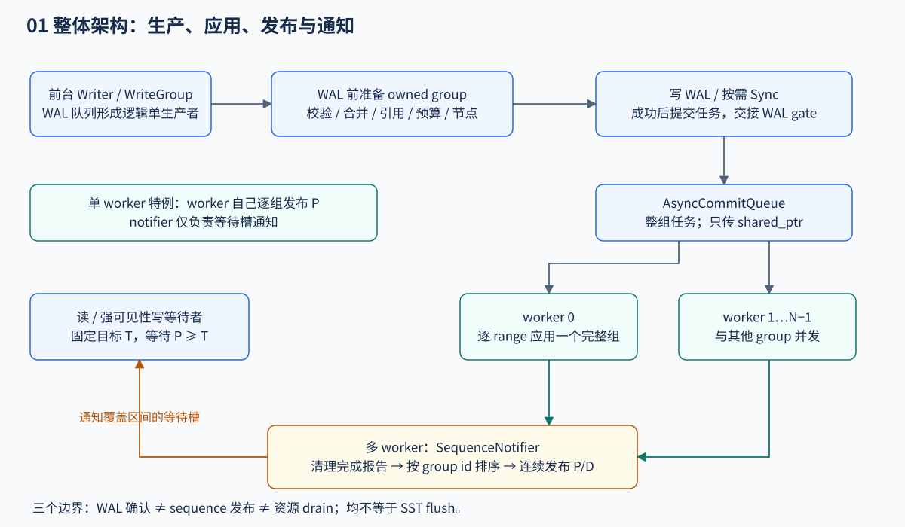
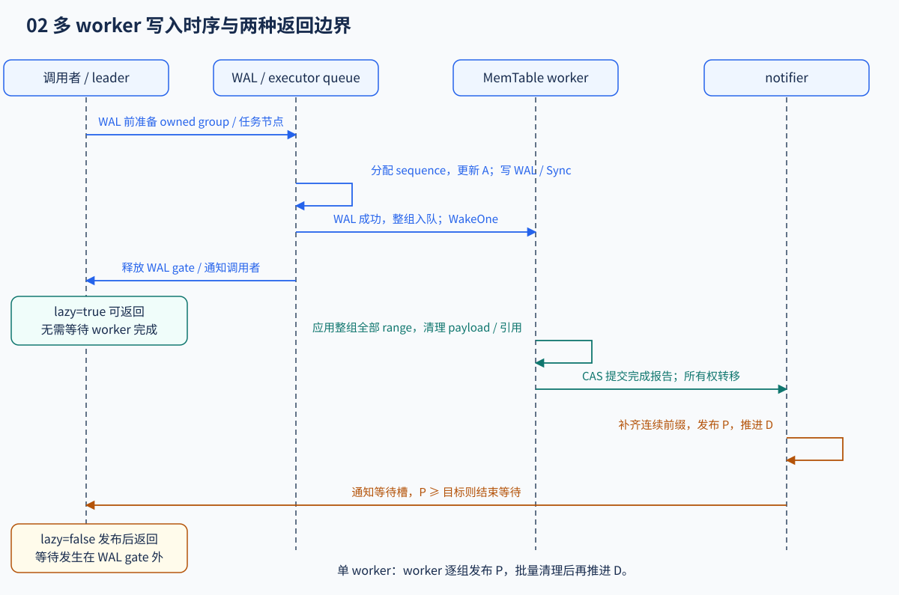
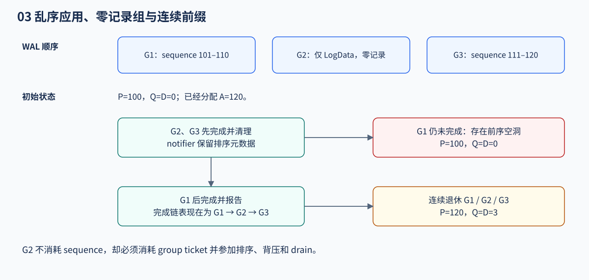
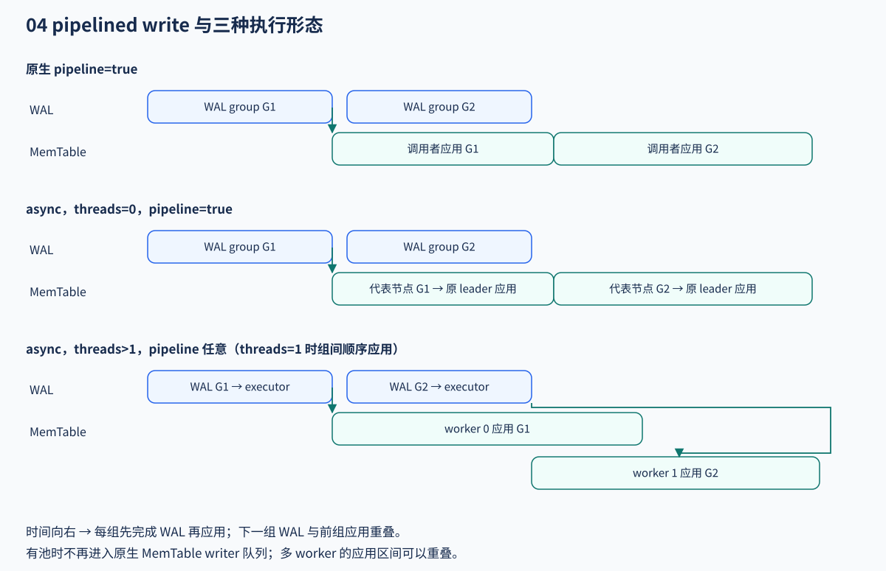
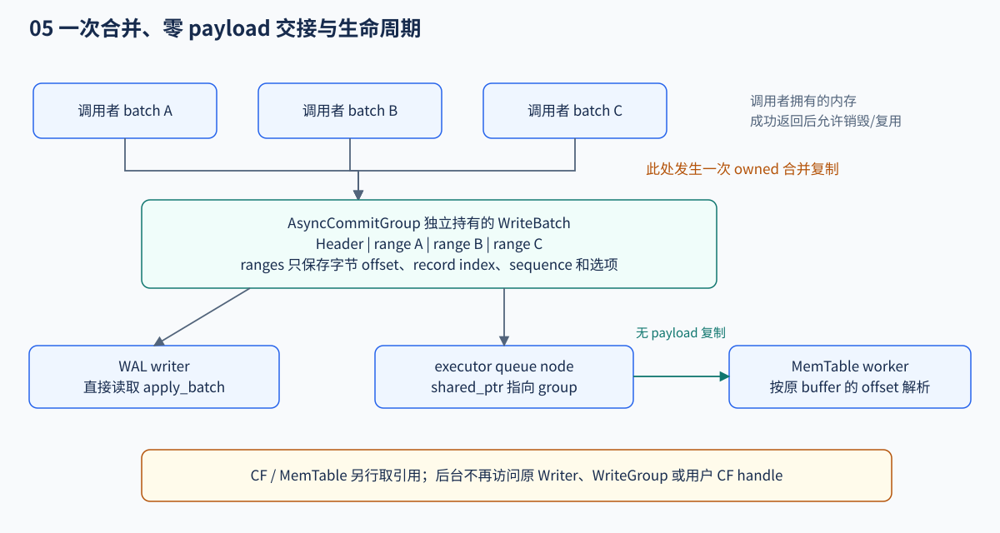
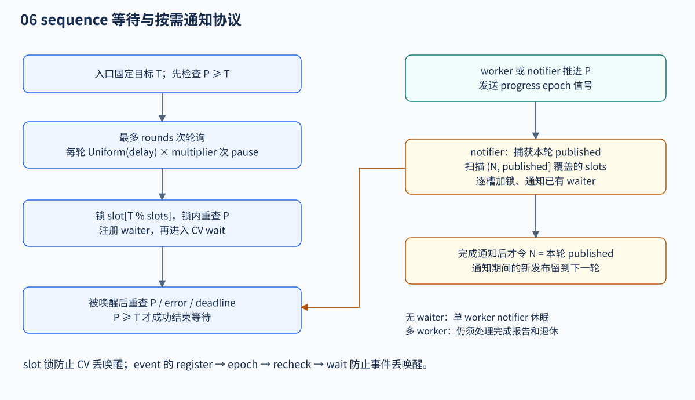
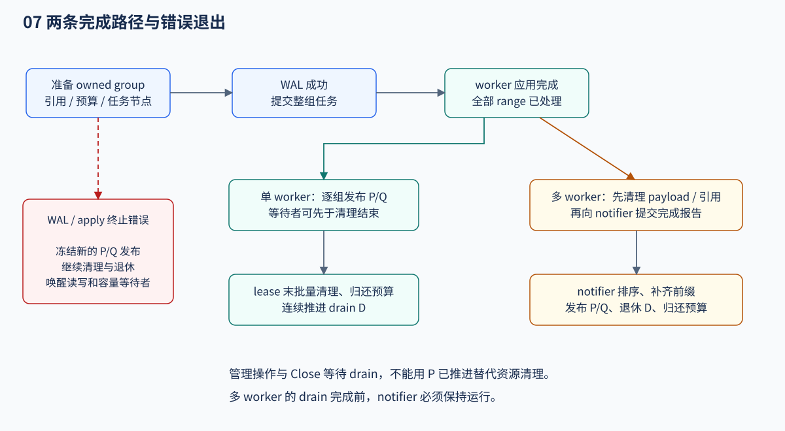
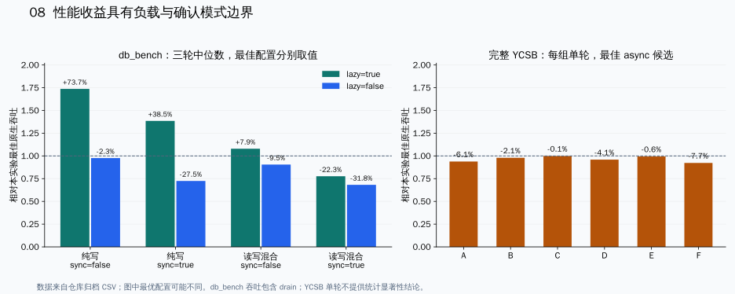

# RocksDB Async Memtable Write 特性设计说明书

| 项目 | 内容 |
| --- | --- |
| 所属模块 | RocksDB 写入、WAL、MemTable、读视图与后台任务管理 |
| 适用版本 | 本仓库 RocksDB 6.26.1，`async-commit-worktree` 分支 |
| 分析基线 | `ff629fb02a370117909feb4c4d589ea5c12ef9a3` |
| 产品实现基线 | `97fc7d395c2e7b363ac5c258d80c27e375ed0de2`；其后一个提交新增测试工具与归档 |
| 分析范围 | HEAD 最近 7 个提交，基线之前为 `4d57a393a8f1563c0dff1ff468756c23d89e3601` |
| 文档日期 | 2026-11-27 |
| 文档状态 | V1.0，依据现有实现编写的设计评审稿 |
| 设计人员、评审人及落入产品版本 | 由特性负责人在正式评审时填写；本文不代替产品发布决策 |

本文参考 [openGauss 特性设计说明书模板][template] 的六章结构，保留第 3 章的总体方案、约束、详细实现、子系统接口、DFX、外部接口及自测设计。GitCode 页面获取超时时，依据 [openGauss 官方 GitHub 镜像中的同名模板][template-mirror] 核对章节。模板用于章节组织；本文技术内容来自本地提交、源码和归档数据。

| 日期 | 版本 | 修订内容 |
| --- | --- | --- |
| 2026-11-27 | V1.0 | 汇总七次提交，重建设计动机、线程协议、可见性、所有权、配置和验证依据 |

阅读建议：先读 1～2 章了解适用范围，再读 3.2、3.4.1～3.4.8 理解核心协议；评审并发正确性时重点检查 3.4.9～3.4.11；参数与性能分别见 3.7、3.6.1。所有插图均为可缩放 SVG，同目录提供生成脚本与离线 HTML 阅读版。

## 1. 特性概述

RocksDB 的普通写入需要经历请求组装、分配 sequence、写 WAL、插入 MemTable 和发布可见 sequence。原生 group commit 已能摊薄 WAL 成本；原生 pipelined write 已能让相邻组的 WAL 与 MemTable 阶段重叠，但写入执行和调用者线程仍有较强耦合。

本补丁把 WAL 成功之后的 MemTable 应用转交给独立执行者，并将对调用者的确认、读可见性和资源清理分开管理。线程池模式下，一个 WAL WriteGroup 对应一个独立持有数据的后台任务；前台完成 WAL 与队列交接后，可按配置立即返回，或在离开 WAL 队列后等待 sequence 发布。后台执行可以乱序完成，公开读视图始终只使用已完成的连续前缀。

收益主要面向 WAL 与 MemTable 可以有效重叠、直接写入较多的负载。已归档数据证明特定 db_bench 纯写配置有收益，也证明完整 YCSB A–F 并未普遍受益，因此本设计不承诺所有场景提速。

### 1.1 范围

包括普通 WriteBatch 的异步 MemTable 应用、专用 worker、无锁任务交接、连续 sequence 发布、分片等待通知、跨线程读前等待、原生 pipeline 衔接、内存与组数背压，以及 flush、CF 管理、关闭和恢复边界。

保留三种执行形态：原生路径、`threads=0` 的 leader 执行路径、`threads>0` 的线程池路径。本文主要说明线程池优化，同时说明兼容路径的真实行为。

不扩展事务、用户时间戳、unordered write、手动 WAL flush 或 tailing iterator。没有新增磁盘文件格式，没有把异步 WAL I/O 或异步 fsync 纳入本特性。

### 1.2 特性需求列表

| 编号 | 需求 | 验收要点 |
| --- | --- | --- |
| R1 | WAL 和 MemTable 执行解耦 | 有 worker 时，下一 WAL group 可在前组 MemTable 完成前执行 |
| R2 | 可选择写成功边界 | lazy=true 确认 WAL；lazy=false 等待本次请求的 sequence 发布 |
| R3 | 后台执行不借用已返回调用者的数据 | 调用者可销毁、清空或复用自己的 batch 和 CF handle |
| R4 | 读视图连续且一致 | 多 worker 乱序完成不允许跳过前序组发布；跨 CF batch 不暴露半组 |
| R5 | 读等待有确定边界 | 新视图固定捕获入口目标；历史 snapshot 不等待后续写 |
| R6 | 降低调度与通知开销 | 整组任务、单 worker 批量清理、独立 notifier、按需唤醒 |
| R7 | 资源有界并可排空 | 限制 pending bytes/groups；管理操作等待清理和连续退休 |
| R8 | 失败可终止且可恢复 | WAL 失败不成功确认；应用失败冻结发布、唤醒等待者并要求重开 |
| R9 | 性能结果可审计 | 吞吐包含排空，区分确认延迟和应用完成，核验实际二进制与配置 |

## 2. 需求场景分析

### 2.1 典型场景与收益来源

**高并发直接 Put/覆盖写。** 前台能够继续组 WAL，后台承担解析和 MemTable 插入，使 WAL 串行阶段不再因前组的插入、引用释放和读者通知而延长。多 worker 并行的是不同 WAL group；同一个 group 中的 range 仍由一个 worker 依次执行。

**sync=true 的组提交。** fsync 成本可能占主导；补丁保留原 group commit，同时让 MemTable 执行与下一组 WAL 重叠。收益受 WAL 同步吞吐和组大小限制，不能预期按 worker 数线性扩展。

**写后读和混合读写。** lazy=true 将一部分等待从写返回挪到后续新读入口。读者固定捕获 DB 已分配水位并等待连续发布；这加强了跨线程读可见性，但也可能使读尾延迟上升。lazy=false 在写端完成等待，读端使用普通 published view。

**需要历史视图的读取。** 显式 snapshot、已有 iterator 不应因为新的后台写而追赶最新水位。最近一次产品提交对 snapshot 等待目标做了专门修正。

### 2.2 系统位置与周边影响

变更位于 `DBImpl::WriteImpl()` 与原生 MemTable 插入之间，复用 WAL 格式、WriteThread 组装、MemTable 表示及后续 flush/compaction。读 API 的新视图选择之前增加等待；生命周期操作通过 WAL 队列屏障与后台排空同步。见 [S01][S01]、[S02][S02]、[S09][S09]。

`async_memtable_write=true` 是本分支当前默认值，而 `async_memtable_write_threads=0`。因此默认开启特性并不等于默认启用后台 MemTable worker；它启用的是 leader 应用、follower 提前返回的兼容形态。默认值改变会使事务等原来可接受的配置受到新校验约束，是部署兼容性评审的重点。

### 2.3 必须区分的完成边界

| 边界 | 含义 | 不能推出的结论 |
| --- | --- | --- |
| WAL 成功并完成任务交接 | WriteBatch 已按 WriteOptions 完成日志步骤，后台可独立执行 | 尚不能推出 MemTable 已应用、sequence 已发布 |
| sequence 发布 | 整组及其所有前序组已完成应用，公开水位 P 已覆盖目标 | 单 worker 下资源清理可能尚未完成 |
| drain / 组退休 | 组数据、CF/MemTable 引用已释放，预算归还，连续退休票据已覆盖目标 | 不表示 MemTable 已写成 SST |
| SST flush 完成 | 后台 flush 将 immutable MemTable 写入 SST | 与上述三个边界属于不同阶段 |

WAL 成功的持久性继承 `WriteOptions::sync`。`sync=false` 不新增逐次持久化承诺；`sync=true` 仍执行原 WAL 同步逻辑。`use_fsync` 决定同步实现，不能代替 `WriteOptions::sync=true`。见 [S10][S10]。

## 3. 特性/功能实现原理

### 3.1 目标

在保持有序 sequence 分配、普通 batch 原子可见和 WAL 恢复语义的前提下，缩短 WAL 生产者占用写入关键路径的时间。具体目标是：

1. WAL 后交接不需要复制任务 payload，也不依赖完成路径持有的互斥锁。
2. worker 可以跨组并发应用；发布严格按照 group id 的连续前缀推进。
3. 单 worker 逐组发布，引用释放和预算记账可合并；多 worker 的排序发布交给单一所有者。
4. 通知读者的锁操作不阻塞执行 MemTable 的 worker。
5. backlog、错误和管理操作均有明确的等待、唤醒与退出协议。

性能验收同时看完成吞吐、API P99、读等待、CPU 与资源残留。纯写吞吐改善不能替代混合负载和强可见性模式的独立评估。

### 3.2 总体方案

#### 3.2.1 整体设计思想

设计分为五个职责：前台生产、任务所有权、后台应用、连续发布、等待通知。



*图1：WAL 队列形成一个逻辑生产者；后台 worker 应用整组数据；多 worker 的 notifier 同时承担发布排序与通知。*

前台 leader 在 WAL 前完成校验、CF/MemTable 引用固定、预算申请、batch 合并和任务节点准备。WAL 后只提交已经准备好的组、唤醒 worker、修复写队列并通知调用者。这样可提前失败的工作尽量发生在 WAL 确认之前，后台不依赖调用者的栈对象。

发布顺序与执行顺序分离：不同组可同时应用，但 `VersionSet::LastSequence()` 只覆盖完整且连续的组。物理上已经插入 MemTable、sequence 却大于 P 的记录，对使用 published view 的正常读取不可见。

资源清理与发布也分离：单 worker 可以在清理本次取得的所有组之前逐组推进 P；管理操作必须等待 drain，而不是只等 P。多 worker 先清理资源，再报告完成，由 notifier 统一推进连续发布和连续退休。

#### 3.2.2 核心状态与不变量

| 符号/字段 | 定义与所有者 |
| --- | --- |
| A | `async_commit_allocated_sequence_`，异步写已分配的 sequence 水位；WAL leader 更新 |
| P | `versions_->LastSequence()`，公开连续可见水位；以 release 发布、acquire 读取 |
| N | notifier 已经处理过读等待通知的 P 快照，即 `Run(notified)` 的局部变量 |
| T | 某个读/写等待者一次确定的目标 sequence |
| S | `last_submitted_`，最近一次提交的 group id；独立于 sequence |
| Q | `published_ticket_`，已按组发布的连续 group id，包含零记录组 |
| D | `drained_ticket_`，已完成资源清理并连续退休的 group id |

需要保持以下不变量：

1. 公开 P 不越过尚未成功应用的前序组；错误后不再发布新的组。A、P 在纯异步写阶段满足 P≤A；恢复或管理操作可能先改变 P，所以新读目标使用 `max(A,P)`。
2. 以组为单位发布：所有 range 完成以后，才可以发布组尾 sequence。
3. 正常运行时 `0 ≤ D ≤ Q ≤ S`。单 worker 可有 D<Q；多 worker 连续发布与退休在同一处理阶段推进。终止错误后 Q 冻结，D 仍可继续推进到 S，因此错误态不要求 D≤Q。
4. 零记录/LogData-only 组不消耗 sequence，但仍消耗 group id 和 pending group 配额。
5. 入队之后生产者不再访问组的 payload/ranges/targets；worker 可能在前台通知 follower 之前就完成清理。
6. drain 覆盖资源清理；正常情况下还要求组发布。终止错误时，允许停止发布但继续清理退休。
7. N 只在真正通知对应区间后推进；无人等待时不得直接把 N 跳到当前 P。

A 不是“已经成功确认的 WAL 水位”：它在 WAL 写入之前就会更新。新读可能等待入口时已经分配、但 WAL 尚未完成的请求；如果该请求失败，则等待通过终止错误退出。[S02][S02]、[S05][S05]、[S06][S06]、[S11][S11]

#### 3.2.3 方案选择与权衡

| 方案 | 优点 | 代价与采用情况 |
| --- | --- | --- |
| 继续由调用者参与 MemTable 执行 | 少后台调度，容易沿用原 WriteThread | 执行与调用者绑定；保留为 threads=0 兼容路径 |
| 按原请求 range 分发 worker | 一个大 group 内也可利用多核 | 需要更多节点和组内完成协调；当前实现已演进为整组任务 |
| 整个 WAL group 一个任务 | 一次交接、生命周期清楚、减少完成报告和队列争用 | 大 group 无法在组内并行，组间耗时差异会形成发布空洞；当前采用 |

发布也分两条路径：一个 worker 天然有序，直接发布成本低；多个 worker 会乱序完成，由 notifier 单线程管理完成链表，避免每个 worker 都维护全局排序结构和读等待槽。

#### 3.2.4 最近七个提交的详细分析

| 顺序 | 提交 | 日期 | 在方案中的位置 |
| --- | --- | --- | --- |
| C1 | [`8fe481080`][C1] | 11-06 | 初始异步 WAL 确认、独立 MemTable 执行与无锁交接 |
| C2 | [`6df8d54e3`][C2] | 11-06 | 增加强可见性写返回模式 |
| C3 | [`7df1be374`][C3] | 11-07 | 新读固定捕获全局 A，并采用分片发布等待 |
| C4 | [`785a62dc6`][C4] | 11-10 | 独立 notifier、随机 pause 等待、单 worker 与 WAL 唤醒优化 |
| C5 | [`b969f2fe7`][C5] | 11-11 | 整组任务、多 worker notifier 排序发布、单 worker 逐组发布与批量清理 |
| C6 | [`97fc7d395`][C6] | 11-24 | 当前配置命名、默认开启及历史 snapshot 等待修正 |
| C7 | [`ff629fb02`][C7] | 11-25 | db_bench/YCSB 采集脚本、证据链和结果归档 |

**C1：把 WAL 确认与 MemTable 应用拆开。** 为线程池建立独立持有的组数据、固定 worker、预分配节点的 FIFO 和 hazard-pointer 回收；加入字节/组数背压、drain、错误冻结和生命周期屏障。WAL 之后的队列发布不依赖完成锁。初版还通过线程局部上下文实现同线程写后读依赖，这个读语义后来被 C3 替换。初版的任务分配方式也不能直接当作最终实现描述。

**C2：执行解耦不必绑定提前返回。** 增加原名 `async_commit_strong_visibility`。leader 和 follower 均先离开 WAL 队列，然后等待本次 sequence 被连续发布，使等待不会占住下一组 WAL。该提交改变确认边界，不改变 WAL sync。当前等价开关是 `lazy_advance_sequence=false`，布尔含义反转。

**C3：从线程局部依赖升级为 DB 级入口边界。** 读入口捕获一次已分配 A，因此也覆盖其他线程在入口之前分配的写；后续分配不再扩大本次等待目标。等待按 sequence 对 slot 取模，避免所有读写等待者竞争同一个条件变量。该版采用按时间的 spin/yield，已由 C4 替换，文档不能继续把旧的微秒预算写作当前行为。

**C4：把发布通知移出 worker。** 独立 notifier 承担读等待槽加锁与唤醒，使 worker 不被读者锁拖住；waiter/progress 两类事件支持无读者时休眠。等待改为按次数轮询和随机 CPU pause，降低普通路径读取时钟和调用 scheduler yield 的成本。另有 group/batch 对象合并分配、单 worker 成批退休、共享 WAL epoch 与 futex mask 唤醒。该检查点的单 worker 分块策略后经 C5 继续调整。

**C5：确定当前任务与发布拓扑。** 所有线程池任务均以完整 WAL group 为单位，每组一个队列节点。多 worker 清理后通过 MPSC 完成收件箱报告，由 notifier 排序并发布连续前缀。单 worker 取得当前 ready 前缀，逐组 apply 后立即发布 P，最后统一清理与退休；不再等待整个 lease 完成才发布早期组。加入多 worker 的 `groups_per_fetch` 参数，保持 Merge fence 和 sync 相关的 WAL 通知次序。

**C6：明确“异步 MemTable 写入”的外部接口。** `enable_async_commit` 改为 `async_memtable_write` 且默认 true；强可见性开关改为反向的 `lazy_advance_sequence`，并统一其余选项名。显式 snapshot 的等待目标由最新 A 改为 snapshot 自身 sequence，避免历史读被无关的后续写阻塞。对调用者而言，这同时是配置、默认行为和历史读等待语义变更，不能仅按重命名评审。

**C7：建立可复核的性能结论。** 没有继续修改产品执行协议。加入 504 次 db_bench、90 次 YCSB 限时筛选和 30 项完整流程结果、采集/汇总脚本、实际参数、源代码身份、JNI 加载指纹与校验记录。结果显示优化有适用场景，而非普遍性能改善。数据来源及结果限制见 3.6.1。

仓库既有 `async_commit.md` 和历史计划记录了各阶段的探索，其中的 V1/V2/V3、TLS 读依赖、range task、旧 spin/yield 参数等需要按提交时间理解。本说明书以 C6 的最终产品实现为准。

### 3.3 约束条件

| 层次 | 条件 | 当前行为及原因 |
| --- | --- | --- |
| DB 配置 | async=true 时禁止 unordered_write、two_write_queues、manual_wal_flush、allow_2pc | Open 返回 NotSupported，限定有序普通写和自动 WAL flush |
| worker 配置 | threads≥0；threads>1 要求 allow_concurrent_memtable_write=true | 多组可以同时写入同一 MemTable，底层表示也须支持并发写 |
| 强可见性 | lazy=false 要求 async=true 且 threads>0 | 发布由独立 worker 推进，避免把兼容路径当作强可见性池路径 |
| CF 选项 | 禁止 inplace_update_support、非零 max_successive_merges、用户 timestamp comparator | 不纳入会额外改变插入/读取依赖的行为 |
| Write 请求 | disableWAL、timestamp、callback、pre_release_callback、特殊事务序号、WAL termination point 等不支持 | WriteImpl 提前拒绝，不把未实现组合悄悄回退 |
| 操作类型 | 支持普通 Put/Delete/SingleDelete/DeleteRange/Merge/LogData | 先校验记录类型、边界、CF 与 Merge operator；Merge 组执行独占 fence |
| 事务 | TransactionDB、OptimisticTransactionDB 不支持 async=true | 包装器 Open 显式拒绝；使用事务需明确关闭 async |
| iterator | tailing iterator 不支持；普通 iterator、snapshot 保持历史视图 | 新视图和 Refresh 在相应入口等待；已有视图不随 A 自动推进 |
| 平台 | 队列要求始终 lock-free 的指针原子操作 | Linux 使用 futex；其他平台事件睡眠使用 mutex/CV 回退 |

来源：[S01][S01]、[S03][S03]、[S12][S12]、[S13][S13]、[S14][S14]、[S15][S15]。这里描述的是本分支支持范围，不能推广为 RocksDB 上游通用限制。

### 3.4 详细实现

#### 3.4.1 写入主流程：WAL 前准备与 WAL 后交接



*图2：lazy=true 可在提交任务并完成 WAL 队列交接后返回；lazy=false 在离开 WAL 队列之后等待 P。单 worker 的发布发生在 worker，图中 notifier 发布步骤对应多 worker。*

调用链为：

```text
DBImpl::WriteImpl
  -> AsyncWriteImpl
     -> WriteThread::JoinBatchGroup
     -> PreprocessWrite / EnterAsBatchGroupLeader
     -> BuildAsyncCommitGroup
        -> 校验原 batch、固定 CF 和目标 MemTable
        -> ReserveAsyncCommitBytes / 合并 batch
     -> AsyncCommitExecutor::PrepareGroup             [WAL 前]
     -> 分配各 range sequence，发布 A
     -> WritePreparedBatchToWAL / 必要的 WAL Sync
     -> AsyncCommitExecutor::SubmitPreparedGroup      [WAL 后]
     -> WakeOne / 退出 WAL group / 通知原调用者
     -> finish
        -> lazy=true：返回 WAL 结果
        -> lazy=false：WaitForAsyncCommitSequence(end)
```

`PrepareGroup()` 分配节点，记录前一个 exclusive barrier；多 worker 还预先设置 `completion_owner`。WAL 失败时取消准备并清理引用。成功提交时分配递增 group id，记录入队时间、S 和统计，将节点链接进 FIFO。WAL 后交接不重新构造数据副本，不为完成报告再分配节点。[S02][S02]、[S04][S04]、[S05][S05]

“WAL 后无 payload 分配”针对准备好的提交/完成报告交接协议，不表示整个后台线程永远不再分配：单 worker 的 lease vector、插入器或队列退休列表等仍可能涉及内存分配。

#### 3.4.2 MemTable writer 线程池工作原理

每个 DB 的 executor 持有一个专用 `ThreadPoolImpl`。Start 设置固定线程数，给每个线程提交长期运行的 `Run(worker_id)` 作业，并等待所有 worker 注册完成。因此它不是“每个 WriteGroup 都向通用线程池提交一个新 job”：ThreadPoolImpl 启动长寿命 worker，真正的高频任务通过 executor 自己的 FIFO 交接。

**任务队列。** WAL 队列保证同一时刻只有一个逻辑生产者；多个固定注册的 worker 是消费者。队列采用 Michael–Scott 风格的 head/tail helping，通过 CAS 推进；节点在 WAL 前准备，队列操作本身不分配队列存储。consumer 用两个 hazard pointer 保护旧 dummy 和新 head，退休节点达到阈值或即将休眠时扫描回收。线程暂停在受保护节点上不会持有队列锁阻塞其他 consumer。[S07][S07]

这里的“无锁”限定队列交接和完成收件箱。背压、fence、CF 引用、发布与 drain 记账仍有互斥锁；整个数据库写入不是全路径无锁。

**空闲协议。** `TakeOrWait()` 先尝试取任务；空闲前约 10 μs 执行 pause，随后 yield，达到内部 50 μs 阈值后进入事件睡眠。睡前顺序为“注册 sleeper → 取得 epoch → 再查队列与 stop → 等待该 epoch”，避免入队恰好发生在检查和睡眠之间而丢唤醒。生产者每组 `WakeOne()`；shutdown/error 使用 `WakeAll()`。这一内部空闲策略与读/写 sequence 等待的 spin 参数是两套机制。[S05][S05]、[S08][S08]

**单 worker。** 使用 `RunSerial()`，取得第一个任务后捕获 `ready_through=LastSubmitted()`，继续获取已可见的当前前缀；遇到空队列、独占组或 barrier 变化即停止。不会为了尚未链接的已预留 ticket 等待生产者，也不会随持续到来的任务无限延长本次 lease。每组依次应用并立即推进 P，整个 lease 结束后批量释放引用、归还预算并推进 D。`groups_per_fetch` 不限制这条路径。

**多 worker。** `Run()` 最多取得 `groups_per_fetch` 个相容组，上限 64；遇到 fence 则保留一个 pending task，下一轮处理。每个组仍然依次执行其 range，组完成后立即清理和报告，不等待本 lease 的其他组结束。不同 worker 可以同时执行不同 group。

多 worker 并发插入通过 `InsertIntoRange(..., concurrent=true)` 进入既有 MemTable 并发路径，结束时执行 PostProcess，包括部分插入后出错的计数提交；flush 调度与引用清理由单独的 DB mutex 阶段完成。[S05][S05]、[S16][S16]

#### 3.4.3 sequence advance / sequence notifier 的职责与引入原因

当前源码没有单独的 `sequence_advance` 线程类。sequence advance 是推进连续可见水位的职责；`AsyncCommitSequenceNotifier` 是实际存在的一个线程。它在不同配置下承担不同职责：

| 执行形态 | 谁推进 P | notifier 做什么 | 新增后台线程数 |
| --- | --- | --- | --- |
| async=false | 原生 WriteThread | 不启动 | 0 |
| async=true，threads=0 | 原调用者 leader | 读等待槽通知 | 1 |
| async=true，threads=1 | 唯一 MemTable worker | 读等待槽通知 | 2 |
| async=true，threads>1 | notifier 的 ProcessCompleted | 完成排序、连续发布/退休、读等待槽通知 | threads+1 |

上表不包含 RocksDB 原有 flush/compaction 等后台线程。

**为什么分离通知。** 发布 P 本身是一个短原子更新，但通知 slot 需要逐一取得 mutex。等待者可能持有这些锁或正进入睡眠。如果 worker 在每次完成后直接处理所有读者通知，则下一组 MemTable 应用受读线程调度影响。C4 引入 notifier，worker 只发 progress 信号，槽加锁留给独立线程。

**为什么多 worker 还要集中 advance。** 不同 worker 可能先完成 G3、再完成 G2、最后完成 G1。任何 worker 都不能简单把 P 设置为自己组尾。C5 把完成报告与有序链表交给 notifier 独占管理，减少 worker 对全局完成结构的协调，也明确了空洞关闭的唯一决策者。



*图3：G2/G3 已应用不代表可以发布。零记录组 G2 仍必须按 group id 跨越，才能发布后续 G3。*

**多 worker 完成协议。** `PrepareGroup()` 在 WAL 前令 `completion_owner=group` 保持报告存活；worker 完成资源清理后，用 CAS 将 `completion_next` 推入 MPSC 收件箱，随后不再触碰报告内容。notifier 用 acquire exchange 取走报告，反转链表恢复接收次序，每轮最多处理 64 个，再按 group id 插入自己拥有的有序完成链表。

它在 async mutex 下归还已清理 payload 的预算，仅保留完成元数据预算和 group 配额；如果链表头正好等于 D+1，就逐组调用 `RetireCompletedGroup()`，推进 P、Q、D 并归还剩余预算。前序未完成时，已完成后序组只保留排序元数据，不持有原 payload 或 CF/MemTable 引用。[S06][S06]

完成报告每轮处理 64 个，是为了在完成 backlog 较大时仍交替处理发布与读者通知。它与 worker 的 `groups_per_fetch` 是两个独立限制。

**为什么单 worker 自己 advance。** 只有一个执行者，组完成天然有序；让 notifier 再做排序转交只会增加一次异步跳转。单 worker 因而每组直接发布，读者通知仍交给 notifier。不要把“独立通知线程”误写为“所有模式都有独立 sequence 推进线程”。

#### 3.4.4 通知线程的休眠、唤醒与等待槽协议

notifier 的两个事件解决不同条件：`waiter_event_` 用于单 worker/无池模式下“原来无人阻塞，现在第一个等待者出现”；`progress_event_` 用于 P 进展、多 worker 完成报告、最后一个 waiter 退出以及 shutdown。

无阻塞读写等待者时，单 worker 模式的 notifier 睡在 waiter_event 上；worker 更新 progress epoch 不会为纯通知职责额外唤醒它。多 worker 则即使没有读者，也必须处理完成报告、推进 P/D 和预算，所以一直使用 progress_event。

不能在观察到 `waiters=0` 时直接跳过旧的通知区间。第一个 waiter 注册与 worker 发布可能随后交错；若 N 被提前推进，会漏掉该 waiter 所需的区间。正确做法是保留 N，等实际扫描通知区间后才令 N 等于本轮捕获的 P。

等待目标 T 对 slot 数取模：`slot=T % slots`。发布从 previous 到 published 时，仅访问这一 sequence 区间覆盖的余数；最多访问全部 slots 一次。通知者即使发现某个槽目前没有 waiter，也须先取得槽锁；等待者取得同一锁后重新检查 P，再注册和睡眠。两者共同关闭“检查条件以后、真正睡眠以前”的竞态窗口。错误和关闭则通知所有槽。[S02][S02]、[S06][S06]

WAL writer 的 futex mask 是另一种通知优化：共享 epoch，按照调用者的 mask 合并唤醒，减少逐 Writer 的私有等待对象和 syscall。mask 哈希碰撞只带来额外唤醒；每个 Writer 仍以 release/acquire 状态检查确认自己是否完成，不会把碰撞当成成功。[S08][S08]、[S09][S09]

#### 3.4.5 和 pipelined write 的结合



*图4：线程池自行建立 WAL/应用重叠。threads=0 时，pipeline 通过一个代表节点保留原 group 在 MemTable 队列中的位置。*

| 模式 | pipeline=false | pipeline=true |
| --- | --- | --- |
| 原生 async=false | 同一组完成 WAL 与 MemTable 后释放相应阶段 | 原生 WAL/MemTable 双队列，调用者参与执行 |
| async=true，threads=0 | follower 在 WAL 后摘除返回；leader 保持 WAL gate 应用 MemTable | 整个原 group 用一个代表 Writer 进入 MemTable 队列；释放下一 WAL leader，原 leader 等代表节点轮到自己后执行 |
| async=true，threads>0 | 整组提交 executor 后退出 WAL 队列；worker 独立应用 | 走同一 executor 分支，不把任务再送入原生 MemTable writer 队列 |

`AsyncWriteImpl()` 先判断 executor，再判断 `enable_pipelined_write`。因此有池时，pipeline 开关不是“能否重叠 WAL/MemTable”的必要条件，也不会叠加出第二个 MemTable 调度层。保留该开关是接口兼容；性能差异还需按实测配置解释，不能仅根据名字推断流水线数目。

无池且 pipeline=true 的 `TransferAsyncGroupToMemtable()`，先建立 WAL 队列边界，再把代表节点链接到 MemTable 队列，最后交接下一 WAL leader 并唤醒原 follower。边界上的 dummy 防止空队列并发入队破坏原 group 次序。原 group 不能被后续原生 MemTable 队列重新拼成另一套确认边界。[S09][S09]

**sync 相关交接策略。** 有池且 `sync=true` 时，先摘除/通知 follower，再唤醒 worker并释放当前 WAL leader，使被唤醒调用者更有机会加入下一组 fsync。`sync=false` 时通过 `ExitAsyncWalGroup()` 先修复队列并通知下一 leader，再处理原 follower，减少短 WAL 路径被逐 follower 通知串行拉长的影响。这是组提交效率的权衡，不改变 sync 或发布语义。

#### 3.4.6 WriteGroup 到线程池的零 payload 拷贝



*图5：顶部是调用者持有的 batch，绿色框为异步组独立持有的缓冲区。原 batch 到 owned batch 有一次合并复制；WAL 使用与 worker 应用指向同一 owned batch。*

`WriteThread::WriteGroup` 是由调用者栈上 Writer 链成的分组视图，本身不持有可供异步长期使用的 payload。允许调用者提前返回后，后台不能再引用这条链、原 batch 或原 CF handle。

`BuildAsyncCommitGroup()` 因此构造独立的 `AsyncCommitGroup`：

1. 逐请求校验 batch 和保护信息，生成 range 的字节偏移、记录索引、记录数和请求选项。
2. 合并所有请求的数据到一个 owned WriteBatch。线程池下即使只有一个请求，也要持有自己的数据。
3. 分配 sequence 后，WAL 直接使用 `group.apply_batch`，worker 后续仍读取这个对象的相同缓冲区。
4. 每组一个队列节点；task 只持有 `shared_ptr<AsyncCommitGroup>`。传递/复制 shared_ptr 及偏移元数据，不复制 key/value 字节。
5. worker 通过 `InsertIntoRange()` 在原缓冲区的 `[begin_offset,end_offset)` 上解析，不创建 range payload 副本；保护信息通过 first_record_index 对齐。

所以“零拷贝”的准确范围是 **已合并 WAL group 到 executor，再到 MemTable 插入解析入口的 payload 交接**。它不包括用户 batch 到 owned batch 的初始复制、WAL 编码/系统 I/O，以及记录真正存入 MemTable 的分配与复制。

单 worker 的 `AsyncCommitSerialGroup` 将 WriteBatch 对象放入 group 同一次 `make_shared` 分配中，减少对象分配；WriteBatch 内部字节缓冲区仍有独立存储，不能表述为“group 和所有 key/value 只有一次分配”。无池、单请求的兼容路径可借用 leader batch，因为 leader 在应用完成前不会返回。[S04][S04]、[S02][S02]、[S16][S16]

#### 3.4.7 lazy_advance_sequence 与读可见性

lazy 参数选择调用者等待位置，后台在两种配置下都会持续推进 P。它不是“读到来才推进 sequence”的开关。

| 行为 | lazy=true | lazy=false |
| --- | --- | --- |
| 有池时写成功返回 | WAL 成功且任务已交接即可返回 | 离开 WAL 队列后，等待 P≥本请求末 sequence |
| 新读入口 | 固定捕获 `T=max(A,P)`，先等 P≥T，再选择视图 | 跳过异步读前等待，使用正常 published view |
| 显式 snapshot 读 | `T=snapshot.sequence`，不追赶当前 A | 使用 snapshot 原有 sequence |
| 等待发生在哪 | 写后读/新视图可能承担发布等待 | 写调用承担发布等待 |
| 持久性 | 由 WriteOptions.sync 决定 | 同左 |

新视图捕获的 T 是等待下界；等待结束后正常选择的 published sequence 可能更大。固定 T 不等于把普通读精确钉在入口 A 上。后来分配的写不延长目标，但后来已经完成发布的写可能进入实际读视图。

lazy=true 的等待涵盖其他线程的已分配写，不再是 C1 的 TLS read-your-writes。由于 A 在 WAL 之前更新，它还可能等待尚未完成 WAL 的组。lazy=false 也不是“读必须看到所有进行中的写”：它保证成功返回的写已经发布，尚未返回的写仍可不进入当前普通读视图。

对空 batch/LogData-only 请求，`async_end_sequence` 使用组尾 sequence，保守等待前序数据。它不消耗新 sequence，若 P 已覆盖目标，写端 sequence 等待可立即结束；这仍不等同于按 group id 等待该元数据组 drain。

读接口包括 Get、不同 MultiGet 入口、KeyMayExist、NewIterator/NewIterators、GetSnapshot，以及 iterator Refresh 的新视图准备。GetSnapshot 不能返回 Status，因此等待失败时记录错误并返回 nullptr；iterator 返回 error iterator；KeyMayExist 在等待失败时返回“不能排除存在”，清空 value/value_found，不伪造确定不存在。已有 iterator 的普通 Seek/Next 不重新追赶 A。[S17][S17]、[S18][S18]

#### 3.4.8 sequence 等待参数与低开销等待



*图6：发布条件始终是 P≥T。epoch 避免事件丢唤醒，slot mutex 关闭条件变量检查到睡眠的竞态窗口。*

当前等待路径是“快速检查 → 有界次数 spin → slot CV 阻塞”。C3 的“按微秒 spin → scheduler yield → CV”已经取消。

每一外层轮询失败后执行：

```text
sample = Uniform(async_memtable_write_wait_spin_delay)
pauses = sample * async_memtable_write_wait_spin_pause_multiplier
连续执行 pauses 次 CPU pause，再检查 P / 终止状态
```

默认 rounds=30、delay=6、multiplier=50，因此每轮取样 pause 次数为 0、50、100、150、200、250，均匀取样下期望 125；全部 30 轮均失败时，理论期望总计 3750 次 pause。它不是微秒上限，也不能在不同 CPU 间直接换算成固定等待时长。

普通无 deadline 路径的内层只操作本地计数并 pause，不读取时钟；随机延迟使多个等待者不必同时反复读取共享 P。存在显式 deadline 时，长内层 delay 以最多 64 次 pause 为块检查 P、终止状态和 deadline；外层及进入 CV 前也检查 deadline。0 rounds 直接进入阻塞准备；delay 或 multiplier 为 0 只跳过 pause，并不跳过外层条件轮询。[S02][S02]

调参权衡是 CPU 消耗、阻塞/唤醒成本和尾延迟。slots 减少共享槽竞争，却增加内存及大步发布时的通知工作；spin 增大可能降低短等待的上下文切换，也可能抢占 worker CPU。默认值是已有实现选择，不是所有硬件的最优值。

#### 3.4.9 Merge fence、生命周期屏障与 flush 衔接

**Merge fence。** 包含 Merge 的整个 group 标记 exclusive。普通组记录 `previous_barrier`；独占组开始前等待 D≥自身 id−1，后续普通组等待 D≥前一个独占组 id。这样先前组已清理退休、Merge 独占执行，后续组不会越过 Merge。代价是 Merge 频繁时组间并发退化，且包含单个 Merge 的大组也整体独占。[S05][S05]

**管理屏障。** CF drop、选项变更、手动 flush/atomic flush 等不能只看到“WAL 已交接”。`EnterUnbatched()` 取得 WAL gate 后调用 drain 回调，捕获此前 S，等待 D 覆盖目标并检查发布/错误。持有 DB mutex 时需要先释放它再等待 worker，否则 worker 清理 target 时无法取得 DB mutex，形成互等。[S09][S09]、[S19][S19]

**MemTable target 固定。** 准备组时在 DB mutex 下对 CF 和当前 MemTable 取引用，保存 log_number。worker 用组内 `AsyncCommitMemTables` 访问这些固定目标，不借用共享的、随当前 CF 切换而变化的查询状态。切表和 drop 通过屏障先排空，清理阶段断言目标仍是当前 MemTable。

**自动 flush。** pool 插入路径不直接使用前台 flush_scheduler 指针；清理阶段在 DB mutex 下检查 ShouldScheduleFlush、MarkFlushScheduled 和 history trim 条件，安排调度并释放引用。前台 PreprocessWrite 在需要切 WAL、处理 WBM 或写停顿前收集此前 worker 的调度和记账，再安排能释放停顿的工作，避免“前台等 flush，worker 的 flush 请求却未被调度”。

drain 后的 SwitchMemtable 只是封存旧表并安装新表；之后才由后台 flush 生成 SST。sequence 发布、drain、MemTable seal 和 SST flush 不应在时序图或性能统计中合并为一个完成事件。

#### 3.4.10 背压、预算与资源释放

预算覆盖 owned batch 分配容量、保护信息、range/CF/target 数组、group 元数据及任务节点的保守估算。先预留，再合并；合并后的实际容量更大时补充预留。限制为额外异步 backlog 的预算，不是整个 RocksDB 的内存上限，也不是操作系统 RSS 的严格上限。

`max_async_memtable_write_pending_groups` 统计准备、排队、运行和未连续退休的组，包含零记录组。只限 bytes 不限 groups 会遗漏大量极小任务和元数据组；两个限制需要同时存在。

无空间时，普通请求等待 async CV；`WriteOptions::no_slowdown=true` 返回 Incomplete。超大单组允许在没有其他 pending 组时独占预算，以保留大 WriteBatch 支持；因此 64 MiB 是常规 backlog 限制，不能宣称任何时候都绝不超过它。

单 worker 将 lease 的引用清理与预算归还合并，减少 DB mutex/async mutex 获取次数。多 worker 提前清理后序组 payload，notifier 先归还大块预算，只保留排序元数据；组数配额等连续退休才归还，防止前序空洞导致无界完成链表。queue 的 hazard 延迟回收还可能短暂保留任务节点及已清理 group 对象，所以 pending=0 不表示每个队列节点都已经物理 delete。[S02][S02]、[S05][S05]、[S06][S06]、[S07][S07]

#### 3.4.11 错误、关闭与恢复协议



*图7：单 worker 发布可以先于批量清理；多 worker 清理先于完成报告。错误阻止新的发布，但保留清理、退休和唤醒通路。*

**WAL 前校验/容量失败。** 不提交后台任务，返回对应错误，释放引用和预算。已准备节点要取消；拒绝组的 target 清理完成前保持 WAL gate，防止下一管理操作越过未释放的目标。

**WAL append/sync 失败。** 不给该组成功确认；`FailAsyncCommit()` 记录首个终止错误，停止等待并唤醒所有相关线程。由于已经分配 sequence，不能静默跳过失败组再继续发布后续 sequence。

**WAL 成功后 MemTable 失败。** lazy=true 的某些调用者可能早已拿到成功，无法追溯改写返回值。系统记录 BGError、冻结新的 P 推进，后续新进入的写由状态检查拒绝，需要等待未发布目标的读/写返回错误。错误发生时已经在执行 WAL 的组仍可能完成 WAL、交接并按 lazy 语义返回，因此不能把终止标记解释为对所有在途成功结果的追溯撤销。已分配并完成 WAL 的组仍需要走清理/退休，不能因为前序 apply 错误丢掉已确认 WAL 的所有权。此前已发布前缀保留，重新打开数据库后按原 WAL 回放恢复。

**关闭。** 先停止接收并 drain 到最后提交 group，设置 worker stop、唤醒并 join worker；然后设置 closing/wait_stopped，唤醒 sequence 等待者，停止并 join notifier，最后销毁相关状态。多 worker drain 期间 notifier 必须存活，否则完成报告无人退休。[S05][S05]、[S06][S06]、[S20][S20]

**恢复。** 持久化的是普通 WAL batch 与 sequence，没有持久化后台任务或完成链表。重开走正常 WAL recovery；测试覆盖已确认但尚未应用时退出进程后的恢复。这类测试不等价于断电持久化试验，不能扩大 sync=false 的保证。

空/LogData-only batch 的 WAL header 仍从 A+1 开始；恢复通过 inserter 的下一 sequence−1 计算最后序号，这个细节用于防止尾部元数据组把先前已确认更新的恢复水位向后错误移动。[S02][S02]

### 3.5 子系统间详细设计

| 文件/子系统 | 核心接口 | 职责与修改影响 |
| --- | --- | --- |
| `db/db_impl/db_impl_write.cc` | WriteImpl、PreprocessWrite、WritePreparedBatchToWAL | 分流普通异步写；停顿/flush 前 drain；复用 WAL 和 sync |
| `db/db_impl/db_impl_async_commit.cc` | AsyncWriteImpl、Build/Apply/Release、Wait/Drain | 生产者流程、所有权、目标固定、等待与资源协议 |
| `db/async_commit_executor.{h,cc}` | Prepare/Submit、Run/RunSerial、DrainThrough | 固定 worker、整组任务、fence、单 worker 发布、多 worker 完成上报 |
| `db/async_commit_sequence_notifier.{h,cc}` | SubmitCompleted、ProcessCompleted、Run | MPSC 收件箱、有序完成链表、连续推进和读等待通知 |
| `util/async_commit_queue.h` | PushChain、TryPop、Reclaim | 单逻辑生产者/多 consumer FIFO、hazard-pointer 回收 |
| `util/async_commit_event.h` | PrepareWait、Wait、NotifyOne/All/Mask | epoch 与 sleeper 注册，Linux futex 和跨平台回退 |
| `db/write_thread.{h,cc}` | Detach/ExitAsyncWalGroup、TransferAsyncGroupToMemtable、EnterUnbatched | Writer 生命周期、WAL gate 交接、无池 pipeline 代表节点、管理 drain |
| `db/write_batch{,_internal}.{cc,h}` | ValidateAsyncCommitRange、InsertIntoRange、AllocatedBytes | 按 offset 复用数据，记录/sequence/保护信息一致性校验 |
| `db/db_impl/db_impl.cc` / `arena_wrapped_db_iter.cc` | 读入口、GetSnapshot、Refresh、CloseHelper、GetIntProperty | 入口可见性等待、错误表达、关闭顺序与观测 |
| `include/rocksdb/options.h` / `options/*` | DBOptions、ImmutableDBOptions、解析/序列化 | 配置定义、默认值、Open 校验、OPTIONS 和日志 |
| `column_family.cc` / transaction wrappers | ValidateOptions / Open | CF 与事务组合拒绝 |
| `tools/db_bench_tool.cc` | RunBenchmark、Stats 的异步完成统计 | 区分确认计时与含 drain 的完成吞吐 |

锁和内存序的职责如下：

| 同步域 | 保护内容 | 顺序原则 |
| --- | --- | --- |
| WriteThread WAL gate | group 生产、sequence 分配、提交次序 | 管理屏障取得 gate 后才能确定要 drain 的前缀 |
| DB mutex | CF/MemTable 引用、选项、flush/trim 调度 | 等待 worker/drain 时释放；不能持有它等待需同锁清理的 worker |
| async mutex | 首个错误、pending 配额、Q/D、发布与退休记账 | 发布后先解锁，再通知读等待槽 |
| slot mutex | 对应 slot 的 waiters 与 CV 协议 | 等待前锁内重查；notifier 锁内完成覆盖区间的通知 |
| 队列/完成报告原子操作 | task 与完成记录的跨线程交接 | 先完成初始化再发布；consumer acquire 后使用 |
| P 的 release/acquire | MemTable 写入到读视图的可见性同步 | 发布前完成组应用；普通读只选择已发布水位 |

### 3.6 DFX 属性设计

#### 3.6.1 性能设计与归档证据

优化减少关键路径上的任务拆分、payload 复制、逐组锁操作、通知耦合和调度次数，但新增 worker、队列 CAS、shared_ptr、完成排序和读前等待。这些成本需要和 WAL/MemTable 重叠收益一起测量。

**db_bench。** 归档为 168 个有效组合×3 次，共 504 次；16 CPU 配额、cpuset 0–15、32 GiB 内存的容器，32 前台线程，100 万 key，16 B key/100 B value，10 秒/次，三次中位数。WAL 开启，完成吞吐包含异步 drain。下表按负载和 sync 分别选取原生最佳，以及两种 lazy 模式的最佳；这些最优配置不保证 concurrent/pipeline 相同。

| 负载 | sync | 最佳原生 ops/s | lazy=true 最佳 ops/s | 相对变化 | lazy=false 最佳 ops/s | 相对变化 |
| --- | --- | ---: | ---: | ---: | ---: | ---: |
| 纯读 | false | 3,153,601 | 3,158,234 | +0.1% | 3,159,712 | +0.2% |
| 50% 读写 | false | 913,228 | 985,693 | +7.9% | 826,661 | −9.5% |
| 50% 读写 | true | 437,289 | 339,615 | −22.3% | 298,161 | −31.8% |
| 纯覆盖写 | false | 555,173 | 964,314 | +73.7% | 542,168 | −2.3% |
| 纯覆盖写 | true | 222,516 | 308,135 | +38.5% | 161,227 | −27.5% |



*图8：左侧是 db_bench 三轮中位数中的最佳配置，右侧是完整 YCSB 单轮最佳候选；两套实验分别归一化，不能跨图比较绝对吞吐。*

无同步纯写最佳 lazy=true 使用 2 workers，三轮范围 962,066–966,166，最佳原生范围 554,650–555,497；该实验的收益明确。同步纯写中，1 worker 达 307,939 ops/s，16 workers 为 308,135，不能从这个最佳值推断需要 16 workers。

混合负载要同时看尾延迟：sync=false 的最佳 lazy=true 吞吐虽增加 7.9%，读 P99 从原生最佳吞吐配置的 20.37 μs 上升到 206.10 μs，写 P99 从 133.88 μs 上升到 358.68 μs。纯写收益不能直接外推至混合读写。小于 0.5% 的纯读最佳观察差异也不足以建立可靠的性能改善结论。

**完整 YCSB。** 五种配置，逐配置恢复独立副本，完整预热 1 亿读，再按 A→F 各执行 1 亿逻辑操作；每种配置内沿用同一数据库演化。正式 30 项，每配置/负载只有一次，不提供统计显著性结论。初始库约 117 GiB，16 前台线程，WAL 开启、WriteOptions.sync=false；binding 的 UPDATE 为 Get 后 Put 完整记录，约 1 KiB，模型与 db_bench 直接覆盖写不同。

| workload | 最佳原生 ops/s | 最佳 async ops/s | 变化 |
| --- | ---: | ---: | ---: |
| A | 235,449 | 221,001 | −6.1% |
| B | 331,689 | 324,826 | −2.1% |
| C | 367,126 | 366,746 | −0.1% |
| D | 542,997 | 520,980 | −4.1% |
| E | 40,937 | 40,689 | −0.6% |
| F | 204,813 | 188,999 | −7.7% |

完整 YCSB 没有观察到 async 吞吐优势。候选仅含 1/2 workers 等给定配置，不能声称已穷尽所有参数；同样不能把下降直接归因于某一把锁或某次调度，因为该轮没有针对这些原因独立 profile。

来源：[db_bench 分析与方法](../../benchmark_results/async_memtable_write/analysis_zh.md)、[全部 CSV](../../benchmark_results/async_memtable_write/summary.csv)、[YCSB 完整流程分析](../../benchmark_results/ycsb_async_full/analysis_zh.md)、[YCSB 全部 CSV](../../benchmark_results/ycsb_async_full/summary.csv)、[源码身份](../../benchmark_results/source_provenance.json)。图8从上述 CSV 生成，而非手工绘制性能值。

**完成统计。** `db_bench` 在前台完成后调用内部 `DBImpl::WaitForAsyncCommit()`，检查 pending_groups=0、pending_bytes=0、terminal_error=0，并将 drain_end 纳入主吞吐计时。lazy=true 的 API 延迟是 WAL 确认延迟；lazy=false 是 sequence 发布确认延迟。二者不能作为同一语义的延迟直接比较。WaitForAsyncCommit 是内部接口，不能把该命令示例误认为新增的公共 `rocksdb::DB` API。[S21][S21]

#### 3.6.2 升级与扩容设计

WAL/SST 格式不变；后台 group、ticket、报告链表和等待槽都是执行态状态，重开时重建。升级或关闭异步模式前应正常关闭 DB，并按目标版本支持范围恢复配置。

配置源码名称和默认值有兼容性影响。当前解析表只对 `async_commit_wait_spin_us`、`async_commit_wait_yield_us` 保留 deprecated 接受并忽略；这些微秒值不会转换成当前 rounds。其他旧异步名称不应假定是新名别名；是否忽略未知选项由调用方的解析策略决定，严格解析可能失败。

worker 数量为 immutable 配置，不能靠 SetDBOptions 动态扩容。应重开 DB 切换，复核 concurrent MemTable 支持、CPU 配额和与 flush/compaction 的资源竞争。默认开启 async 的发布决策还需要覆盖事务、disableWAL、时间戳等既有应用的兼容性验证。[S03][S03]、[S12][S12]

#### 3.6.3 异常处理设计

终止错误保留第一条原因；后续错误不覆盖根因。错误唤醒容量等待、sequence 等待及 worker，避免任一等待者永久滞留。没有实现“跳过失败组继续提供新发布”的降级模式；按日志提示重新打开数据库。只读历史视图已经满足 P≥T 的快速路径可能继续读取，不能把“错误冻结发布”扩大表述为每一次历史读都必然报错。

过载通过 pending bytes/groups 和 no_slowdown 表达。超大 group 的独占预算策略保留功能，但可能带来长延迟和后序组阻塞；业务仍需合理限制 batch 大小。

#### 3.6.4 资源管理相关设计

额外资源包括 threads 个 MemTable worker、一个 notifier、任务/完成节点、owned batch、CF/MemTable 引用、等待槽及 hazard 退休列表。没有新增网络 I/O；WAL 和 SST 仍使用原文件体系。

序列化的完成链表按 id 插入，极端乱序 backlog 下有线性扫描成本；group 配额约束积压规模。worker 增多不保证提速，可能放大队列争用、完成报告成本和 CPU 竞争。默认 threads=0，因此部署时不能只检查 async 开关就判断是否已开启线程池。

#### 3.6.5 可测性设计

通过 SyncPoint 固定 group 组装、WAL 完成、入队、某 range 应用、报告接收、slot 注册、睡眠和资源释放的交错。确定性竞态测试比依赖高并发概率触发更能证明前缀发布、所有权和丢唤醒边界。测试矩阵、具体入口与命令见 3.8。

#### 3.6.6 安全设计确认

| 检查项 | 涉及情况 | 设计处理 |
| --- | --- | --- |
| 新监听端口、认证、跨进程协议 | 不涉及 | 均为进程内执行协议 |
| 外部参数与资源上限 | 涉及 | Open 校验取值和互斥组合，bytes/groups 背压，溢出检查 |
| batch 类型、offset、record count、保护信息 | 涉及 | WAL 前验证，应用时复核范围与 sequence 消耗 |
| 对象释放后访问 | 涉及 | owned payload、CF/MemTable 引用、shared_ptr 完成所有权、hazard pointer |
| 敏感数据复制 | 复用普通写入数据 | owned batch 延长数据在内存的存活期；未新增日志明文输出 payload 的协议 |
| 新第三方运行依赖 | 产品实现不新增 | 文档生成工具不进入产品执行路径 |

这是一份按变更范围整理的设计确认，不代替 sanitizer、压力测试或产品级安全审查。

### 3.7 系统外部接口

#### 3.7.1 DBOptions 参数

以下参数在 DB 打开后均不可变；来源为当前 `include/rocksdb/options.h` 和 ValidateOptions。

| 参数 | 类型 / 默认值 | 合法范围或依赖 | 设计目的 |
| --- | --- | --- | --- |
| `async_memtable_write` | bool / true | 与有序普通写及自动 WAL flush 配合 | 选择异步 MemTable 写路径 |
| `lazy_advance_sequence` | bool / true | false 要求 async=true、threads>0 | 选择 WAL 后返回或发布后返回 |
| `async_memtable_write_threads` | int / 0 | ≥0；>1 要求 concurrent=true；>0 要求 async=true | 专用 worker 数，0 保留 leader 应用 |
| `async_memtable_write_groups_per_fetch` | uint32 / 1 | [1,64] | 多 worker 每次最多取得的整组数量；不限制单 worker ready 前缀 |
| `async_memtable_write_wait_slots` | uint32 / 32 | [1,1024] | 按目标 sequence 分片阻塞等待 |
| `async_memtable_write_wait_spin_rounds` | uint32 / 30 | 可取 0，按类型上界；无较小的 Open 上限 | 阻塞前外层轮询次数 |
| `async_memtable_write_wait_spin_delay` | uint32 / 6 | [0,1000] | 每轮 Uniform 的不含上界随机范围 |
| `async_memtable_write_wait_spin_pause_multiplier` | uint32 / 50 | [0,100] | 将随机样本转换为 pause 次数 |
| `max_async_memtable_write_pending_bytes` | size_t / 64 MiB | async=true 时非零；超大单组可独占 | 限制额外异步数据及元数据预算 |
| `max_async_memtable_write_pending_groups` | size_t / 4096 | threads>0 时非零 | 限制包含零记录组在内的未退休组数 |

相邻参数 `enable_pipelined_write` 默认 false，作用见 3.4.5；`allow_concurrent_memtable_write` 还须满足 MemTableRep 自身的并发写支持条件。

**参数迁移对应。**

| 历史名称 | 当前名称/处理 |
| --- | --- |
| `enable_async_commit` | `async_memtable_write`，默认 false→true |
| `async_commit_strong_visibility` | `lazy_advance_sequence`，布尔值取反 |
| `async_commit_memtable_threads` | `async_memtable_write_threads` |
| `async_commit_memtable_groups_per_fetch` | `async_memtable_write_groups_per_fetch` |
| `async_commit_wait_slots` | `async_memtable_write_wait_slots` |
| `async_commit_wait_spin_rounds/delay/pause_multiplier` | 对应 `async_memtable_write_wait_spin_*` |
| `max_async_commit_pending_bytes/groups` | 对应 `max_async_memtable_write_pending_bytes/groups` |
| `async_commit_wait_spin_us/yield_us` | deprecated，接受但忽略，不转换 |

上述对应是人工迁移关系，不表示解析器支持全部旧名。[S03][S03]、[S12][S12]

#### 3.7.2 配置示例

```cpp
// 原生对照：必须显式关闭本分支默认开启的 async。
options.async_memtable_write = false;
options.async_memtable_write_threads = 0;
options.lazy_advance_sequence = true;

// 一个后台 worker：WAL 后返回；读新视图时等待固定入口水位。
options.async_memtable_write = true;
options.async_memtable_write_threads = 1;
options.lazy_advance_sequence = true;

// 多 worker：允许不同 WAL group 并行应用。
options.async_memtable_write_threads = 2;
options.allow_concurrent_memtable_write = true;

// 如调用者需要写返回时已发布，再选择此模式。
options.lazy_advance_sequence = false;
```

这些是互相切换的配置片段，应在 Open 前选定最终组合。使用事务、disableWAL 或不兼容 CF 特性时，需要选择原生路径，而不是仅把 worker 数改为 0。

#### 3.7.3 可观测接口

`GetIntProperty()` 暴露 DB 级 `rocksdb.async-commit-pending-bytes`、`pending-groups`、`terminal-error`；executor 模式还暴露 `rocksdb.async-commit-executor-*`：

| 后缀 | 含义 / 解释边界 |
| --- | --- |
| submitted-groups、drained-groups | 累计提交和连续退休组数；正常排空后相等 |
| lease-batches、lease-ranges、lease-bytes | 取得/处理的批次、range 数和 payload 字节累计 |
| single-copy-bytes | 单 range owned group 的 batch 字节统计；不是全路径复制次数 |
| queue-micros | 按 range 数加权累加排队时间；不是现成的逐操作均值 |
| apply-micros、submit-micros | 应用/提交阶段累计耗时；多 worker 累计值可以并行重叠 |
| idle-polls、sleep-calls、wake-calls | 空闲尝试、睡眠、实际存在 sleeper 时的通知统计 |
| queue-cas-retries、retired-nodes | 队列争用和延迟回收节点数量 |
| idle-micros | 当前内部 worker 空闲阈值，默认 50 μs；不是对外可调 DBOptions |

这些属性名仍保留 `async-commit`，没有随 C6 全部改名。上述异步属性没有同时暴露 A/P/N、等待分布或完成链表长度；公共 `GetLatestSequenceNumber()` 可以取得 P，但它直接返回 LastSequence，不负责等待 A 发布。补齐其他诊断能力属于后续观测增强，而非本文已实现能力。[S05][S05]、[S22][S22]

### 3.8 自测用例设计

| 测试方向 | 现有代表用例 | 要证明的性质 |
| --- | --- | --- |
| 整组所有权与任务粒度 | OwnedGroupUsesOneQueueNode、OneGroupKeepsRangesOnOneWorker | 每组一个任务；调用者退出不影响数据 |
| 单 worker 快路径 | SerialWorkerPublishesBeforeLeaseFinishes、SerialBatchFailureKeepsPublishedPrefix | 逐组发布与批量清理可分离；后组失败不抹掉前缀 |
| 多 worker 发布 | NotifierOwnsOnlyMultiWorkerPublication、NotifierClosesHoleAcrossMetadataGroup、NotifierPublishesBeforeBacklogIsExhausted | notifier 唯一发布者，零记录组和 backlog 不破坏前缀 |
| 跨线程与固定目标 | ReadWaitsForOtherThreadsAllocatedSequence、ReadCapturesSequenceBeforeWALCompletes、ReadTargetDoesNotChaseLaterAllocations | 目标是入口已分配水位，不是仅已确认写，也不追赶后续分配 |
| 历史 snapshot | SnapshotReadsIgnoreLaterAllocatedSequences | 多 API、跨 CF 历史读不被新写拖住 |
| 强可见性 | EagerSequenceWaitsForLeaderAndFollowers、EagerSequenceWaitsForEarlierGroupPublication | leader/follower 均在 WAL gate 外等连续发布 |
| 通知竞态 | FirstWaiterActivatesIdleNotifier、PublicationBetweenPredicateAndSleepIsNotLost、NotifierKeepsSnapshotAcrossSlotCycle | 首 waiter、检查到睡眠、通知期间 P 继续前进均不漏唤醒 |
| spin/deadline | RandomSpinDelayGroupsPauses、RandomSpinDelayDeadlineInterruptsInnerLoop、CountedSpinCVHonorsDeadline | 随机取样、pause 分组和超时边界正确 |
| pipeline/WAL 交接 | WALHandoffRespectsSyncNotificationOrder、LeaderReturnsAndNextWALRunsBeforeApply | sync 策略正确，下一组 WAL 不被 apply 阻塞 |
| Merge/flush/管理 | MergeFenceBlocksBothEarlierAndLaterGroups、ManagementOperationsWaitForWorkers、AtomicFlushWaitsForAcknowledgedCrossCFGroup | 特殊操作与生命周期边界完整 |
| 错误与恢复 | PartialInsertionFailureAccountsAndRecovers、WALSuccessStillQueuesAfterEarlierApplyError、AllCallersAcknowledgedWALSurvivesProcessExit | 冻结发布但保留清理与 WAL 恢复能力 |
| 队列与事件 | MultipleConsumersExactlyOnceAcrossChains、PausedHazardReaderDoesNotBlockOtherConsumers、NotificationBeforeKernelWaitIsNotLost | 恰好一次交接、hazard 回收和 epoch 协议 |

测试文件为 `db/async_commit_test.cc`、`db/async_commit_executor_test.cc`、`util/async_commit_queue_test.cc`；配置/工具另由 options_settable_test、db_bench_tool_test 覆盖。executor 的参数化测试使用 0～15 共 16 组参数：pipeline 与 sync 两位组合，worker 数为 `1 << (param/4)`，即 1/2/4/8；具体用例可能因前提条件提前返回，不能把每个参数实例都算成同样深度的独立并发覆盖。

完整构建和执行入口如下，返回 0 且输出实际运行的测试数才视为通过：

```sh
cmake --build build --target async_commit_test async_commit_executor_test \
  async_commit_queue_test options_settable_test db_bench_tool_test --parallel 4
./build/async_commit_queue_test
./build/async_commit_test
./build/async_commit_executor_test
./build/options_settable_test
./build/db_bench_tool_test
```

一个聚焦协议的可执行过滤器为：

```sh
./build/async_commit_executor_test --gtest_filter='*SerialWorkerPublishesBeforeLeaseFinishes*:*NotifierOwnsOnlyMultiWorkerPublication*:*NotifierClosesHoleAcrossMetadataGroup*:*SnapshotReadsIgnoreLaterAllocatedSequences*:*OneGroupKeepsRangesOnOneWorker*'
```

历史提交与归档记录了不同检查点的 Debug、ASan/UBSan、TSan 验证。不能将早期 sanitizer 结果自动视为 C6 全量 sanitizer 已重跑；性能采集也使用独立 Release 构建，不以 Debug 耗时评价吞吐。

本次文档整理时重新构建上述五个目标并完整执行：queue 7 项、async_commit 151 项、executor 979 项、options 3 项、db_bench_tool 6 项，共 1,146 项通过，五个进程退出码均为 0。本次没有重新采集性能数据或重跑 sanitizer；性能表格依据 C7 归档。

## 4. 特性非功能性质量属性相关设计

### 4.1 可测试性

重点覆盖四种边界：数据边界（空组、LogData、保护信息、跨 CF、missing CF、sequence 极值）、并发边界（任务发布/回收、首 waiter、slot 循环、前序空洞、Merge fence）、生命周期边界（CF handle 释放、drop、SetOptions、flush、关闭）、故障边界（WAL append/sync、部分 MemTable 插入、前序错误后的后序 WAL）。

性能验证保留环境、源码 tree、实际 OPTIONS、动态库/JNI 映射、样本操作数和 drain 结果；每组足够重复，分别报告中位数和波动。新增机器或业务负载时必须重新选参，尤其检查 lazy=true 混合读尾延迟和 CPU 配额竞争。

### 4.2 语法与兼容性

不涉及 SQL、数据库系统表或 A/B/C/D/PG 兼容模式；对应模板的这一节在 RocksDB 中主要是 C++ 配置源码、OPTIONS 文本与工具参数兼容性。

普通 API 签名保持，但写成功返回时机、读入口等待、默认配置和不支持组合是调用者可见变更。C++ DBOptions 结构增加字段，跨版本使用共享库时也要按本项目的构建/ABI 策略重新核验；没有“只要磁盘格式兼容就能直接混用二进制”的承诺。

### 4.3 可维护性

以 group 为所有权和发布单位，按 producer、worker、notifier、reader 划分修改权限。调试优先检查实际生效的 async/threads/lazy/concurrent/pipeline，而后检查 S、Q、D 的逻辑关系、pending 配额和首个终止错误。不要只根据参数文件名判断是否真的用了新 JNI 或线程池。

定位卡顿的推荐断点链是 `AsyncWriteImpl → SubmitPreparedGroup → ApplyGroup → ProcessCompleted/PublishCompletedGroup → WaitForAsyncCommitSequence`，管理等待再追 `EnterUnbatched → DrainThrough`。单 worker 的发布不经过 ProcessCompleted；断点选择必须匹配执行形态。

后续值得讨论的设计项包括：默认开启策略及事务兼容、面向不同负载的配置建议、notifier 完成链表规模与排序开销、A/P/等待时延的观测、长期大库稳态与不同 CPU/NUMA 下的表现。这些是评审议题，不是已经完成的功能承诺。

### 4.4 资料

| 类别 | 涉及 | 文档内容 |
| --- | --- | --- |
| 技术设计 | 是 | 本说明书；既有 async_commit.md 保留为演进记录 |
| 开发者指南 | 是 | 写成功边界、读新视图/历史视图、sync、所有权和错误恢复 |
| 参数参考 | 是 | 全部新参数、合法组合、默认值、人工迁移及弃用参数 |
| 工具参考 | 是 | db_bench 的确认延迟/完成吞吐与复现实验脚本 |
| 兼容/升级指南 | 是 | 默认开启影响、事务/时间戳等限制、重开切换线程池 |
| 性能报告 | 是 | db_bench 与 YCSB 的环境、样本、结果和推论边界 |
| 安装/集群扩容 | 无特性专属流程 | 沿用 RocksDB 嵌入式部署；worker 数不可在线调整 |

## 5. 数据结构设计

本特性不修改数据库系统表。关键内存结构如下。[S04][S04]

| 结构 | 关键字段 | 生命周期与所有者 |
| --- | --- | --- |
| `WriteThread::Writer` | batch、state、sequence、async_end_sequence、链接指针 | 调用者栈；通知前必须先断开依赖，通知后不可再解引用 |
| `WriteThread::WriteGroup` | leader、last_writer、size | 前台组装视图，不能交给后台长期引用 |
| `AsyncCommitGroup` | merged_batch/inline_batch/apply_batch、ranges、cf_refs、targets、last_sequence、group_id | 与调用者独立；前台准备，task 持有，worker 应用/清理 |
| `Range` | begin/end_offset、first_record_index、record_count、first_sequence、ignore_missing、hint | 原请求在合并 batch 中的只读描述；不是独立 payload |
| `Target` | cfd、mem、log_number | DB mutex 下固定并取引用；清理时释放 |
| `AsyncCommitSerialGroup` | 内嵌 WriteBatch | 单 worker 合并对象分配；通过 shared_ptr 保留实际子类型析构 |
| `AsyncCommitTask` | shared_ptr group | 一组一个任务；队列仅交接所有权 |
| queue Node | const task、atomic next | WAL 前准备；出队后通过 hazard 退休列表回收 |
| 完成报告 | completion_owner、completion_next、next | WAL 前自持有；MPSC 发布后转交 notifier，next 由 notifier 独占 |
| `AsyncCommitWaitSlot` | mutex、cv、waiters | DB 级固定数组，目标 sequence 取模定位 |
| `AsyncCommitEvent` | epoch、sleepers | 表达“状态可能已变化”，真实完成仍由各自 predicate 决定 |

`completion_owner` 是有意建立的临时自持有关系；取消准备或 notifier 取走报告时必须解除，不能当成普通 shared_ptr 循环永久保留。任务队列和完成收件箱的节点协议不同：前者需要 hazard pointer，后者依靠预先持有的 group 所有权和 notifier 独占消费，不应混用回收规则。

## 6. 参考资料清单

### 6.1 模板、提交与归档

1. [openGauss 模板原地址][template]、[官方镜像同名模板][template-mirror]。
2. 七次提交：[C1][C1]、[C2][C2]、[C3][C3]、[C4][C4]、[C5][C5]、[C6][C6]、[C7][C7]。
3. [已有异步写设计和历史实验记录](async_commit.md)。
4. [C5 之前的整组发布设计讨论](../superpowers/specs/2026-11-10-async-writegroup-publication-design.md)，仅用于了解演进动机。
5. [性能归档总览](../../benchmark_results/README.md)、[db_bench 完整表格](../../benchmark_results/async_memtable_write/report.md)、[YCSB 完整表格](../../benchmark_results/ycsb_async_full/report.md)。

### 6.2 固定版本源码索引

以下链接固定在产品提交 C6，避免后续代码变动导致依据漂移；字段/函数名可用于本地跳转。

| 索引 | 入口 |
| --- | --- |
| S01 | [WriteImpl 异步请求分流与拒绝条件][S01] |
| S02 | [异步写完整实现：等待、构组、应用、清理与 drain][S02] |
| S03 | [Open 参数校验][S03] |
| S04 | [AsyncCommitGroup、task 与 executor 结构][S04] |
| S05 | [executor 提交、worker、发布与退休][S05] |
| S06 | [notifier 完成处理与休眠协议][S06] |
| S07 | [FIFO 与 hazard-pointer 回收][S07] |
| S08 | [epoch 事件与 futex mask][S08] |
| S09 | [WriteThread 异步交接与管理屏障][S09] |
| S10 | [WAL 写入和 Sync][S10] |
| S11 | [LastSequence 的 acquire/release][S11] |
| S12 | [DBOptions 默认值与参数说明][S12] |
| S13 | [CF 特性约束][S13] |
| S14 | [TransactionDB 拒绝异步模式][S14] |
| S15 | [OptimisticTransactionDB 拒绝异步模式][S15] |
| S16 | [range 验证与原缓冲区插入][S16] |
| S17 | [读入口与 snapshot/iterator 行为][S17] |
| S18 | [iterator Refresh 等待][S18] |
| S19 | [PreprocessWrite 与 pool stall 调度][S19] |
| S20 | [CloseHelper 的停止顺序][S20] |
| S21 | [db_bench 排空与统计][S21] |
| S22 | [异步状态属性][S22] |
| S23 | [OPTIONS 解析与弃用项][S23] |

[template]: https://gitcode.com/opengauss/community/blob/master/design/template/openGauss%20xx%E7%89%B9%E6%80%A7%E8%AE%BE%E8%AE%A1%E8%AF%B4%E6%98%8E%E4%B9%A6.md
[template-mirror]: https://raw.githubusercontent.com/opengauss-mirror/community/master/design/template/openGauss%20xx%E7%89%B9%E6%80%A7%E8%AE%BE%E8%AE%A1%E8%AF%B4%E6%98%8E%E4%B9%A6.md
[C1]: https://github.com/lbsswhu/rocksdb/commit/8fe481080d9022fda26b0c3bcd7d7bf2c544528c
[C2]: https://github.com/lbsswhu/rocksdb/commit/6df8d54e302e0f6883718990749ec1ca1c4fe527
[C3]: https://github.com/lbsswhu/rocksdb/commit/7df1be374296250c41410159b8e5a23d433ba7f7
[C4]: https://github.com/lbsswhu/rocksdb/commit/785a62dc6f9ec66441410159b8e5a23d433ba7f7
[C5]: https://github.com/lbsswhu/rocksdb/commit/b969f2fe7a5734e1120461b8b0037c8428f13f81
[C6]: https://github.com/lbsswhu/rocksdb/commit/97fc7d395c2e7b363ac5c258d80c27e375ed0de2
[C7]: https://github.com/lbsswhu/rocksdb/commit/ff629fb02a370117909feb4c4d589ea5c12ef9a3
[S01]: https://github.com/lbsswhu/rocksdb/blob/97fc7d395c2e7b363ac5c258d80c27e375ed0de2/db/db_impl/db_impl_write.cc#L113
[S02]: https://github.com/lbsswhu/rocksdb/blob/97fc7d395c2e7b363ac5c258d80c27e375ed0de2/db/db_impl/db_impl_async_commit.cc
[S03]: https://github.com/lbsswhu/rocksdb/blob/97fc7d395c2e7b363ac5c258d80c27e375ed0de2/db/db_impl/db_impl_open.cc#L235
[S04]: https://github.com/lbsswhu/rocksdb/blob/97fc7d395c2e7b363ac5c258d80c27e375ed0de2/db/async_commit_executor.h#L18
[S05]: https://github.com/lbsswhu/rocksdb/blob/97fc7d395c2e7b363ac5c258d80c27e375ed0de2/db/async_commit_executor.cc
[S06]: https://github.com/lbsswhu/rocksdb/blob/97fc7d395c2e7b363ac5c258d80c27e375ed0de2/db/async_commit_sequence_notifier.cc#L60
[S07]: https://github.com/lbsswhu/rocksdb/blob/97fc7d395c2e7b363ac5c258d80c27e375ed0de2/util/async_commit_queue.h#L19
[S08]: https://github.com/lbsswhu/rocksdb/blob/97fc7d395c2e7b363ac5c258d80c27e375ed0de2/util/async_commit_event.h#L23
[S09]: https://github.com/lbsswhu/rocksdb/blob/97fc7d395c2e7b363ac5c258d80c27e375ed0de2/db/write_thread.cc#L802
[S10]: https://github.com/lbsswhu/rocksdb/blob/97fc7d395c2e7b363ac5c258d80c27e375ed0de2/db/db_impl/db_impl_write.cc#L1157
[S11]: https://github.com/lbsswhu/rocksdb/blob/97fc7d395c2e7b363ac5c258d80c27e375ed0de2/db/version_set.h#L1114
[S12]: https://github.com/lbsswhu/rocksdb/blob/97fc7d395c2e7b363ac5c258d80c27e375ed0de2/include/rocksdb/options.h#L1047
[S13]: https://github.com/lbsswhu/rocksdb/blob/97fc7d395c2e7b363ac5c258d80c27e375ed0de2/db/column_family.cc#L1324
[S14]: https://github.com/lbsswhu/rocksdb/blob/97fc7d395c2e7b363ac5c258d80c27e375ed0de2/utilities/transactions/pessimistic_transaction_db.cc#L204
[S15]: https://github.com/lbsswhu/rocksdb/blob/97fc7d395c2e7b363ac5c258d80c27e375ed0de2/utilities/transactions/optimistic_transaction_db_impl.cc#L75
[S16]: https://github.com/lbsswhu/rocksdb/blob/97fc7d395c2e7b363ac5c258d80c27e375ed0de2/db/write_batch.cc#L2360
[S17]: https://github.com/lbsswhu/rocksdb/blob/97fc7d395c2e7b363ac5c258d80c27e375ed0de2/db/db_impl/db_impl.cc#L1732
[S18]: https://github.com/lbsswhu/rocksdb/blob/97fc7d395c2e7b363ac5c258d80c27e375ed0de2/db/arena_wrapped_db_iter.cc#L54
[S19]: https://github.com/lbsswhu/rocksdb/blob/97fc7d395c2e7b363ac5c258d80c27e375ed0de2/db/db_impl/db_impl_write.cc#L926
[S20]: https://github.com/lbsswhu/rocksdb/blob/97fc7d395c2e7b363ac5c258d80c27e375ed0de2/db/db_impl/db_impl.cc#L528
[S21]: https://github.com/lbsswhu/rocksdb/blob/97fc7d395c2e7b363ac5c258d80c27e375ed0de2/tools/db_bench_tool.cc#L3817
[S22]: https://github.com/lbsswhu/rocksdb/blob/97fc7d395c2e7b363ac5c258d80c27e375ed0de2/db/db_impl/db_impl.cc#L3412
[S23]: https://github.com/lbsswhu/rocksdb/blob/97fc7d395c2e7b363ac5c258d80c27e375ed0de2/options/db_options.cc#L318
